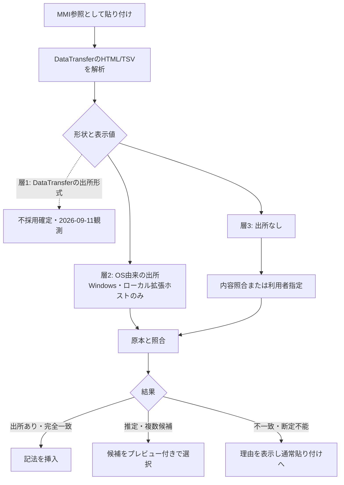

# MMI入力支援 引継ぎパッケージ

作成日: 2026-09-17（初版2026-09-10）。他の生成AIへ渡す単一文書です。設計はレビュー指摘R1〜R5を反映済み（作業A完了）。原本座標を保持する読込み・切り出し（issue-0114段1／作業B）を実装・自動テスト完了（WSL2 Ubuntu、Node v20.20.2）。VS CodeのDataTransfer観測（作業C）も完了（Windows実機、VS Code 1.137.0）。作業Cで採取した実データにより、`src/dx/pasteDrop.ts`が原本ではなくExcelの一時ステージングファイルを誤認識する不具合を発見・修正し、続けてシート名・範囲の誤った推測も撤去して占有グリッド方式の形状抽出（`extractHtmlTableShape`）へ置き換え、表示値行列を抽出する`parseTsv`を追加し、両者を使って単一シート内を検索する内容照合アルゴリズム本体`findContentMatches`、複数ワークブック横断で集約する`findWorkbookContentMatches`を実装した（2026-09-14〜15）。続けて2026-09-16、内容照合を`editor.action.pasteAs`（Ctrl+.）へ統合し、段2（作業D）を完全に実装完了させた。併せて作業Bの既知の残課題2件も解消した——`mode=table`強制時のセル数上限（10万セル、超過は`mmi-error`として可視化。時間上限のみ未実装）と、CSVの`trim()`座標ずれの依存テスト洗い出し（既存テストへの影響0件を確認、現状挙動をピン留め。修正自体は製品判断として保留）。

**2026-09-17、この開発環境（WSL2）には元からWSLgによる実表示があり、xvfb無しで実VS Code（1.138.0）のExtension Host e2eが動作することが判明した。実際に走らせたところ、本物のバグを2件発見・修正した**——(1) e2eテスト自体の期待値が2026-09-14の変更に追従していなかった（旧`#Sheet|Range`形式のまま）、(2) `insertEmbedByContentMatch`が`registerTextEditorCommand`で登録されていたが、これは非同期コールバックを一切サポートしないVS Codeの既知の制約に該当し、実運用でも常にコマンドが何も挿入できていなかった可能性が高い（`registerCommand`へ修正）。修正後、明示コマンド経路の全パイプラインを実VS Code上で実証した。`npm test`は355件全成功。貼り付け機能で残るのは、`editor.action.pasteAs`経路のみのe2e確認（実クリップボードへの`text/html`設定手段が本環境に無い）——次の担当が着手すべき最優先項目。CPU探索も未着手。

作業順は `01_Plans/input-assistance-design-review.md` のA〜Fが正本です。2番目に収録しているので先に読んでください。issue-0114の「Bの完了内容」「Cの完了内容」「作業D: 内容照合コマンドの実装」「作業D続き: 自動貼り付けへの統合」節に実装したファイル・テスト・未対応点が詳細に書かれています。

作業Cの確定した結果（最重要）: VS Codeの`DataTransfer`はExcelの出所形式を一切公開しない。 実機で確認したMIME型は`text/plain`・`text/html`・`text/rtf`・`image/png`の4件のみ。`Link`・`Object Descriptor`は無く、`text/html`内の`SourceURL`（CF_HTMLヘッダー）もVS Code／Electronのクリップボード正規化で失われる。[ADR-0017](01_Plans/adr/ADR-0017-windows-clipboard-provenance-bridge.md)の選択肢1（拡張内だけで完結）は却下確定。出所を得るには選択肢2（Windows補助プロセス）が必須で、それを避けるなら選択肢3（内容照合のみ・出所なし）に限られる。

1. 作業Dは実装完了（2026-09-14〜16）、明示コマンド経路は実VS Codeでe2e確認済み（2026-09-17）。次に着手すべきは`editor.action.pasteAs`経路のe2e確認のみ: `extractHtmlTableShape`（形状）・`parseTsv`（値行列）・`findContentMatches`（単一シート内照合）・`findWorkbookContentMatches`（複数ワークブック集約）はいずれも実装済み。VS Code統合は3経路——(a) 明示コマンド`markdownMatrixInjector.insertEmbedByContentMatch`（`showQuickPick`で明示選択）、(b) `editor.action.pasteAs`（既定Ctrl+.、VS Code標準の「挿入前に選ぶ」ドロップダウンへ候補を追加）、(c) 通常のCtrl+V（`triggerKind: Automatic`）は意図的に変更していない。(b)を実装した経緯: 元々この機能は自動貼り付けへの統合を目的に作られたが、初版（2026-09-15）では「毎回のワークスペーススキャン」「`showQuickPick`が使えない」という2つの懸念から見送っていた。翌日、ユーザーの指摘を受けて再検証した結果、性能懸念は実測で否定（ネイティブファイルシステムで実サンプル30ファイル約20ms、300ファイル約65〜140ms。`/mnt/c`のようなWSL2↔Windowsブリッジは代表的でないため除外）、`showQuickPick`の制約はそもそも統合先の選択ミス（VS Codeの`DocumentPasteEditProvider`は`context.triggerKind`で挙動が違い、`Automatic`は複数候補の最初の1件を自動適用してしまう一方、`PasteAs`は挿入前に選ばせる契機——だから`PasteAs`だけに限定して統合すれば、自前UIなしでR1を満たしたまま自動貼り付け統合が実現できる）と判明し、(b)を実装した。単一スカラー値の貼り付け（単語・URL等）ではワークスペースへのアクセス自体が発生しない（`looksLikeTabularClipboard`によるゲート）。病的に大きいワークスペース向けの安全弁`MAX_CONTENT_MATCH_WORKSPACE_FILES`（500件、暫定値）も追加。

   2026-09-17: この開発環境（WSL2）には元からWSLgの実表示があり、xvfb無しでExtension Host e2eが動くと判明した。 実VS Code（1.138.0）で走らせ、明示コマンド経路の全パイプライン（クリップボード→検索→`showQuickPick`→挿入）を実証した。この過程で本物のバグを2件発見・修正した——(1) e2eテスト自体の期待値が2026-09-14の変更（シート名・範囲推測の撤去）に追従しておらず旧`#Sheet|Range`形式のままだった、(2) `insertEmbedByContentMatch`が`registerTextEditorCommand`で登録されていたが、これは非同期コールバックを一切サポートしないVS Codeの既知の制約（microsoft/vscode#178931等）に該当し、実運用でも常にコマンドが何も挿入できていなかった可能性が高い（`registerCommand`＋`vscode.window.activeTextEditor`の自前解決へ修正）。`editor.action.pasteAs`経路のみ、実クリップボードへの`text/html`設定手段（xclip等）が本環境に無くe2e未確認のまま残る。 候補一覧のプレビュー（先頭数行の値表示）も最小限（ファイル#シート＋範囲のみ、値プレビューなし）。詳細は[出所設計](02_Architecture/input-assistance-paste-provenance.md)§5〜§7、issue-0114「作業D: 内容照合コマンドの実装」「作業D続き: 自動貼り付けへの統合」「実VS Code GUI確認」節。
2. その後: 必要な場合だけWindows橋渡し（作業E、ADR-0017選択肢2の採否） → 補完（0110、座標保持完了により着手可能）→ 参照編集（0111）→ CPU探索（0115）。0112は任意、0113のローカルLLMは保留です。
3. 作業Bの残り: `mode=table`強制時の時間上限（タイムアウト）と構造化された診断コードが未実装（サイズ上限は実装済み）、読込み自体の厳密な性能計測が未実施（内容照合の性能検証から`loadWorkbook`単体のおおよその参考値は得られている）。いずれもissue-0114に明記済み。
4. 作業Cの残り: 最低対応版（VS Code `^1.96.0`）での再現、実キー入力（Ctrl+V）とコマンド経由貼り付けの経路一致の実測（意図的に未検証。無関係なウィンドウへのキー入力注入を避けるため）。

守る境界は次のとおりです。

- 自動確定しない。 同一内容の別コピーは内容比較では区別できません（R1）。出所（今後実装するなら層2のみ）が取れても初期提供では明示選択を経ます。
- 結合セルは占有グリッドで扱い、行ごとのセル数の最大値で列数を決めないでください（R2）。ソースモデル側の宣言済みmerges取得（`SheetSource.merges`）は実装済みです。
- `Object Descriptor` は宣言オフセットから読みます。バッファ全体の文字列検索を製品へ持ち込まないでください（R4）。ただしこれは層2（Windows補助プロセス）を実装する場合のみ関係します。DataTransfer単独の経路では`Object Descriptor`は入手できません。
- `pasteMimeTypes`にワイルドカード`'*'`を使わないでください。VS Codeは「任意のMIME型」と解釈せず、providerが一切呼ばれなくなります（本セッションで実際に踏んだ不具合）。具体的なMIME文字列を列挙してください。
- ローカルLLM・GPU・外部推論APIを必須にしないでください。未対応条件を黙って別の意味へ変換しないでください。

確認済みの事実と未確認事項の区分は `01_Plans/input-assistance-technical-research.md` §1にあります。Draft/Proposedを実装済みと読み替えないでください。CPU探索の性能・精度はすべて未測定です。観測の期待値は `03_Implement/scripts/clipboard-probe/expected-cases.json` に固定してあり、`verify-cases.cjs` で差分検査できます。

本文内のローカル参照はリポジトリ相対パスです。着手前に対象リポジトリの `AGENTS.md`、`00_Prompt/requirements.md`、`04_Documentation/spec/mmi-notation-v1.md` の現在の内容を確認してください。CSVのCP932対応はコミット `0154944` で実装済みです。UTF-8固定の処理へ戻さないでください。この調査環境（Windows直下）にはNode.js・npm・実体のあるPython 3が無く、実装はWSL2 Ubuntu側で行いました。VS Code実機操作（DataTransfer観測）はWindows側で行い、動作確認済みです。


---

出典: `01_Plans/input-assistance-proposal.md`

> 実装の着手条件と優先順位は設計レビューと作業指示 (`01_Plans/input-assistance-design-review.md`)を参照。貼り付けは初期提供で明示選択し、橋渡しは観測後に採否を決める。

# MMI入力支援 企画: Excelコピーを入口に、CPUで範囲を探索する

- 更新日: 2026-09-11
- 状態: Proposed。設計確定。原本座標を保持する読込み・切り出しは実装・自動テスト済み（issue-0114段1）。 貼り付け本体・CPU探索は未実装。CPU探索の性能・精度は未測定。
- 関連: ADR-0016 (`01_Plans/adr/ADR-0016-notation-first-input-assistance.md`)、ADR-0017 (`01_Plans/adr/ADR-0017-windows-clipboard-provenance-bridge.md`)、要求仕様 (`00_Prompt/requirements.md`)、記法仕様 (`04_Documentation/spec/mmi-notation-v1.md`)

## 設計文書

利用体験と作業範囲は本書に、技術的な根拠と契約は設計文書に置く。実装者は設計文書を正本とする。

| 内容 | 文書 |
| --- | --- |
| 原本座標を保持する読込みと切り出し | ソースモデル (`02_Architecture/input-assistance-source-model.md`) |
| クリップボードからの出所取得と照合 | クリップボード出所と照合 (`02_Architecture/input-assistance-paste-provenance.md`) |
| 索引・自然言語解析・候補検索の比較 | CPUでの範囲探索 (`02_Architecture/input-assistance-cpu-search.md`) |
| 観測の再現手順 | clipboard-probe (`03_Implement/scripts/clipboard-probe/README.md`) |

技術調査 (`01_Plans/input-assistance-technical-research.md`)には一次資料と確認済み・未確認の区分を残す。他の生成AIへ渡す単一の引継ぎ文書 (`01_Plans/input-assistance-handoff-20260910.md`)は上記のスナップショットであり、更新時は元文書を正本とする。

## 1. 提案する順序

1. Excelで領域をコピーし、VS CodeへMMI参照として貼り付ける。 元ファイル・シート・絶対的なセル位置を正しく保持する。
2. 文法補完と参照編集を整え、貼り付け後の範囲・列・表示条件を変更できるようにする。
3. 自然言語＋Excelの構造索引＋FlyHash等の類似検索＋コンパイラ技術で、CPU上で範囲と既定クエリを探す。
4. 既存AIへの手渡しは任意の補助手段。ローカルLLMの評価は保留し、上記機能の依存条件にしない。

APIキー、クラウド推論、GPU、ニューラル埋め込みの生成を必須にしない。正本の読み取り専用境界と既存MMI文法は維持する。

## 2. 最優先: コピーした領域を参照として貼り付ける

### 利用体験

保存済みの `設計.xlsx` の「状態遷移」シートで `C5:F12` を選択してCtrl+C。Markdown本文で貼り付け時の「MMI参照として貼り付け」を選ぶと、次が入る。

```markdown
![[./data/設計.xlsx#状態遷移|C5:F12]]
```

初回はVS Codeの貼り付け選択肢から明示して使用する。常時MMI貼り付けを望む利用者には明示設定を用意し、確実に参照先を識別できるときだけ通常Ctrl+Vでも採用する。表の値を貼る通常操作を維持し、Undo1回で取り消せる。見出し・caption・grepを勝手に追加しない。

### 実現できることと、できないこと

実Excelから13ケースを採取して確認した（詳細 (`02_Architecture/input-assistance-paste-provenance.md`)）。

- 原本のパス・シート名・開始セルはクリップボード上に存在する。 `Object Descriptor`が`状態遷移!R5C3:R12C6`、`HTML Format`のヘッダが`SourceURL`を持つ。推測に頼らず`C5:F12`を復元できる。
- HTMLの表には住所が無い。 現行の`inferRangeFromHtmlTable`が常にA1起点を返すのはこのためで、原本の位置の証拠にならない。HTMLの行列数は「コピーされた矩形の大きさ」としてのみ使う。
- 住所を得ても、それは選択内容の証明ではない。 フィルターで行が隠れたコピーでは、住所が3行分を指すのに内容は2行しかない。住所をそのまま挿入すると、利用者が除外した行が混ざる。
- 未確認: VS Codeの`DataTransfer`にこれらの形式が現れるか。 結果でWindows専用の橋渡しが要るかどうかが決まる（ADR-0017 (`01_Plans/adr/ADR-0017-windows-clipboard-provenance-bridge.md`)）。実装前にこの観測を行う。

### 判断の段階

| 得られる情報 | 解決方法 | 適用条件 |
| --- | --- | --- |
| 出所のパス・シート・座標がある | メタデータを解析し、原本の範囲と照合 | ワークスペース境界内、保存済み原本、形状と表示値がコピー内容と一致 |
| 出所が一部だけある | 対象ブック/シートを絞り、値と形状から候補を探索 | 候補の元座標・内容を確認して選択 |
| HTML/TSVのセル値しかない | 利用者がブックを選択、または既存の対象索引を検索 | 同じ値が複数あれば選択必須。位置を断定しない |
| 出所不明・一致なし | ファイル/シート/範囲を指定する案内、または通常貼付け | 勝手なA1範囲を生成しない |

同じ内容が複数の場所や複数ファイルにある場合は、唯一の一致に見えてもコピー元の証明としない。出所がある一致と内容から推定した一致をUIで区別する。候補にはファイル・シート・範囲・見出し・先頭数行・一致の根拠を表示し、「類似度90%」だけで自動確定しない。値の正規化は候補抽出に使い、最終照合では型・空欄・先頭ゼロ・日付・表示値/数値・数式の計算済み値を区別する。計算や外部リンク更新は実行しない。

非連続選択や非表示行を飛ばしたコピーは、単一の矩形を参照する既定文法と同じ意味にならない。初期版では自動変換せず理由を表示する。未保存ブックは保存を案内し、ディスク上の原本とコピー内容が違う場合は一致済みにしない。一般のテキスト、範囲外ファイル、未信頼workspace、読み込み失敗では通常貼り付けを妨げない。

### 解決済み: 原本座標の喪失

修正前は、正しい参照文字列を挿入しても現在の読込みでは違う位置が表示されていた。 使用範囲がC5開始で途中に空行を持つ実ブックで、`C5:F12`が3行の別内容として描画されることを計測で確認していた（原因は使用範囲の列原点の喪失と空行の除去。`blankrows`の変更だけでは解決しない）。

2026-09-11、issue-0114段1でこの契約を修正・実装・自動テスト済み（`npm test`258件成功）。読込範囲をA1へ拡張する案は、原点が遠方のシートで実セル1個でも使用範囲の終端まで展開するため採らなかった。住所指定の切り出しは20万行規模でもミリ秒未満で完了する。詳細・計測値・実装内容はソースモデル (`02_Architecture/input-assistance-source-model.md`)とissue-0114 (`https://github.com/hat47x/markdown-matrix-injector/issues/495`)「Bの完了内容」。

## 3. CPUでの自然言語＋Excel範囲探索

この節は設計案であり、性能・精度はいずれも未測定。 構成、対応する依頼の範囲、FlyHashの評価条件、測定手順はCPUでの範囲探索 (`02_Architecture/input-assistance-cpu-search.md`)に定めた。要点だけ再掲する。

- 近似検索は候補を速く絞る部品にすぎない。意味の理解と範囲の確定を担わせない。最終判定は原本との厳密照合で行う。
- FlyHashは完全一致索引・TF-IDF/BM25・単純な疎ベクトル類似度と同条件で比較し、実益が確認できた場合のみ採用する。論文の結果をMMIの実測値として扱わない。
- 既存文法で表せない依頼（集計、列単位の完全一致、最新のみ）は未対応として説明する。`grep`へ安易に置換しない。
- 自由な日本語をすべて理解すると約束しない。受け付ける入力の例を画面に示す。

## 4. 費用と性能

主経路はLLMを使わない。ただしCPU・メモリ・初期索引構築・更新のコストは残るため「費用も計算量もゼロ」とはしない。非GPU環境のローカルLLMが本用途で必ず遅いと実証したわけではないが、利用者の想定と優先順位に従い必須構成から外す。

採用目標（未測定・保証値ではない）: 索引済み検索p95 100ms以内、厳密照合を含めてp95 300ms以内、自然言語のRecall@5 95%以上。必須条件: 誤った範囲の自動確定0件、原本変更0件、クラウドAPI呼出し0件。

## 5. 実行計画

| 順序 | タスク | 終了時の証拠 |
| --- | --- | --- |
| 1 | issue-0114: Excel範囲貼り付け (`https://github.com/hat47x/markdown-matrix-injector/issues/495`) | 原本座標での表示、実ExcelのC5:F12コピー→参照挿入→同じ値の表示、重複/不明時の選択、Undo、原本ハッシュ |
| 2 | issue-0110: 補完 (`https://github.com/hat47x/markdown-matrix-injector/issues/491`) → 0111: 編集 (`https://github.com/hat47x/markdown-matrix-injector/issues/492`) | 貼り付けた記法を値候補/選択式で修正できる |
| 3 | issue-0115: CPU探索 (`https://github.com/hat47x/markdown-matrix-injector/issues/496`) | 非GPUの基準方式/FlyHash比較と自然言語→範囲→MMIの動作 |
| 任意 | issue-0112: 既存AI手渡し (`https://github.com/hat47x/markdown-matrix-injector/issues/493`) | 主経路の依存にしない |
| 保留 | issue-0113: ローカルLLM (`https://github.com/hat47x/markdown-matrix-injector/issues/494`) | 今回の実装順から除外。再開は別判断 |

最初にVS Codeの`DataTransfer`観測で入口の実現性を確定し、並行して原本座標の修正に着手する。その後に必要な検索とコンパイラ部品を共通化する。FlyHashの採否を待って基本の貼り付け機能を止めない。


---

出典: `01_Plans/input-assistance-design-review.md`

# 入力支援設計レビューと次の作業

## 判定

方向性は妥当。ただし貼り付け全体の実装開始には設計修正が必要。 原本座標の保持は先行して進められる。Windows橋渡しと自動挿入は、以下の条件を満たすまで着手しない。対象はADR-0016/0017、issue-0114/0115と入力支援の3設計文書。

## 今回確認したこと

現行コード、観測用スクリプト、保存済みの架空ブックと13ケースの生バイトを照合した。Excelの再操作や現在のクリップボードの採取は行っていない。

- 保存済みObject Descriptorの構造オフセットから13件の出所文字列を読み直し、`状態遷移!R5C3:R12C6`等を確認した。観測された住所の存在は支持できる。
- `summarize.cjs`を再実行し、フィルターの住所3行・内容2行、全列選択`C3:C4`、非ANSIパスの破損を再確認した。13件目は「コピー後変更前」の資料であり、変更後の棄却機能を検証したものではない。
- `repro-coords.cjs`を再実行し、現行オプションと切出しによる座標ずれを再現した。ただしスクリプトは製品関数を複製しているため、製品コード直結の回帰試験へ置き換える必要がある。
- Windows Node v24.19.0で案Cは3,527,040セル・5,747ms、案Dは32セル0.112ms、2,010セル0.677msだった。異なる入力と処理量の測定であり、同じ処理を4桁高速化した比較ではない。 原本の読込み、モデル構築、値照合は案Dの時間に含まれない。
- 独立したセルオブジェクトで日付を再比較すると、書式なしはdateNFあり`2026-04-03`、なし`4/3/26`。`m/d/yy`書式は両方`4/3/26`。元ハーネスは同じオブジェクトを使い回し、先の呼出しが保存する`w`に後の結果が影響される。

これは保存済み資料の再検証である。実GUIによる選択、VS Code DataTransfer、最小対応版、検索精度、検索全体の速度は未確認。CP932は現行コミットで実装・自動検証済みであり、変更前のUTF-8固定処理へ戻さない。

## 修正が必要な事項

### R1 — P1: 同一内容の別コピーを出所と誤認する

対象: 出所設計 (`02_Architecture/input-assistance-paste-provenance.md`)§3/4、ADR-0017 (`01_Plans/adr/ADR-0017-windows-clipboard-provenance-bridge.md`)。

DataTransfer取得後に、別ブックの同じ値・形状をコピーすると、補助プロセスが読む別コピーも現在の照合条件を通る。そのまま挿入すると元ブックを取り違える。採取された非連続選択も外接矩形へ変化し、形状・値の一致では元の選択意図を復元できない。

**指示:** OS読取りは同一の取得単位で必要な形式を読み、前後のシーケンス番号を記録する。ただしそれだけでは過去のDataTransferと同じコピーとは証明できない。対応するコピー操作と結び付けられないOS由来情報は「候補」とし、ブック・シート・範囲・プレビューの明示選択を必須にする。初期提供では自動確定を無効とする。

受入例: 同一内容のブックAをコピー→DataTransfer取得→ブックBをコピーしてもBを自動挿入しない。非連続選択が矩形に展開された場合も確認なしで挿入しない。

参考: [GetClipboardSequenceNumber](https://learn.microsoft.com/en-us/windows/win32/api/winuser/nf-winuser-getclipboardsequencenumber)。番号は内容更新の検知に使えるが、VS Codeが渡すデータとの対応を保証するものではない。

### R2 — P1: HTML形状の最大列数ではセル配置を復元できない

対象: 出所設計§1.5/6、issue-0114の段2、`summarize.cjs::htmlShape`。

例えば1行目が「A(rowspan=2), B」、2行目が「C, D」の表は、各行のセル数の最大が2でも、占有位置を考慮すると3列必要になる。最大列数だけでは縦結合後のセル位置も分からない。`<table>`全体の走査は、断片外の別行・別表を取り込む可能性もある。

**指示:** HTMLを構文解析し、選択断片とそれを包む表の文脈を区別する。rowspan/colspanの占有グリッドを作り、結合元と被覆セルを原本の結合モデルに対応させる。単一行の不足タグは親文脈から補う。複数表、入れ子、不正なspan、過大なspanは自動解釈しない。単純なtr/tdの正規表現は観測表の補助に限定する。

参考: [CF_HTML仕様](https://learn.microsoft.com/en-us/windows/win32/dataxchg/html-clipboard-format)。文脈と断片は別で、オフセットはUTF-8のバイト位置。

### R3 — P1: 巨大矩形の実体化を防ぐ前段がない

対象: ソースモデル (`02_Architecture/input-assistance-source-model.md`)§3、`smartFallback.ts`、`renderTable.ts`、`collectDeliveryManifest.ts`。

案Dでも範囲省略時にusedRange全体を矩形化すれば巨大な疎シートで停止する。明示範囲が全シート相当なら同様。現行のカード判定は`sliceRange`を先に呼ぶため、単純に`sliceRegion`へ差し替えるだけでは防げない。

**指示:** 住所検証→行列数の算術評価→カード/資源制限判定→必要範囲だけ実体化、の順にする。範囲の上下限、0・逆順・数値桁あふれを検査する。`mode=table`でもメモリ・時間の上限を設け、超過は可視エラーとして仕様との整合を取る。表示、カード判定、マニフェストで同じ範囲解釈を使う。読込みとモデル構築の費用も別に計測する。

受入例: 遠方原点、範囲省略、巨大明示範囲、空シート、使用範囲外、縦横転置で不要な全セル展開が起きない。カード閾値直前/直後の判定も確認する。

### R4 — P1: 出所データの解析契約と証拠の保存が不足

対象: `summarize.cjs`、出所設計§1/4、観測ハーネス。

Object Descriptorは単なるUTF-16文字列ではなく、サイズと文字列オフセットを持つ構造体である。バッファ全体のUTF-16化と正規表現検索を製品へ持ち込まない。SourceURLの欠落だけでは未保存ブックと断定できない。プロバイダ側で削除された場合なども区別できない。

**指示:** サイズ・オフセット・終端・最大長を検証して`dwSrcOfCopy`から文字列を取得する。シート名の`!`等と住所を分離し、R1C1の数値範囲を検査する。SourceURLはfile URIとして解析し、一度だけ復号して実パスの境界を検証する。ネットワークURI、UNC、シンボリックリンク等の扱いを明記する。SourceURLなしは「出所不明」とし、ブック選択へ進める。

保存済み架空資料はケースID、元ブックと各形式のハッシュ、環境、手順、期待値を持つ小さな再現資料として固定する。TEMPにあるだけの成果を恒久的な受入根拠にしない。生データを採用する前に架空データと個人パスの扱いを確認する。

参考: [OBJECTDESCRIPTOR](https://learn.microsoft.com/en-us/windows/win32/api/oleidl/ns-oleidl-objectdescriptor)。構造体と出所文字列の解釈を分ける。

### R5 — P2: 日付・性能・観測ハーネスの結論を狭める

対象: ソースモデル§2/5、CPU設計 (`02_Architecture/input-assistance-cpu-search.md`)§2.3、issue-0115、`repro-details.cjs`、`probe-vscode.ps1`と観測拡張。

**指示:** 日付比較は新しいセルオブジェクトを条件ごとに作る。表示値のwが欠落する日付・真偽・エラー・数式のキャッシュ値欠落を定義し、`String(v)`をExcel表示の保証にしない。表示用の値と照合用の値を区別する。日付パラメータ追加は今回の必須条件にせず、既存表示との相違を先に整理する。

切出し時間を「厳密照合は安価」と言い換えない。同一入力・同一出力で比較し、cold/warm、反復、モデル構築、厳密比較、ピークメモリを分ける。

VS Code観測では、拡張のactivateや通常貼り付けの成功だけを合格にしない。ケースIDを付けた`provideDocumentPasteEdits`の呼出しと全MIMEの記録を必須とし、呼ばれなければ失敗終了する。対象は専用のpaste-target文書に固定し、現在の任意エディタへ挿入しない。自動呼出し経路に加え実際の貼り付け操作も比較する。観測失敗を「出所形式なし」と結論しない。

## 次の担当への作業指示

| 順序 | 作業 | 完了条件 | 止める範囲 |
| --- | --- | --- | --- |
| A | R1〜R5を設計とADRへ反映し、観測ハーネスを修正 | 上記反例と期待動作がテスト可能な形で定義される | 貼り付け・橋渡しの製品実装 |
| B | issue-0114段1の座標保持と範囲評価 | 製品関数の回帰、CP932回帰、カード/マニフェスト整合、資源上限を確認 | 未確認の日付仕様変更 |
| C | VS Code DataTransferの観測 | 最低対応版と現行版でprovider呼出し・MIME・出所内容を保存 | 観測不能なら橋渡しの採用決定のみ保留。Bは進められる |
| D | 内容照合＋明示候補選択の最小貼り付け | 原本・選択範囲の確認、Undo、中止、30ケース、原本不変 | 自動確定 |
| E | 必要な場合だけWindows橋渡し | R1/R4、実行環境、配布、失敗時動作を満たすとADRで判断 | 観測で不要なら実装しない |
| F | 補完→参照編集→CPU探索 | issue-0110→0111→0115。検索評価は独立した未見データで実施 | FlyHashの採否で基本機能を止めない |

今回の依頼では実装へ進めず、レビューと計画修正までとする。次担当はこの表をissue-0114の作業分割として使用し、未確認を一括で「残り1点」と扱わない。


---

出典: `01_Plans/input-assistance-technical-research.md`

> 実装条件と測定値の解釈は設計レビューと作業指示 (`01_Plans/input-assistance-design-review.md`)を参照。切出し単体の測定を厳密照合や検索全体の性能と扱わない。

# MMI入力支援 技術調査

- 調査日: 2026-09-10。状態: 設計確定。原本座標を保持する読込み・切り出し（issue-0114段1）は2026-09-11に実装・自動テスト済み。貼り付け・CPU探索は未着手。
- 対象コードの基準コミット: `0fedd60`は次のとおりです。
- 企画の正本は改訂企画書 (`01_Plans/input-assistance-proposal.md`)、判断はADR-0016 (`01_Plans/adr/ADR-0016-notation-first-input-assistance.md`)とADR-0017 (`01_Plans/adr/ADR-0017-windows-clipboard-provenance-bridge.md`)。

本書は確認済みの事実と未確認事項の区分を保つ台帳である。契約と構造は02_Architecture (`02_Architecture/README.md`)の3つの設計文書に置き、ここへ重複させない。製品仕様の追加や性能保証は行わない。

## 1. 何を確認し、何を確認していないか

| 論点 | 状態 | 根拠 |
| --- | --- | --- |
| Excelコピーに原本の出所と住所が含まれるか | **確認済み。含まれる** | 実Excelから13ケースの生バイトを採取 |
| HTMLだけで開始セルを決められるか | **確認済み。決められない** | `HTML Format`本文にセル住所が無い |
| VS CodeがそれらのMIMEを公開するか | **未確認。最大の未解決事項** | 宿主の更新保留で観測を実行できず |
| 現行の読込みが原本座標を失うか | **確認済み。失う** | 実ブックで誤った矩形を再現・計測 |
| 座標保持の実現方法 | **実装済み** | 4案を比較・採用案を実装。`SourceCell.text`が旧`sheet_to_json`出力と一致することを全ケースで確認 |
| 座標保持の費用 | **一部のみ計測** | 切出し単体の時間のみ。読込み・モデル構築・値照合は未計測 |
| CPUでの自然言語探索の性能・精度 | **未測定** | 実装・評価データとも未着手 |
| FlyHashの有効性 | **未確認** | 原論文を確認。MMIでの比較は未実施 |
| 費用 | 推奨経路は外部推論APIを呼ばない設計 | ローカル計算・索引保存の資源は必要。速度・容量は未測定 |

非GPUのローカルLLMが本用途で必ず遅いと実証したわけではない。利用者の想定と優先順位に従い、必須構成から外す。

## 2. 観測環境

| 項目 | 値 |
| --- | --- |
| OS | Windows 11 Pro 10.0.26200 |
| Excel | Microsoft Excel 16.0（Office ClickToRun 16.0.20326.20132、ja-jp） |
| VS Code | 1.136.1 |
| Node | v24.18.1（VS Code同梱の実行環境を`ELECTRON_RUN_AS_NODE`で使用） |
| SheetJS | 0.20.3（リポジトリ導入済み） |

架空ブックのみを使用した。実業務のブックとクリップボードは採取に使っていない。再現手順はclipboard-probe (`03_Implement/scripts/clipboard-probe/README.md`)。

この環境ではnpm/nodeが導入されておらず、`npm ci` / `npm run build` / `npm test`を実行していない。 計測はSheetJSを直接読み込むスクリプトで行った。実装時は開発環境 (`04_Documentation/developer-setup.md`)の手順で回帰検査を行う。

## 3. 一次資料

- [Microsoft CF_HTML仕様](https://learn.microsoft.com/en-us/windows/win32/dataxchg/html-clipboard-format): `StartFragment`等はバイト位置であり、Excelの行列番号ではない。日本語を含む場合、JavaScript文字列の位置と同一視できない。
- [Excel XlClipboardFormat](https://learn.microsoft.com/en-us/office/vba/api/excel.xlclipboardformat): 形式の列挙。形式が存在することと、VS Codeへ渡ることは別である。
- [VS Code API: DocumentPasteEditProvider](https://code.visualstudio.com/api/references/vscode-api#DocumentPasteEditProvider): `prepareDocumentPaste`はVS Codeのエディタからのコピーを扱うため、ExcelでのCtrl+CにMMI固有メタデータを付ける入口にはならない。
- [Dasgupta, Stevens, Navlakha, Science 2017](https://cseweb.ucsd.edu/~dasgupta/papers/fly-lsh.pdf): FlyHashの原論文。日本語からの特徴生成やExcel座標の解析は含まない。論文の評価からMMIの精度・待ち時間を推定できない。
- [Stanford IR textbook: BM25](https://nlp.stanford.edu/IR-book/html/htmledition/okapi-bm25-a-non-binary-model-1.html): 語彙検索の比較基準。
- [SheetJS 配列変換](https://docs.sheetjs.com/docs/api/utilities/array/) / [セルモデル](https://docs.sheetjs.com/docs/csf/cell/) / [結合セル](https://docs.sheetjs.com/docs/csf/features/merges/)
- [Chevrotain lexer tutorial](https://chevrotain.io/docs/tutorial/step1_lexing.html): 限定文法の解析器を外部依存にする場合の比較対象。依存追加は未決定。

オンライン資料の確認日は2026-09-10。実装時は最低対応版と依存版で再確認する。

## 4. 現行コードとの差分

| 箇所 | 確認した事実 |
| --- | --- |
| pasteDrop.ts (`03_Implement/src/dx/pasteDrop.ts`) | `inferRangeFromHtmlTable`はHTMLの表の大きさから常にA1起点の範囲を返す。コピー断片内の座標であり原本のセル座標ではない |
| 同上 | 転送値の取得に`trim()`を使う。TSVの端のタブ・空セル・引用内改行・末尾行区切りを失う |
| 同上 | シート名をHTMLの`title`や`data-sheet`から取る。原本シートの確証にならない |
| workbookLoader.ts (`03_Implement/src/core/workbookLoader.ts`) | `blankrows: false`と`sheet_to_json`のA1起点前提により、非A1の使用範囲と途中の空行で座標がずれる |
| 同上 | `cellDates`+`dateNF`は**書式を持たない日付セルには効く**（`4/3/26`→`2026-04-03`）が、自身の書式を持つセルには効かない。コメントが述べる「日付型セル全般のISO化」は成り立たない |
| 同上 | `parseCsv`のファイル全体`trim()`が、先頭の空行数だけA1原点をずらす |
| tableGeometry.ts (`03_Implement/src/core/tableGeometry.ts`) | `sliceRange`は配列がA1起点の物理行列であることを前提にする |
| smartFallback.ts (`03_Implement/src/core/smartFallback.ts`) | `cellCount`が行長の合計のため、長さの違う行でセル数を過少に数える |
| renderTable.ts (`03_Implement/src/core/renderTable.ts`) | 行配列をそのまま`<td>`へ写すため、長さの違う行が列崩れの表になる |
| extension.ts (`03_Implement/src/extension.ts`) | 貼り付け処理が文書・キャンセル等の引数を利用していない |
| pasteDrop.test.ts (`03_Implement/test/pasteDrop.test.ts`) | 人工的な`data-sheet`とファイルパスを付けたHTMLで成功を確認している。実Excelの出所・住所取得の証拠ではない |
| package.json | 宣言上の最低VS Codeは`^1.96.0`だが、調査環境の`@types/vscode`は`1.110.0`。最低版と現在版で宿主テストを行う |

計測値と設計の結論はソースモデル (`02_Architecture/input-assistance-source-model.md`)とクリップボード出所と照合 (`02_Architecture/input-assistance-paste-provenance.md`)にある。

## 5. 次の担当が実施する検証

### A. VS CodeのDataTransfer観測（最初の作業）

```powershell
powershell -ExecutionPolicy Bypass -File .\03_Implement\scripts\clipboard-probe\build-books.ps1
powershell -ExecutionPolicy Bypass -File .\03_Implement\scripts\clipboard-probe\probe-vscode.ps1
```

VS Codeに保留中の更新があると2つ目のインスタンスが起動しない。VS Codeを再起動して更新を完了させてから実行する。結果でADR-0017 (`01_Plans/adr/ADR-0017-windows-clipboard-provenance-bridge.md`)の採否が決まる。

OS形式の観測と拡張機能での利用を分けて記録する。情報を取得できない場合は、対象ブック選択＋矩形内容照合＋候補選択で基本機能が成立するか判定する。Windows専用連携を採るなら保守・配布・Remote環境の実行場所をADR-0017へ追記する。

### B. 貼り付けの実機検証

架空ブックで30ケース以上を用意し、Excel/Windows/VS Codeの版、DataTransfer MIME、出所・住所の有無、実際の挿入結果と表示値を一行ずつ記録する。issue-0114 (`https://github.com/hat47x/markdown-matrix-injector/issues/495`)の受入条件を判定単位とする。

### C. CPU探索（基本貼り付けと補完の後）

日本語依頼60件以上を、完全名・略称・言い換え・誤字・同名・未対応条件・該当なしに分ける。正解のブック・シート・範囲と許容する候補を人手で固定し、調整用と評価用を分離する。10/100/1000ブック、1千/1万/10万領域の段階を用意し、合成データと業務を模した架空データを区別する。測定項目と目標はCPUでの範囲探索 (`02_Architecture/input-assistance-cpu-search.md`)§5。

## 6. 引継ぎ境界

次の担当は、AGENTS.md (`AGENTS.md`)、要求仕様 (`00_Prompt/requirements.md`)、記法仕様 (`04_Documentation/spec/mmi-notation-v1.md`)、本書、企画 (`01_Plans/input-assistance-proposal.md`)、設計文書3件、issue-0114 (`https://github.com/hat47x/markdown-matrix-injector/issues/495`)の「Bの完了内容」を読み、issue-0114の作業C（VS CodeのDataTransfer観測）から着手する。並行して0110（補完）に着手できる。0111の順に進み、0112は任意、0113のローカルLLMは保留する。Draft/Proposedを実装済みと読み替えない。

**2026-09-11に実施した事項（WSL2 Ubuntu、Node v20.20.2）:** issue-0114段1（原本座標を保持する読込み・切り出し）の実装。`npm ci`／`npm run build`／`npm test`（258件成功）／conformanceコーパスへのケース追加／実サンプルでの回帰確認／旗艦の再現ケースの実描画確認。

**今回も実施していない事項:** VS CodeのDataTransfer観測（宿主のVS Code更新保留により本セッションでも再試行不能）、貼り付け機能そのものの実装、検索索引の実装、FlyHashの実装、日本語精度・CPUベンチマーク、`mode=table`強制時の資源上限、読込み自体の性能計測、新VSIXの作成。


---

出典: `02_Architecture/input-assistance-source-model.md`

# 原本座標を保持するソースモデル

- 状態: 実装・自動テスト完了（2026-09-11）。 計測日2026-09-10。実装はWSL2 Ubuntu（Node v20.20.2）で行い、`npm run build`・`npm test`（258件）が成功する。VS Code実機での確認と性能計測は未実施。
- 対象: sheetSource.ts (`03_Implement/src/core/sheetSource.ts`)（新規）、workbookLoader.ts (`03_Implement/src/core/workbookLoader.ts`)、tableGeometry.ts (`03_Implement/src/core/tableGeometry.ts`)、smartFallback.ts (`03_Implement/src/core/smartFallback.ts`)、renderTable.ts (`03_Implement/src/core/renderTable.ts`)
- 関連: ADR-0016 (`01_Plans/adr/ADR-0016-notation-first-input-assistance.md`)、issue-0114 (`https://github.com/hat47x/markdown-matrix-injector/issues/495`)（実装内容は「Bの完了内容」節）、記法仕様 (`04_Documentation/spec/mmi-notation-v1.md`)

貼り付け・補完・範囲探索は、いずれも「原本のA1座標」を共通の基準にする。その基準が現在の読込みで失われている。本書はその実測結果と、置き換えるモデルを定める。

## 1. 実測した不具合

架空ブック（使用範囲`C5:F12`、9行目が完全な空行、`Excel 16.0`で作成・保存）を、リポジトリ導入済みのSheetJS 0.20.3と現行の読込オプションで変換した。実行環境はVS Code 1.136.1同梱のNode v24.18.1。

`![[設計.xlsx#状態遷移|C5:F12]]` は、正しくは次の8行×4列になる。

```
ID      操作  遷移後状態  判定
ST-001  申請  審査中     要確認
ST-002  承認  承認済     合格
ST-003  差戻  記入中     要確認
(空行)
ST-004  取消  取消済     合格
007     2026/04/03  ST-002  #DIV/0!
ST-006        完了      合格
```

現行の`sheet_to_json({ header: 1, raw: false, blankrows: false })`＋`sliceRange`は、次を返した。

```
取消済  合格
ST-002
完了    合格
```

3行、列数もそろわない別位置の内容である。原因は2つが重なっている。

| 原因 | 内容 |
| --- | --- |
| 列原点の喪失 | 使用範囲がC列開始でも配列はA列開始で返るため、`slice(2,6)`が2列ずれた位置を切る |
| 空行の欠落 | `blankrows: false`が9行目を落とし、以降の行番号がずれる |

正しい参照文字列を挿入しても表示が合わない。 よってExcel範囲貼り付けは、この契約の修正を先に行う。

副作用として、renderTable.ts (`03_Implement/src/core/renderTable.ts`)は行配列をそのまま`<td>`へ写すため、長さの違う行が列崩れの表を生む。smartFallback.ts (`03_Implement/src/core/smartFallback.ts`)の`cellCount`は行長の合計なので、同じ理由でセル数を過少に数え、§7.4のカード判定を誤らせる。

## 2. 検討した解決方法と計測値

| 案 | 結果 | 判定 |
| --- | --- | --- |
| A. 現行 | 上記のとおり誤った矩形 | 不可 |
| B. `blankrows: true`のみ | 空行は戻るが列原点は戻らず、依然誤った矩形 | 不可 |
| C. `range`を`A1:<使用範囲の終端>`へ拡張 | 正しい矩形を得るが下記の3つの問題 | 不可 |
| D. 疎なセルモデルから住所で切り出す | 正しい矩形。空行は`["","","",""]`、`#DIV/0!`も保持 | **採用** |

案Cを退ける理由は計測値である。

- 使用範囲`ZZ5000:AAB5010`（実セル1個）のシートで、A1への拡張は 3,527,040セルを実体化し2.1〜2.7秒 を要した。原点が原本の遠方にあるシートで破綻する。
- エラーセル`#DIV/0!`が`""`に落ちる。表示としても照合の基準としても失われる。
- 完全な空行は`defval`を与えても`[]`のまま返り、行長がそろわない。

案Dは、200,000行×40列・実セル1,142,880個の疎シートに対して次を計測した。

| 切り出し | 結果 | 時間（3回の実行の幅） |
| --- | --- | --- |
| `C5:F12` | 8行×4列 | 0.05〜0.20ms |
| `B100000:K100200` | 201行×10列 | 0.19〜0.48ms |

要求した矩形だけを実体化するため、走査量は要求矩形のセル数に依存する。読込みとモデル構築はこの計測に含まれない。単発の計測であり、統計的な保証ではない。入力と処理量が異なるため、4桁の速度改善を示す比較ではない。要求範囲だけを展開する方針の参考とする。

## 3. モデル

`string[][]`を表示直前まで作らない。読込みは物理座標付きの疎なセル集合を返し、切り出しで初めて矩形の表示行列を作る。

```
WorkbookSource
  sheets: Map<sheetName, SheetSource>

SheetSource
  usedRange?: { start: {row, col}, end: {row, col} }   // !ref。0基点。空シートはundefined
  merges: Array<{ start, end }>                        // 宣言された結合範囲のみ
  cellAt(row, col): SourceCell | undefined             // 疎参照

SourceCell
  text: string        // Excelの表示文字列。表示とクリップボード照合の基準
  type: 's'|'n'|'d'|'b'|'e'
  value: string|number|boolean|Date|null   // 先頭ゼロ・日付シリアルの区別に使う
  formula?: string    // 存在の記録のみ。評価しない
```

SheetJSはこの4項目を再計算なしに提供する。実測した例。

| セル | 取得値 |
| --- | --- |
| C11（文字列書式の`007`） | `t:'s' v:'007' w:'007'` |
| D11（日付） | `t:'d' v:2026-04-03T00:00:00Z w:'2026/04/03'` |
| E11（`=C7`） | `t:'s' v:'ST-002' w:'ST-002' f:'C7'` |
| F11（`=1/0`） | `t:'e' v:7 w:'#DIV/0!' f:'1/0'` |

`f`があっても`v`/`w`は保存済みの値である。数式を評価せず、外部リンクを更新しないという読み取り専用境界（要求「読み取り専用」、記法仕様P1）を保ったまま、型と表示値の両方を索引に使える。

結合範囲は`!merges`から取得できる（架空ブックの`A1開始`シートで`A4:B4`を取得、他シートは空）。空白セルから推定する必要はない。

### 切り出し

実体化の前に必ず寸法を算術で評価する（レビューR3 (`01_Plans/input-assistance-design-review.md`)）。案Dでも、範囲省略時に`usedRange`全体を、あるいは全シート相当の明示範囲をそのまま矩形化すれば、巨大な疎シートで停止する。順序を契約として固定する。

```
1. 住所を検証する            範囲外・0・逆順・桁あふれを棄却
2. 行数×列数を計算する        セルには触れない
3. カード判定と資源上限        記法仕様§7.4の閾値、メモリ・時間の上限
4. 許容された場合だけ実体化    sliceRegion(sheet, range) -> string[][]
```

- `range`があれば、その住所の矩形を`cellAt`で走査し、欠落セルは`''`で埋めて必ず矩形を返す。
- `range`省略時は`usedRange`を範囲とみなし、同じ順序で評価する。
- `mode=table`で強制された場合も上限を外さない。超過は記法仕様P2に沿う可視エラーとする。
- 返す文字列は`SourceCell.text`。既存の変換パイプライン（記法仕様§6のcolumns→transpose→header→grep）は現在と同じ順序でこの矩形に適用する。転置は行列数を入れ替えるだけなので、判定は実体化前に済ませる。

表示・カード判定・納品マニフェストは同じ範囲解釈を共有する。 現行のsmartFallback.ts (`03_Implement/src/core/smartFallback.ts`)は寸法を得るために`sliceRange`を先に呼ぶため、`sliceRegion`へ差し替えるだけでは巨大範囲の実体化を防げない。寸法算出を切り出しから分離することが前提になる。

矩形を保証することで、列崩れとセル数の過少計上が同時に解決する。

## 4. 既存の観測される挙動が変わる点

いずれも回帰試験の対象として先に固定する。conformanceコーパス（`03_Implement/test/conformance/`）と実務サンプルで前後を比較する。

走査結果（2026-09-10）: 同梱のサンプル・フィクスチャ25件のうち、出力が変わるものは0件。 `04_Documentation/samples/practical/data/design.xlsx`の3シート（状態遷移・権限・API）はいずれも`A1`起点で、途中空行・エラーセル・結合セルを持たない。CSV/TSVにも先頭・途中の空行が無い。conformanceコーパス20ケースにも該当が無い。

このことは2つを意味する。回帰の危険は低い。同時に、現在のコーパスは以下の変化を1件も検証できない。 非A1起点・途中空行・エラーセル・結合セルのケースを追加しない限り、修正は未検証のまま残る。

| 変わる点 | 影響 | 扱い |
| --- | --- | --- |
| 途中の空行が表に現れる | 行数・セル数が増え、記法仕様§7.4のカード閾値（列>10・セル>500）判定が変わる文書がある | 原本の形状を正とする。閾値超過は別紙化として正しい結果 |
| 使用範囲が非A1のシートで、範囲省略時の内容が変わる | 空行を含む形になる | 同上 |
| エラーセルが`#DIV/0!`として表示される | 現在は空欄 | 記法仕様P2（見える失敗）に沿う。原本の表示と一致させる |
| 行長がそろう | 列崩れが解消する | 修正 |

## 5. 未解決の判断: 日付の表示文字列

workbookLoader.ts (`03_Implement/src/core/workbookLoader.ts`)のコメントは、`cellDates` + `dateNF: 'yyyy-mm-dd'`が日付型セルをISO-8601へ強制し、`4/3/26`のような曖昧な表示を防ぐと説明している。この効果は書式を持たない日付セルに限られ、「日付型セル全般」には及ばない。 実測結果（条件ごとに独立したセルオブジェクトで測定。同じオブジェクトを使い回すと`w`キャッシュが後続の結果を汚染する）。

| セルの書式 | `raw:false` + `dateNF` | `raw:false`のみ |
| --- | --- | --- |
| 書式なし（独立オブジェクトで再確認） | `2026-04-03` | `4/3/26` |
| `m/d/yy` | `4/3/26` | `4/3/26` |
| `yyyy/mm/dd` | `2026/04/03` | `2026/04/03` |
| `yyyy"年"m"月"d"日"` | `2026年4月3日` | `2026年4月3日` |

1行目はコメントどおりに機能している。`dateNF`が無ければ`4/3/26`になる日付セルが`2026-04-03`になる。一方、自身の書式を持つセルには`dateNF`が届かない。Excelで作った日付列は通常なんらかの書式を持つため（実ブックのD11は`yyyy/mm/dd`書式で`2026/04/03`を返した）、実務上の多くの日付は正規化されていない。 コメントが目的とした「曖昧な短縮表記の回避」は、書式が`m/d/yy`のブックでは達成できない。

判断すべきこと。

- 表示の基準を`SourceCell.text`（Excelの表示文字列）に寄せる案。 クリップボードのHTMLも同じ表示文字列を含むため、照合の基準が一致する（§6参照）。ただし書式なし日付の現在の出力（ISO）が`4/3/26`へ変わるため、既存文書の表示が変わる。
- ISO表記を求めるなら、記法のパラメータとして明示的に足す。読込み時に全体を書き換えない。
- どちらにしても、効果の範囲を正しく述べるようコメントを修正する。

この選択は既存文書の表示を変えるため、レビューR5 (`01_Plans/input-assistance-design-review.md`)に従いissue-0114の必須条件にしない。 既存表示との差分を整理し、実装時にユーザー確認を得る。

## 6. クリップボード照合との接点

案Dの切り出しが返す文字列は、Excelがクリップボードへ書くHTMLのセル文字列と同じ表示値である。実測で一致を確認した項目。

| 項目 | 原本の`text` | クリップボードHTML |
| --- | --- | --- |
| 文字列書式の先頭ゼロ | `007` | `<td class=xl65>007</td>` |
| 日付 | `2026/04/03` | `<td class=xl66 align=right>2026/04/03</td>` |
| 数式の結果 | `ST-002` | `<td>ST-002</td>` |
| エラー値 | `#DIV/0!` | `<td align=center>#DIV/0!</td>` |
| 途中の空行 | `["","","",""]` | 空の`<td>`4個を持つ`<tr>` |

案Cではエラー値が`""`になり照合が外れる。案Dは外れない。貼り付けの照合が成立するかどうかは、このソースモデルの選択に直接依存する。 詳細はクリップボード出所と照合 (`02_Architecture/input-assistance-paste-provenance.md`)。

## 7. CSVの同じ問題

workbookLoader.ts (`03_Implement/src/core/workbookLoader.ts`)の`parseCsv`はファイル全体に`trim()`を適用する。先頭の空行がn行あれば、A1原点の前提がn行ずれる（架空入力で確認）。Excelと同じ座標契約をCSVへ広げるかは別判断とし、issue-0114では影響範囲の整理までを行う。既存の空行処理・自動範囲・見出し解釈に依存するテストを先に洗い出す。

調査完了（2026-09-15）。 既存テスト（`test/csvEncoding.test.ts`・`test/workbookCache.test.ts`・`test/markdownMatrixPlugin.test.ts`・`test/conformance/cases.json`）のCSVフィクスチャを全数確認したところ、先頭空行のtrim挙動に依存するものは0件だった。修正しても既存テストは壊れないが、修正するかどうかの判断自体は別途行う。現状挙動は`test/workbookCache.test.ts`にピン留めテストとして固定済み（詳細はissue-0114 (`https://github.com/hat47x/markdown-matrix-injector/issues/495`)「CSVの座標ずれ（trim）の影響範囲調査」節）。

## 8. 再現手順

`03_Implement/scripts/clipboard-probe/`の`build-books.ps1`で架空ブックを作り、`repro-coords.cjs`を実行する。Node未導入の環境では、VS Code同梱のNodeを使える。

```sh
ELECTRON_RUN_AS_NODE=1 "<VS Codeのインストール先>/Code.exe" 03_Implement/scripts/clipboard-probe/repro-coords.cjs
```

回帰試験にはExcelを必要としない。 SheetJSで`!ref`を`C5:F12`にし9行目を空にしたブックを書き出すと、Excelが作ったブックと同一の結果（現行実装で3行`[["取消済","合格"],["ST-002"],["完了","合格"]]`）になることを確認済み。既存の`test/workbookCache.test.ts`と同じく一時ディレクトリへ`XLSX.write`する方式を使い、バイナリをリポジトリへ追加しない。

ハーネスのスクリプトは製品関数を複製しているため、回帰試験として使わない（レビュー (`01_Plans/input-assistance-design-review.md`)）。製品コードを直接呼ぶテストへ置き換える。

## 実装結果（2026-09-11）

設計レビュー (`01_Plans/input-assistance-design-review.md`)のR3/R5に従い実装した。日付比較ハーネスの`w`キャッシュ再利用は修正済み（§5の表は独立オブジェクトでの再測定値）。`SourceCell.text`は`XLSX.read()`が計算する`.w`をそのまま用いており、旧`sheet_to_json({raw:false})`の出力と1件ずつ突き合わせて一致を確認した（相違点はエラーセルの表示のみで、これは意図した修正）。`w`が無いケース（`z`型のスタブセル）は「セルなし」として扱い、`sliceRegion`が空文字で埋める。

`measureRegion`がセルへ一切触れずに寸法を返すことは、`cellAt`が呼ばれたら例外を投げるテスト用`SheetSource`で保証した（`test/tableGeometry.test.ts`）。詳細な変更内容とテスト一覧はissue-0114 (`https://github.com/hat47x/markdown-matrix-injector/issues/495`)の「Bの完了内容」節を参照。

未対応で残る点: `mode=table`強制時の時間上限（サイズ上限は2026-09-14実装済み。issue-0114 (`https://github.com/hat47x/markdown-matrix-injector/issues/495`)「`mode=table`強制時のサイズ上限」節）、読込み自体の性能計測、CSVの`trim()`起因の座標ずれの改修判断そのもの（影響範囲調査は2026-09-15完了、上記参照）。


---

出典: `02_Architecture/input-assistance-paste-provenance.md`

# クリップボード出所の取得と照合

- 状態: Proposed（実装未着手）。観測日2026-09-10、2026-09-11（VS Code DataTransfer観測を追加）。§2のVS Code観測により、出所取得は層2（Windows補助プロセス）か層3（内容照合）に限られることが確定した。
- 対象: pasteDrop.ts (`03_Implement/src/dx/pasteDrop.ts`)、vscodeAdapters.ts (`03_Implement/src/dx/vscodeAdapters.ts`)、extension.ts (`03_Implement/src/extension.ts`)
- 関連: ADR-0016 (`01_Plans/adr/ADR-0016-notation-first-input-assistance.md`)、ADR-0017 (`01_Plans/adr/ADR-0017-windows-clipboard-provenance-bridge.md`)、issue-0114 (`https://github.com/hat47x/markdown-matrix-injector/issues/495`)、ソースモデル (`02_Architecture/input-assistance-source-model.md`)

Excelで`C5:F12`をコピーし、Markdownへ`![[./data/設計.xlsx#状態遷移|C5:F12]]`として貼り付ける機能の設計。原本の開始位置をどこから得るか、そして得た住所をどう検証するかを定める。

## 1. 観測結果

架空ブックのみを使用し、Windows 11 Pro 26200 / Microsoft Excel 16.0（Office 16.0.20326.20132）で実際にコピーし、Win32のクリップボードAPIで生バイトを13ケース採取した。実務データは扱っていない。採取と表の再生成は観測ハーネス (`03_Implement/scripts/clipboard-probe/README.md`)で再実行できる。

### 1.1 Excelが公開する形式

範囲コピー1回で22形式が並ぶ。

```
EnhancedMetafile | MetaFilePict | Bitmap | Biff12 | Biff8 | Biff5 | SymbolicLink |
DataInterchangeFormat | XML Spreadsheet | HTML Format | UnicodeText | Text | Csv |
Hyperlink | Rich Text Format | Embed Source | Object Descriptor | Link Source |
Link Source Descriptor | Link | Format129 | ExcludeClipboardContentFromMonitorProcessing
```

原本の開始位置は存在する。 ただしHTMLの中ではない。

| 形式 | 符号化 | 内容（`状態遷移!C5:F12`をコピーした場合） |
| --- | --- | --- |
| `Link` | ANSI（当環境ではCP932）、NUL区切り | `Excel` / `<絶対ディレクトリ>\[設計.xlsx]状態遷移` / `R5C3:R12C6` |
| `Object Descriptor` | UTF-16 | `Microsoft Excel ワークシート` / `状態遷移!R5C3:R12C6` |
| `Link Source Descriptor` | UTF-16 | `Object Descriptor`と同内容 |
| `HTML Format` | UTF-8（ヘッダ含む） | `SourceURL:file:///.../設計.xlsx` と、値のみのHTML表 |

`R5C3:R12C6`は行5・列3から行12・列6であり、A1表記の`C5:F12`と一致する。

### 1.2 HTMLには住所が無い

`HTML Format`の断片にはセル住所を示す語が1つも現れない。あるのは`<col width>`と`<tr>/<td>`、そして表示値だけである。行列数は「コピーされた矩形の大きさ」を表すが、開始位置ではない。現行の`inferRangeFromHtmlTable`が常に`A1:`から始まる範囲を返すのは、この情報を開始位置として使っているためで、原本の位置の証拠にはならない。

### 1.2a HTMLにはファイルパスも無い（2026-09-11、実装済みの不具合として発見）

`HTML Format`の全文（3,365文字、先頭の`head`表示だけでなく全体）を走査したが、原本ワークブックのパスは一切現れない。`.xlsx`/`.xls`/`.csv`/`.xml`のいずれかで終わる文字列は`<head>`内の2つの`<link>`要素だけである。

```html
<link id=Main-File rel=Main-File href="file:///.../msohtmlclip1/01/clip.htm">
<link rel=File-List href="file:///.../msohtmlclip1/01/clip_filelist.xml">
```

これはMicrosoftのHTMLクリップボード形式が使う一時的な「クリップ保管」参照であり、原本ワークブックではない。`clip_filelist.xml`は`.xml`拡張子を持つため、現行の`src/dx/pasteDrop.ts`の`extractSupportedFilepathFromHtml`はこれを誤って一致させ、`![[C:/.../msohtmlclip1/01/clip_filelist.xml|A1:D8]]`という、原本ではなく一時ステージングファイルを指す壊れた提案を生成していた。 実際に採取したペイロードを製品コードへ通して確認した（合成HTMLではなく実データでの再現）。

2026-09-11に修正済み。 `<head>`内を検索対象から除外し、`msohtmlclip`を含む一致は候補から除く。修正後、この実データを与えると`suggestEmbedFromClipboardHtml`は`null`（提案なし）を返す。これは正しい退避動作である。原本パスがHTMLのどこにも存在しない以上、"提案しない"が"誤ったファイルを提案する"より安全である。詳細と回帰テストはissue-0114 (`https://github.com/hat47x/markdown-matrix-injector/issues/495`)「pasteDrop.tsの修正」節。

**この発見が意味すること:** `suggestEmbedFromClipboardHtml`が抽出しようとする3項目（パス・シート名・範囲）のうち、シート名（`<title>`/`data-sheet`頼み）と範囲（A1起点の仮定）はすでに不正確と分かっていたが、パスの抽出自体が実データでは機能しないどころか積極的に誤った結果を生んでいたことは今回で初めて確認した。**現行の`suggestEmbedFromClipboardHtml`は、実際のExcelコピーに対しては正しい結果を1つも生成できない設計だった。**

### 1.3 採取した13ケース

`summarize.cjs`が生成した表である。`html`はコピーされた矩形の形状（行数×列数、colspan加算、`<table>`全体から算出）。

| ケース | book | sheet | R1C1 | A1換算 | 住所の形 | HTMLの形 | 一致 | `SourceURL` | 結合 |
| --- | --- | --- | --- | --- | --- | --- | --- | --- | --- |
| 状態遷移 C5:F12 | 設計.xlsx | 状態遷移 | `R5C3:R12C6` | `C5:F12` | 8×4 | 8×4 | 一致 | あり | - |
| 重複シート 同一内容 | 設計.xlsx | 重複 | `R5C3:R12C6` | `C5:F12` | 8×4 | 8×4 | 一致 | あり | - |
| A1開始 横結合 | 設計.xlsx | A1開始 | `R1C1:R4C2` | `A1:B4` | 4×2 | 4×2 | 一致 | あり | colspan |
| 縦結合 | 設計.xlsx | 縦結合 | `R2C2:R4C3` | `B2:C4` | 3×2 | 3×2 | 一致 | あり | rowspan |
| 単一セル | 設計.xlsx | 状態遷移 | `R7C4` | `D7` | 1×1 | 1×1 | 一致 | あり | - |
| 単一行 | 設計.xlsx | 状態遷移 | `R6C3:R6C6` | `C6:F6` | 1×4 | 1×4 | 一致 | あり | - |
| 非連続選択 C5:F5,C7:F7 | 設計.xlsx | 状態遷移 | `R5C3:R7C6` | `C5:F7` | 3×4 | 3×4 | 一致 | あり | - |
| 列全体 C:D | 設計.xlsx | 状態遷移 | `C3:C4` | **A1不可** | — | 12×2 | **不一致** | あり | - |
| フィルター可視行のみ | 設計.xlsx | 状態遷移 | `R5C3:R7C6` | `C5:F7` | 3×4 | **2×4** | **不一致** | あり | - |
| 空白入りパス | 設計 控え.xlsx | 状態遷移 | `R5C3:R12C6` | `C5:F12` | 8×4 | 8×4 | 一致 | あり | - |
| 非ANSIパス | **設計_??.xlsx** | 状態遷移 | `R5C3:R12C6` | `C5:F12` | 8×4 | 8×4 | 一致 | あり | - |
| 未保存ブック | Book1 | Sheet1 | `R3C2:R3C3` | `B3:C3` | 1×2 | 1×2 | 一致 | **無し** | - |

この表が設計の根拠である。読み取れることは6つ。

1. 保存済みブックからの通常のコピーでは、出所と住所が完全に得られる。 単一セル・単一行・結合セルを含むコピーでも、住所と形状は一致した。
2. 住所は選択内容の証明ではない。 フィルターで行が隠れている場合、住所は3行分（`C5:F7`）を指すのにコピーされた内容は2行しかない。住所をそのまま挿入すると、利用者が意図的に除外した行が表示に混ざる。形状の比較がこれを検出する。
3. R1C1にはA1と紛れる別の形がある。 列全体を選択すると住所は`C3:C4`になる。これはA1表記の「C列の3行目から4行目」と字面が同じだが、意味は「3列目から4列目の全体」である。A1として解釈すると完全に誤った範囲になる。
4. 観測した未保存ブックでは`SourceURL`が行ごと現れない（`Link`のパスもディレクトリを持たず`[Book1]Sheet1`になる）が、欠落だけで未保存とは判別できない。
5. `Link`のパスはファイル名を壊し得る。 ブック名`設計_한글.xlsx`は`Link`では`設計_??.xlsx`になり、同じコピーの`SourceURL`は`設計_한글.xlsx`を正しく保持した。ANSI符号化の実害を確認した。
6. 非連続選択（COM経由の複数領域指定）では、Excelは外接矩形を出力した。住所`C5:F7`・内容3行がともに矩形全体であり、選択していない6行目を含む。形状は一致するため検出できない。UI操作でのCtrl+ドラッグ選択は別に確認する（§8）。

### 1.4 符号化の扱い

- `HTML Format`はUTF-8。`SourceURL`は空白をパーセント符号化する（`設計%20控え.xlsx`）が日本語はそのまま置く。復号が必要。
- `Link`のパスはANSI符号化である。システムのANSIコードページで表せない文字は失われる（`設計_한글.xlsx` → `設計_??.xlsx`を確認）。パスの取得元として使えない。
- `Object Descriptor`はUTF-16なのでコードページの制約を受けない。シート名と住所はここから取る。

したがってパスは`SourceURL`から、シート名と住所は`Object Descriptor`から取る。 `Link`は交差検証にのみ使う。

.NETの`DataObject`による文字列変換はこれらを誤って復号する（`HTML Format`はUTF-8なのにANSIとして復号され、`Csv`/`Link`はANSIなのにUTF-8として復号されU+FFFDになる）。生バイトを取得し、形式ごとに復号する必要がある。

### 1.5 HTMLの構文上の注意

- コピー範囲内の空行は、空の`<td>`を持つ`<tr>`として出力される。形状に含まれる。
- 横方向の結合セルは`<td colspan=2>`になる。列数はcolspanを加算して数える（現行実装は加算しており妥当）。
- 縦方向の結合は`rowspan`になり、結合に覆われた行は`<td>`が1個少ない（`縦結合`シートのB2:C4で行ごとのtd数が`[2,2,1]`）。製品ではrowspan/colspanの占有グリッドで列位置を復元する。観測用の最大列数だけでは一般の結合配置を扱えない。 行ごとの数をそのまま列数としない。
- 1行だけのコピーでは`<tr>`が`<!--StartFragment-->`〜`<!--EndFragment-->`の外に置かれる。 断片内だけを数えると0行になる。観測表の行数は`<table>`全体から数える。製品では断片と親文脈を区別する（この方法で単一行・単一セルとも住所と形状が一致した）。
- 値は表示文字列のみ。日付は原本の書式のまま、数式は計算済みの値、エラーは`#DIV/0!`、文字列書式の先頭ゼロは`007`。ソースモデル (`02_Architecture/input-assistance-source-model.md`)§6の切り出し結果と一致する。

### 1.6 クリップボードは開けないことがある

観測中、`OpenClipboard`が`ERROR_ACCESS_DENIED`(5)を返し続ける状態に入った。Win32経由と.NET経由の両方が失敗し、数分にわたって回復せず、その後は自然に復旧した。他プロセスがクリップボードを開いたまま保持している状態である。取得は必ず失敗し得る。 再試行に上限を設け、失敗しても貼り付け操作自体を止めない設計が必要（ハーネスは25回×120msで再試行し、それでも駄目なら`NOTHING CAPTURED`を報告する）。

## 2. VS Codeから何が見えるか（2026-09-11 確認済み）

`DataTransfer`に出所形式は含まれない。 VS Code 1.137.0（ローカル、`remoteName: null`）の隔離インスタンスで、実Excelから`状態遷移!C5:F12`をコピーし、`vscode.languages.registerDocumentPasteEditProvider`で登録した`provideDocumentPasteEdits`を実際に呼び出させて確認した。観測されたMIME型は次の4件のみ。

```
text/plain, text/html, text/rtf, image/png
```

`Link`・`Object Descriptor`・`Csv`・`XML Spreadsheet`・`Hyperlink`・`SymbolicLink`・`Link Source Descriptor`は`pasteMimeTypes`へ明示的に登録したにもかかわらず一切現れなかった。

さらに、`text/html`の内容そのものが、OSクリップボードの生バイトとは異なる。 §1.1で確認したOS生バイトの`HTML Format`には`Version:1.0` / `StartHTML:...` / `SourceURL:file:///...`というCF_HTMLヘッダーが前置される。VS Codeが拡張へ渡す`text/html`の文字列は`SourceURL:`・`Version:1.0`のいずれも含まず、`<html xmlns:o=...`から直接始まる（`containsSourceUrlMarker: false`を実測で確認）。VS Code／ElectronのクリップボードブリッジがCF_HTMLの外枠を除去し、Web標準の`text/html`（HTML本文のみ）へ正規化しているためである。

結論: 原本のパス（`SourceURL`）もシート・住所（`Object Descriptor`）も、`DataTransfer`からは一切取得できない。 ADR-0017 (`01_Plans/adr/ADR-0017-windows-clipboard-provenance-bridge.md`)の選択肢1（拡張内だけで完結）は不採用が確定した。出所を得るには選択肢2（Windows専用の補助プロセスでOSクリップボードの生バイトを読む）が必須であり、それを避けるなら選択肢3（内容照合のみ、出所なし）に限られる。

再現手順はclipboard-probe (`03_Implement/scripts/clipboard-probe/README.md`)の`probe-vscode.ps1`。観測ログは`%TEMP%\mmi-clipboard-probe\vscode-probe.log`（架空データのみ、個人パスはこの環境のTEMP配下）。

### 未確認のまま残る点

- 宣言している最低対応版（VS Code `^1.96.0`）での再現。今回の観測は現行版（1.137.0）のみ。CF_HTMLの正規化はVS Code自体でなくElectron/Chromiumのクリップボード実装に由来するため、対応版間で挙動が変わる可能性は低いと考えるが、実測はしていない。
- 実際のキー入力（Ctrl+V）による貼り付けが、本観測で使った`editor.action.clipboardPasteAction`コマンド経由の貼り付けと同じ経路を通ることの実測確認。VS Codeの既定キーバインドはCtrl+Vをこのコマンドへ割り当てており経路は同一のはずだが、任意のウィンドウへキー入力を注入するリスクを避けるため（レビューR5の設計意図に反する）、本セッションでは意図的に検証しない。

## 3. 取得経路の階層

出所の取得手段は3層あり、どの層を通っても§4の照合を必ず通す。



層1（`DataTransfer`自体が出所を運ぶ）は2026-09-11の実測で不採用が確定した。 §2参照。実装は層2（Windows専用補助プロセス）と層3（内容照合・出所なし）の2系統だけを対象にする。

層2の制約。

- Windows専用。`vscode.env.remoteName`が設定されている場合（WSL・SSH・Codespaces・web）は拡張ホストとクリップボードが別の機器にあるため利用しない。
- 補助プロセスは生バイトを読むだけで、Excelを操作しない。現在アクティブなExcelの`Selection`をコピー元と決めつけない（コピー後に選択が移動している可能性がある）。
- 競合の検査が必須。 `DataTransfer`はVS Codeが貼り付け時点で取ったスナップショットだが、補助プロセスは実行時点のクリップボードを読む。両者の間にコピーが挟まると別の内容を混同する。補助プロセスが読んだHTMLの形状と表示値を`DataTransfer`のHTMLと突き合わせ、違えば出所を破棄する。
- 配布・保守の負担と採否はADR-0017 (`01_Plans/adr/ADR-0017-windows-clipboard-provenance-bridge.md`)で判断する。

## 4. 照合の契約

出所を得ても、それは手掛かりであって証明ではない。フィルターのケースがその反例である。

```
入力: 形状(行数×列数) + 表示値行列 + 任意の出所(パス, シート, R1C1住所)

1. 住所をA1へ変換する
   - `R<n>C<n>[:R<n>C<n>]` のみ受け付ける
   - `C<n>:C<n>` `R<n>:R<n>`（列全体・行全体）は変換せず棄却する
2. パスを検証する
   - percent復号し、ワークスペース境界内か確認する（記法仕様P4）
   - 存在しない・境界外・未信頼workspace・未保存 → 出所を使わない
3. 原本を読み、住所の矩形を切り出す（ソースモデル§3）
4. 形状を比較する
   - 行数・列数が違う → 棄却。フィルター・非連続選択・列全体の可能性を理由として表示
5. 表示値を比較する
   - 全セルの表示文字列が一致するか
   - 違う → 棄却。コピー後の原本変更、未保存の編集の可能性を表示
6. 結果を区分する
   - 出所あり かつ 形状・値が完全一致 → 「出所あり」
   - 出所なし・棄却後に内容から見つけた → 「推定」
```

- 正規化は候補の絞り込みにのみ使う。最終比較は表示文字列をそのまま比べ、先頭ゼロ・空白・日付・エラー値を同一視しない。
- 計算や外部リンクの更新は行わない。原本のハッシュが変わらないことを検証項目に含める。
- 内容が一致する領域が複数あっても（架空ブックの`重複`シートが該当）、唯一に見えても出所の証明としない。区分を保ったまま候補として並べる。

### 自動確定の規則

| 区分 | 動作 |
| --- | --- |
| 出所あり・完全一致・候補1件 | 初期提供では参照先と範囲を示して明示選択後に挿入する。利用者が「MMI参照として貼り付け」を明示的に選んでいるため。Undo1回で戻る |
| 推定・または候補複数 | 必ず候補一覧をプレビュー付きで提示する。類似度だけで確定しない |
| 断定不能 | 理由を表示し、ファイル・シート・範囲の指定へ案内する。勝手なA1範囲を作らない |

## 5. 内容照合（出所が無い場合）

1. 探索対象は利用者が選んだブック、または許可されたworkspace内に限る。端末全体を探索しない。
2. コピー内の希少な非空セルをアンカーにし、原本の転置索引から同じ表示値を持つセルを引く。
3. コピー内オフセットを引いて開始位置候補を作り、複数アンカーの候補を突き合わせる。
4. 矩形全体を§4の手順で照合する。全矩形の総当たり走査は行わない。
5. 読込サイズ・候補数・照合セル数・時間に上限とキャンセルを設ける。
6. 全セルが空、同一内容が多数、非連続選択の疑いがある場合は曖昧さを保ち、通常貼り付けへ戻れるようにする。

索引の構造はCPU範囲探索 (`02_Architecture/input-assistance-cpu-search.md`)と共有する。ただし厳密な内容照合をFlyHash等の近似検索に依存させない。

手順2〜4は実装済み（2026-09-14）。 `src/core/contentMatch.ts`の`findContentMatches(sheet, needle, options?)`が、単一の`SheetSource`に対してアンカー選定→転置索引引き当て→複数アンカー突き合わせ→矩形全体照合を行う。部分一致は候補にしない（手順4「棄却」）。同一内容の複数一致はすべて返す（自動で1件に絞らない、§4「自動確定の規則」）。`maxIndexedCells`（既定20万セル、超過で例外——黙って一部だけ探して真の一致を見逃すことを避ける）と`maxCandidates`（既定200件、超過分は切り詰め——内容の広範な重複は正常なケースであり自動確定禁止規則が安全弁になるため例外にはしない）で手順5の上限を扱う。テストは`test/contentMatch.test.ts`（11件）。

手順1（探索対象ブックの決定）も実装済み（2026-09-15）。 `src/dx/contentMatchSearch.ts`の`findWorkbookContentMatches`が複数ワークブック・複数シートを横断して`findContentMatches`を呼ぶ。探索対象は「許可されたworkspace内」（`vscode.workspace.findFiles`、自動補完機能が既に使っているのと同じglob・除外設定を流用）に解決した——「利用者が選んだブック」（都度ファイルを選ばせるUI）は採用していない。1シートが大きすぎて索引不能でも、そのシートだけ読み飛ばして検索全体は止めない。手順6の「非連続選択の疑い」の検出は依然として未着手（全セル空・複数一致は扱うが、非連続選択そのものを推定するヒューリスティックはまだ無い）。テストは`test/contentMatchSearch.test.ts`（6件）。

## 6. 現行実装から変える点

| 箇所 | 現状 | 変更 |
| --- | --- | --- |
| `extractSupportedFilepathFromHtml` | `<head>`内の`msohtmlclip`一時ステージング参照を原本パスと誤認していた | **修正済み（2026-09-11）。** `<head>`を検索対象から除外し、`msohtmlclip`を含む一致も除外する。§1.2a参照 |
| `inferRangeFromHtmlTable` | HTMLの行列数から常に`A1:`起点の範囲を返す | **修正済み（2026-09-14）。** 関数を削除し、`extractHtmlTableShape`（形状のみ、開始位置を生成しない）に置き換えた。`suggestEmbedFromClipboardHtml`はもう範囲を生成しない |
| 行数の数え方 | `<tr>`をHTML全体から数える | 維持（断片内だけを数えない。§1.5）。`extractHtmlTableShape`で単一行コピーの回帰テストあり |
| 列数の数え方 | colspanを加算して最大値を取る | **修正済み（2026-09-14）。** `extractHtmlTableShape`が結合の占有グリッドから列位置と幅を求める（レビューR2）。rowspanの反例をテストで固定 |
| 転送値の取得 | `trim()`を適用 | **修正済み（2026-09-14）。** `parseTsv`を追加。ExcelのTSVクリップボードが`workbookLoader.ts`のCSVパーサーと同じRFC4180風の引用規則（タブ・改行を含むセルのみ引用、引用時は`""`で内部の引用符をエスケープ）を使うことを実機で確認し、区切り文字をタブに変えて移植した。裸の引用符だけでは引用が発生しない（厳密なRFC4180より緩い）ことも確認済み |
| シート名 | HTMLの`title`や`data-sheet`を採用 | **修正済み（2026-09-14）。** `extractSheetNameFromHtml`を削除した。`suggestEmbedFromClipboardHtml`はシート名を一切推測しない |
| 内容照合ロジック本体 | 存在しなかった | **実装済み（2026-09-14〜15）。** `src/core/contentMatch.ts`の`findContentMatches`が§5手順2〜4を単一`SheetSource`に対して行い、`src/dx/contentMatchSearch.ts`の`findWorkbookContentMatches`が複数ワークブックへ集約する（手順1） |
| VS Code統合 | 存在しなかった | **実装済み。** (1) 明示コマンド`markdownMatrixInjector.insertEmbedByContentMatch`（2026-09-15）、結果は必ず`showQuickPick`を経由。**実VS Code e2eで動作確認済み（2026-09-17）**——この過程で`registerTextEditorCommand`の非同期未サポートという実装バグを発見・修正した。(2) `editor.action.pasteAs`（Ctrl+.）への統合（2026-09-16）、`context.triggerKind === PasteAs`の場合のみVS Code標準ドロップダウンへ候補を追加。**通常のCtrl+V（`Automatic`）には統合していない**——複数`DocumentPasteEdit`は`Automatic`だと最初の1件を自動適用してしまうため（R1違反リスク）。**こちらはe2e未確認**（実クリップボードへの`text/html`設定手段が無い）。理由は下記「2026-09-16の変更のまとめ」「2026-09-17の変更のまとめ」 |
| `extension.ts`の貼り付け | document・cancellation引数を使っていない | 自動貼り付けプロバイダ（`provideDocumentPasteEdits`）自体は未変更のまま。文書相対パスの解決・処理中止・文書versionと原本mtimeの再検証は**依然として未着手** |
| 既存テスト | 人工HTMLに`data-sheet`とパスを付けて成功を確認 | 実Excelの採取結果を固定資料として使う。`test/pasteDrop.test.ts`へ実キャプチャの`<head>`構造を再現したケースを追加。すべてのsheet/range関連アサーションをfilepath-onlyの新契約へ更新（`test/extensionIntegration.test.ts`も含む） |

**2026-09-14の変更のまとめ:** `suggestEmbedFromClipboardHtml`は`filepath`のみを返すようになった（`sheet`/`range`は返さない）。これにより`![[file.xlsx]]`（ファイルのみ、シート・範囲は利用者が補完する）が最大限主張できる誠実な提案になった。`extractHtmlTableShape`（形状）と`parseTsv`（表示値行列、`text/plain`から）を独立した関数としてエクスポートし、実機データで検証・実装した。実キャプチャで両者が同じ形状（8行×4列）で一致することをクロス検証済み。続けて、両者を使って単一`SheetSource`内を検索する内容照合アルゴリズム本体`findContentMatches`（§5手順2〜4）を実装した。この時点では3つともVS Codeの貼り付けパスからどこからも呼ばれていなかった。

**2026-09-15の変更のまとめ:** `findContentMatches`を複数ワークブックへ集約する`findWorkbookContentMatches`（§5手順1）と、新規コマンド`markdownMatrixInjector.insertEmbedByContentMatch`としての`extension.ts`統合を実装した。この時点では「既存の自動貼り付けプロバイダには組み込まない」という設計判断をしていたが、**この判断は翌日（2026-09-16）に見直された。** 経緯は次項。

**2026-09-16の変更のまとめ（自動貼り付けへの統合）:** 内容照合は元々「自動貼り付けへ統合する」ことを目的に作られた機能であり、前日の「別コマンドに留める」という判断はその意図に反していた。統合を妨げていた2つの懸念を再検証した結果、両方とも解消できた。

1. 性能懸念（ワークスペース全体スキャンの毎回実行）は実測で否定された。 `/mnt/c`（WSL2↔Windowsの9pブリッジ）は実際の拡張ホスト実行環境を代表しないため、ネイティブファイルシステムで計測し直した：実サンプル30ファイルで定常状態約20ms、10倍の300ファイルで約65〜140ms。ワークスペースファイル数に対しほぼ線形で、実用規模では体感できない。
2. `showQuickPick`が使えないという制約は、そもそも統合先を誤っていた。 VS Codeの`DocumentPasteEditProvider`は複数の`DocumentPasteEdit`を返せるが、挙動は`context.triggerKind`で異なる。`Automatic`（通常のCtrl+V）は最初の1件を即座に自動適用し、他候補は事後に切り替え可能なウィジェットとして出るだけ——ここに内容照合の推測を混ぜるとR1（自動確定しない）に反するリスクがある。一方`PasteAs`（`editor.action.pasteAs`、既定Ctrl+.）はVS Code公式ドキュメントの記述どおり「挿入される前に選択肢のドロップダウンを出す」——これは自前のUIを実装せずにR1を満たせる、正しい統合先だった。

`registerNativePasteProvider`の`provideDocumentPasteEdits`に`context.triggerKind === vscode.DocumentPasteTriggerKind.PasteAs`のガードを追加し、この条件でだけ`getContentMatchPasteEdits`（`findWorkbookContentMatches`のVS Code側ラッパー）を呼んで候補を追加で返すようにした。通常のCtrl+V（`Automatic`）の挙動は一切変更していない。単語1つ・URL1つのような明らかに矩形照合し得ない貼り付け（`looksLikeTabularClipboard`で判定）では、ワークスペースへのアクセスすら発生しない。病的に大きいワークスペース向けに`MAX_CONTENT_MATCH_WORKSPACE_FILES`（500件、暫定値）の安全弁も追加した。既存の明示コマンドはそのまま維持している（貼り付け操作を経由せず検索したい場合に有用なため）。

`extension.ts`は`text/html`と`files`を貼り付けのMIMEとして宣言している。宣言している最低VS Codeは`^1.96.0`だが調査環境の型定義は`1.110.0`である。最低版と現在版の両方で宿主テストを行う。

**2026-09-17の変更のまとめ（実VS Code e2e確認、xvfb不要と判明）:** この開発環境（WSL2）には元からWSLgによる実表示（`DISPLAY`/`WAYLAND_DISPLAY`）があり、`xvfb`のインストールなしに`test/e2e/runTest.ts`を直接実行してExtension Host e2eが動くことが分かった。実VS Code（1.138.0）でテストを走らせたところ、本物のバグを2件発見・修正した。

1. e2eテスト自体の期待値が2026-09-14の変更に追従していなかった。 `test/e2e/suite/extensionHost.test.ts`の`PASTE_FALLBACK_EXPECTED_INSERT`等が旧`#Summary|A1:B2`形式のままだった。e2eがこの環境で一度も成功実行できていなかったため検出されず、修正した。
2. `insertEmbedByContentMatch`が`registerTextEditorCommand`で登録されていた——これは非同期コールバックを一切サポートしないVS Codeの既知の制約（`editor`/`edit`引数は同期区間のみ有効、`executeCommand`はコールバックの返すPromiseを待たない。microsoft/vscode#178931・#2933・#16814・#90834）。実e2eで観測した挙動は「コマンドは開始するが最初の`await`（クリップボード読込み）以降が孤立し、`executeCommand`は即座に解決、ドキュメントは変化しない」——このコマンドは実運用でも常に何も挿入できていなかった可能性が高い。 `registerCommand`（引数を取らず`vscode.window.activeTextEditor`を関数内で自前解決、最終編集の直前にも再解決）へ修正した。

修正後、明示コマンド経路（`insertEmbedByContentMatch`）の全パイプライン——クリップボードのTSV値→`findWorkbookContentMatches`による実ワークスペース内の実ファイル検索→`showQuickPick`（テスト内で最初の項目を自動選択するよう一時的に差し替え）→`![[...]]`の挿入——を実VS Code上で確認した（`test/e2e/suite/extensionHost.test.ts`の新規ステージ`content-match-standalone-command`）。`editor.action.pasteAs`経路のみ未確認——実OSクリップボードへ`text/html`を設定する手段（xclip等）がこの環境になく、追加インストールもsudo認証キャッシュ失効のため行えない。

## 7. 利用者に見える動作

3つの経路がある（2026-09-16時点）。

1. **自動貼り付け（Ctrl+V、`triggerKind: Automatic`）**: ファイルパスが復元できた場合のみ`![[file.xlsx]]`（ファイルのみ）を提案する。実Excelコピーはパスを含まないため、この経路は現状ほぼ発火しない。内容照合は組み込まれていない（自動適用リスクのため、意図的に対象外）。
2. **`Paste As...`（`editor.action.pasteAs`、既定Ctrl+.）**: VS Code標準のドロップダウンが挿入前に表示され、内容照合が見つけた候補（1件でも複数件でも）がそこに並ぶ。選んだ時点で初めて挿入される。
3. **内容照合コマンド（`MMI: Insert Embed by Content Match`、コマンドパレットから明示実行）**: 貼り付け操作を経由せず、クリップボードに今ある内容でワークスペース内の全ワークブックを検索し、結果を`showQuickPick`で提示する。

共通は次のとおりです。
- 表の値を貼る通常の貼り付けを妨げない。Undo1回で取り消せる（`editor.edit`による通常の編集操作のため）。
- 見出し・caption・grepを勝手に付けない。挿入するのは既存文法のみ。
- 一般のテキスト、対象外のファイル、境界外、未信頼workspace、読み込み失敗では通常の貼り付けを妨げない。

**未達のまま残る点**: 候補には現状ファイル・シート・範囲のみを表示し、先頭数行の値プレビューは表示しない(一致は常に完全一致なので根拠自体は自明だが、値を見ての確認はできない)。出所(provenance)は常に取得不能なため、「出所あり」区分は発生せず、「出所あり」と「推定」の画面上の区別も実装していない(常に内容照合による「推定」)。明示コマンド経路（経路3）は実VS Code（1.138.0）でのe2e確認済み（2026-09-17）——WSLg由来の実表示によりxvfb無しでExtension Host e2eが動作した。`editor.action.pasteAs`（経路2、Ctrl+.）のみ実機確認が未達のまま——実OSクリップボードへ`text/html`を設定する手段（xclip等）が開発環境に無く、追加インストールもsudo認証キャッシュ失効のため行えない（issue-0114 (`https://github.com/hat47x/markdown-matrix-injector/issues/495`)「実VS Code GUI確認」節）。

## 8. 未確認事項

実装前または実装中に確認する。

| 事項 | 状態 |
| --- | --- |
| VS Codeの`DataTransfer`が公開するMIME一覧 | **確認済み（§2、2026-09-11）。`text/plain`/`text/html`/`text/rtf`/`image/png`のみ。出所形式は含まれず、`SourceURL`もCF_HTML正規化で失われる** |
| 最低対応版（VS Code 1.96系）での同一挙動 | 未確認。今回の観測は現行版（1.137.0）のみ |
| 実キー入力（Ctrl+V）と`clipboardPasteAction`コマンドの経路一致 | 未実測（意図的に未検証。§2参照） |
| UIでのCtrl+ドラッグによる非連続選択 | 未観測。COM経由の複数領域指定では外接矩形が出力された。UI操作でも同じか確認する |
| コピー後に原本を変更・保存した場合の値不一致検出 | 採取の固定資料はあるが、検出はissue-0114の実装とテストで確認する |
| 巨大な選択（数万行）のクリップボード生成時間とHTMLの大きさ | 未計測。上限とキャンセルの設計に必要 |
| Excel以外の表計算ソフト（LibreOffice等）が同じ形式を書くか | 未確認。初期対応の範囲外 |

## 9. 再現手順

`03_Implement/scripts/clipboard-probe/README.md`を参照する。`build-books.ps1`で架空ブックを作り、`probe-raw.ps1`で生バイトを採取し、`summarize.cjs`で§1.3の表を再生成する。`ext/`はVS Code側の観測用プローブ拡張である。

## 実装前の修正条件

設計レビュー (`01_Plans/input-assistance-design-review.md`)のR1/R2/R4/R5を満たすこと。同じ値の別コピーは内容比較では検出できないため、初期提供では自動確定しない。Object Descriptorはバイナリ構造のオフセットから読む。観測された形式と文字列はこの環境の実測であり、すべてのExcel環境の保証ではない。

2026-09-11: 作業C（VS CodeのDataTransfer観測）は完了した。 §2の結果により、layer1（DataTransfer自体が出所を運ぶ）は不採用が確定し、ADR-0017 (`01_Plans/adr/ADR-0017-windows-clipboard-provenance-bridge.md`)は「観測待ち」から「補助プロセス方式を実装するか、内容照合のみで進めるかの二択」へ進む。次の判断はADR-0017側で行う。


---

出典: `02_Architecture/input-assistance-cpu-search.md`

# CPUでの範囲探索と自然言語入力

- 状態: Proposed（実装未着手）。性能・精度はいずれも未測定。
- 対象: 構造索引、限定文法の解析器、候補検索の比較評価
- 関連: ADR-0016 (`01_Plans/adr/ADR-0016-notation-first-input-assistance.md`)、issue-0115 (`https://github.com/hat47x/markdown-matrix-injector/issues/496`)、ソースモデル (`02_Architecture/input-assistance-source-model.md`)、クリップボード出所 (`02_Architecture/input-assistance-paste-provenance.md`)

自然言語または貼り付け断片から、Excelの表領域と既存MMI記法を探す。外部推論API・GPU・ニューラル埋め込み・ローカルLLMを必須にしない。本書は設計案であり、達成した性能の記録ではない。

## 1. 責務の分離


近似検索は候補を速く絞る部品にすぎない。意味の理解と範囲の確定を担わせない。最終判定は必ず原本との厳密照合で行う。

## 2. 索引

### 2.1 何を索引化するか

ソースモデル (`02_Architecture/input-assistance-source-model.md`)の`SheetSource`を入力とし、領域単位で索引化する。全矩形を列挙すると組合せが膨らむため、矩形の総当たり生成は行わない。

| 項目 | 内容 |
| --- | --- |
| 領域 | シート名、定義済みテーブル・名前付き範囲、使用範囲、推定した表領域。すべて原本のA1座標に結び付ける |
| 見出し | 見出し候補行・列、周辺の表題セル |
| 型 | 列ごとの型比率（`s`/`n`/`d`/`b`/`e`）、空欄率 |
| セル | 厳密照合用の表示文字列、型、生値、数式の有無、結合範囲 |
| 転置索引 | 表示文字列 → (領域, 原本座標)。貼り付け断片のアンカー検索に使う |

空行だけで表の境界を断定しない。複数表・階層見出し・結合セル・注記を考慮し、境界が不確かな候補にはその理由を付ける。結合範囲は`!merges`から取り、空白セルから推定しない。

索引にはセル内容に由来する情報が含まれる。ローカル保存・明示した対象のみ・削除可能とする。

### 2.2 更新とキャンセル

- ファイルのmtime・サイズをキーに差分更新する。1キー入力ごとに全ブックを再読込しない。
- Workerで初回解析と検索を実行し、キャンセルと更新競合を扱う。
- 候補確定時に原本を再確認する。索引はブック更新で失効させる。

### 2.3 唯一の実測値

住所指定の切り出しは、200,000行×40列・実セル1,142,880個の疎シートに対して`C5:F12`で0.05〜0.20ms、`B100000:K100200`で0.19〜0.48msだった（3回の実行の幅。詳細はソースモデル (`02_Architecture/input-assistance-source-model.md`)§2）。切出しだけの計測であり、厳密照合の費用は未測定。 未測定なのは、原本の読込みとモデル構築、初回の解析と索引構築、領域の検出、近似検索、そして値の照合そのものである。

## 3. 自然言語の解析

### 3.1 入口の範囲

自由会話ではなく、ブック名・シート名・表名・列名・限定操作の組合せを受け付ける。最初の対象は明示的な依頼とする。

```text
入力 → 字句解析 → 構文解析 → 未解決の参照モデル
     → ブック/シート/列の名前解決 → 型・意味の検査
     → 候補プレビュー → 既存MMI記法への変換 → 既存パーサーで再検査
```

内部モデルの例。新しい公開記法ではない。

```json
{"sourceHint":"設計.xlsx","sheetHint":"状態遷移","range":"C5:F12","operations":[],"unresolved":[]}
```

検証後の出力は既存文法のみ。

```markdown
![[./data/設計.xlsx#状態遷移|C5:F12]]
```

### 3.2 特徴

日本語の文字n-gram、識別子、列見出し、業務用語辞書を基本特徴とする。必要なら軽量な形態素解析を比較する。表側と問い合わせ側を同じ特徴空間へ写像し、見出し・表題・値の役割は別の特徴として扱う。ニューラル埋め込みは初期要件にしない。

### 3.3 対応する例と対応しない例

| 入力 | 扱い |
| --- | --- |
| 「状態遷移表のIDと操作を見せて」 | 表題・見出しから領域を探し、`columns`で対応列を指定 |
| 「リリース判定の表から要確認を含む行を見せて」 | 対象を選び`grep=要確認`へ変換 |
| 「このコピー元の範囲を参照したい」 | クリップボードの出所・矩形照合の経路へ |
| 「担当者別に集計」 | 未対応。既存文法に集計は無い |
| 「判定列が完全に一致する行」 | 未対応。`grep`は行全体の部分一致であり意味が違う |
| 「最新のものだけ」 | 未対応。並べ替え・比較は既存文法に無い |

`grep`への安易な置換をしない。記法仕様§6の`grep`は「本体行のいずれかのセルに大文字小文字不問の部分一致」であり、列を指定した完全一致とは意味が異なる。否定・比較・並べ替え・同名列・未知語を黙って削除しない。意味検査で対応可否を判断し、未対応は理由を示す。

画面には文法が受け付ける入力の短い例を示す。自由な日本語をすべて理解すると約束しない。解釈結果は「対象: リリース判定 / 条件: 行のどこかに要確認を含む」のように説明してから候補を選ばせる。

### 3.4 解析器の実装方針

小さな限定文法なら手書きの解析器で足りる可能性がある。規則が増える場合は字句と構文を分離できる既存ライブラリ（Chevrotain等）を比較するが、依存追加は未決定。評価軸は、編集途中の入力、引用された日本語名、エスケープ、診断位置を扱えるか。生成時だけでなく既存参照の編集にも同じ検証を使う。

## 4. 候補検索方式の比較

### 4.1 比較対象

同じ特徴・同じデータ・同じ候補数で比較する。

| 方式 | 位置付け |
| --- | --- |
| 完全一致の転置索引 | 基準。貼り付け断片の厳密照合はこれに依存させる |
| 文字n-gram + TF-IDF / BM25 | 語彙検索の基準 |
| 単純な疎ベクトル類似度 | 素朴な基準 |
| FlyHash | 評価対象 |

### 4.2 FlyHashの位置付け

疎な特徴 → 固定seedの疎射影 → winner-take-allによる疎なタグ → 上位候補検索 → 厳密な再順位付け、という構成で評価する。原論文は画像・単語ベクトルの類似検索を対象としており、日本語からの特徴生成やExcel座標の解析を含まない。論文の結果をMMIのCPU速度や精度の実測値として扱わない。

- 射影出力数m、各出力の接続数s、活性数kは固定値を先に正解とせず、測定で選ぶ。
- 素朴な射影計算は概ねm×sの加算、上位選択は実装次第でm log k程度。N領域の活性ID保存はN×k程度だが、転置索引と原本モデルの容量は別に測る。
- 生物学上の次元数・活性率をそのまま最適値にしない。
- 特徴空間に存在しない同義語はハッシュだけでは扱えない。業務辞書と表題・列名の対応で補う。
- 固定seed、特徴辞書の版、射影設定を保存し再現できるようにする。活性ビット→領域IDの索引が必要で、全ハッシュの総当たりでは意味がない。

### 4.3 採用条件

固定した評価セットで、基準方式以上の候補再現率を保ちつつ、検索と照合を合わせた遅延またはメモリに実益があること。差が無ければ単純な方式を採用する。論文に合わせるために製品を複雑化しない。小規模では索引構築と再順位付けの負担が単純検索を上回り得る。

判断は採用・条件付き採用・見送りのいずれかを根拠付きで記録する。FlyHashの採否を待って、Excel範囲貼り付けと補完を止めない。

## 5. 測定の手順

### 5.1 記録する条件

CPU型番・コア数、RAM、SSD、OS、Node、ブック総容量、セル数、候補領域数、最大シート、索引設定、seed、反復数。

### 5.2 規模

10 / 100 / 1000ブック、1千 / 1万 / 10万の領域候補を段階的に用意する。候補領域数とブック数は独立した規模指標として報告する。 合成データと業務を模した架空データを区別する。

### 5.3 分けて測る項目

初回読込、索引構築、差分更新、warm検索、厳密照合。それぞれp50/p95とピークメモリ。索引メモリとcold/warmの時間を分ける。CPUのみで実行した証拠を残す。

### 5.4 評価データ

- 正解座標付きのコピー検証を30件以上。
- 自然言語の依頼を60件以上。完全名・略称・言い換え・誤字・同名・未対応条件・該当なしに分ける。
- 正解のブック・シート・範囲と許容する候補を人手で固定する。
- 辞書調整用と未見の評価用を分ける。 評価データで辞書を合わせ込まない。

### 5.5 指標

Recall@5、最上位正解率、棄却率、誤った確定数、待ち時間。正解が存在する依頼のRecallと、該当なしを棄却する精度を分けて報告する。

### 5.6 目標と必須条件

| 区分 | 内容 |
| --- | --- |
| 採用目標（未測定・保証値ではない） | warm検索p95 100ms以内、厳密照合を含めてp95 300ms以内、自然言語のRecall@5 95%以上 |
| 必須条件 | 誤った範囲の自動確定0件、原本変更0件、クラウドAPI呼出し0件 |

目標に届かない場合は、候補数・対象規模・対応する言語表現の範囲を見直す。LLMへ自動で切り替えない。

## 6. 費用の前提

主経路はLLMを使わない。ただしCPU・メモリ・初期索引構築・更新のコストは残るため「費用も計算量もゼロ」とはしない。初回のExcel読込と索引構築は別に計測し、進行表示とキャンセルを必須にする。

非GPU環境のローカルLLMが本用途で必ず遅いと実証したわけではない。利用者の想定と優先順位に従い、必須構成から外している（issue-0113 (`https://github.com/hat47x/markdown-matrix-injector/issues/494`)は保留）。


---

出典: `01_Plans/adr/ADR-0016-notation-first-input-assistance.md`

# ADR-0016: Excel範囲貼り付けとCPUでの入力支援

- Status: Proposed
- Date: 2026-09-10（設計文書化にあわせ改訂）
- Scope: 入力支援

## 方針

Excelのコピー領域を原本座標のMMI参照として貼り付ける操作を最優先にする。続いて文法補完、参照編集、自然言語と表構造によるCPU検索を検討する。

既存MMI文法と読み取り専用境界を維持する。外部推論APIとGPUは必須にせず、ローカルLLMは保留する。各入力経路は参照の検証とプレビューへ接続する。

## 提案する設計判断

設計レビュー (`01_Plans/input-assistance-design-review.md`)の修正条件を満たしてから実装へ進める。観測事実と採用判断を区別する。根拠はソースモデル (`02_Architecture/input-assistance-source-model.md`)とクリップボード出所と照合 (`02_Architecture/input-assistance-paste-provenance.md`)。

原本座標を保持する読込み・切り出し（1点目の判断）は2026-09-11に実装・自動テスト済み。 それ以外（貼り付け・出所照合・CPU探索）は未実装。詳細はissue-0114 (`https://github.com/hat47x/markdown-matrix-injector/issues/495`)「Bの完了内容」。

- 読込みは原本座標を保持する疎なセルモデルとし、切り出しで初めて矩形の表示行列を作る。 現行の`blankrows: false`＋A1起点前提は、使用範囲がC5開始・途中に空行を持つ実ブックで誤った矩形を返すことを確認した。`blankrows: true`だけでは解決しない。読込範囲をA1へ拡張する案は、実セル1個でも使用範囲の終端までの全セル（観測では3,527,040セル）を実体化するため採らない。要求した矩形だけを展開する方針を採る。切出し時間の計測は入力も出力量も異なるため、案Cとの速度比として扱わない。読込みとモデル構築の費用は未計測。
- HTMLの表サイズは形状としてのみ使う。 Excelの`HTML Format`にセル住所は含まれないことを確認した。開始位置を生成しない。
- 出所は証明ではない。 取得経路にかかわらず、原本を読んで形状と表示値を照合してから挿入する。フィルターで行が隠れたコピーでは住所が実際のコピー内容より広い範囲を指すことを確認した。
- 出所の取得元を形式ごとに分ける。 パスは`HTML Format`の`SourceURL`、シート名と住所は`Object Descriptor`から取る。`Link`のパスはANSI符号化でファイル名を壊す。
- 表示用と照合用の値の契約を定義する。 観測したセルでは一致したが、書式やキャッシュ値欠落を含む全セルの一致は未検証。現行の`dateNF`は書式を持たない日付セルには効く（`4/3/26`→`2026-04-03`）が、自身の書式を持つセルには効かない（`m/d/yy`は`4/3/26`のまま）。したがって「日付表示の統一」は達成されていない。表示基準を`SourceCell.text`へ寄せるか記法パラメータを足すかは、既存表示との差分を整理してから実装時に決める。
- 位置を特定できない場合は候補選択や通常貼り付けへ戻れるようにする。
- FlyHashは候補検索の比較対象とする。単純な索引方式より有効か実測して採用を判断する。厳密な内容照合を近似検索に依存させない。
- 自然言語で指定された条件を既存記法で表せない場合は説明し、別の意味へ黙って変換しない。

## 残る判断

- VS Codeの`DataTransfer`が出所形式を公開するかは未確認。結果でWindows橋渡しの必要性が決まる（ADR-0017 (`01_Plans/adr/ADR-0017-windows-clipboard-provenance-bridge.md`)）。
- 記法仕様が定めていない点を決める必要がある。 §6手順1は切り出しの結果しか述べておらず、範囲内の空行の保持、矩形の保証、エラーセルの表示、`range`省略時の対象が未定義である。仕様へ加筆するか参照実装の裁量とするかを決める。P3とP8に関わるため、conformanceコーパスへのケース追加と対で判断する（issue-0114 (`https://github.com/hat47x/markdown-matrix-injector/issues/495`)）。
- 空行の保持とエラーセルの表示は既存文書の表示・カード判定を変え得る。ただし同梱サンプル・フィクスチャ25件とコーパス20ケースを走査した結果、出力が変わるものは0件で、実装後の実描画でも再確認した。裏を返せば元のコーパスは新しい挙動を検証できていなかったため、ケースを追加した（issue-0114）。既存文書への影響についてユーザーへの確認は未取得。
- `mode=table`で範囲指定を強制した場合の資源上限（サイズ・時間）は未実装。極端に大きい明示範囲を強制されると`sliceRegion`が制限なく実体化する。

## 実行

企画 (`01_Plans/input-assistance-proposal.md`)と技術調査 (`01_Plans/input-assistance-technical-research.md`)を参照する。設計は02_Architecture (`02_Architecture/README.md`)の3件。現在の作業 (`01_Plans/README.md`)の順序で進める。原本座標を保持する読込み・切り出しは実装・自動テスト済み。貼り付け・出所照合・CPU探索は未実装であり、CPU探索の性能・精度は未測定。

初期提供は出所情報があっても候補を明示選択する。自動確定とWindows橋渡しはレビューR1〜R4を満たすまで採用しない。


---

出典: `01_Plans/adr/ADR-0017-windows-clipboard-provenance-bridge.md`

# ADR-0017: Excelコピーの出所をOSクリップボードから取得するか

- Status: Proposed
- Date: 2026-09-10（2026-09-11: VS Code観測完了により選択肢1を却下、Context/Decisionを確定内容へ更新）
- Scope: 入力支援（貼り付け）、配布、対応環境

## Context

Excelの選択範囲をMMI参照として貼り付けるには、原本のパス・シート名・開始セルが必要である。観測 (`02_Architecture/input-assistance-paste-provenance.md`)で次を確認した。

- Excelは範囲コピーで22のクリップボード形式を公開し、原本の住所は`Link`（ANSI、`Excel`/`<dir>\[book]sheet`/`R5C3:R12C6`）と`Object Descriptor`（UTF-16、`sheet!R5C3:R12C6`）に含まれる。
- `HTML Format`はヘッダに`SourceURL`（絶対パス、UTF-8、パーセント符号化）を持つが、本文にセル住所は一切含まれない。 得られるのは形状と表示値だけである。
- したがって`HTML Format`だけでは開始セルを決められない。現行の`inferRangeFromHtmlTable`が常に`A1`起点を返すのはこの制約による。

`Link`と`Object Descriptor`はWindowsに登録された私的形式であり、VS CodeのDocumentPasteEditProviderが受け取る`DataTransfer`に現れるかが未確認だった。2026-09-11、VS Code 1.137.0（ローカル、`remoteName: null`）へ実際に`registerDocumentPasteEditProvider`を登録し、実Excelから`状態遷移!C5:F12`をコピーして`provideDocumentPasteEdits`を呼び出させて確認した（観測 (`02_Architecture/input-assistance-paste-provenance.md`)§2）。

結果: `DataTransfer`が公開するMIME型は`text/plain`・`text/html`・`text/rtf`・`image/png`の4件のみ。 `Link`・`Object Descriptor`等は`pasteMimeTypes`へ明示登録しても一切現れなかった。さらに、`text/html`の内容そのものがOSクリップボードの生バイトとは異なり、CF_HTMLヘッダー（`Version:1.0`・`StartHTML:`・`SourceURL:`等）はVS Code／Electronのクリップボード正規化で除去されている。原本のパスも、シート名・住所も、`DataTransfer`からは一切取得できない。 観測用の拡張とスクリプトはclipboard-probe (`03_Implement/scripts/clipboard-probe/README.md`)にあり、`probe-vscode.ps1`で再現できる。

選択肢は3つあった。

1. `DataTransfer`に出所形式が含まれる。拡張内だけで完結する。→ 却下（確認済み、上記）。
2. 含まれない。拡張ホストから補助プロセスを起動してOSクリップボードの生バイトを読む（Windows専用）。
3. 出所を使わず、内容照合と利用者指定だけで成立させる。

## Decision

選択肢1は却下が確定した。 出所を得る手段は選択肢2（Windows補助プロセス）に限られ、それを避けるなら選択肢3（内容照合のみ）となる。選択肢2を実装するか否かは、本ADRでは決定しない。 配布・保守・リモート開発非対応という「Bad」（下記）を負ってまで出所取得の速度・精度を上げる価値があるかは、実装着手時にあらためて判断する。

- 選択肢2を実装する場合の設計・制約は下記のとおり固定する。ネイティブアドオンを新たにコンパイルせず、OS標準の実行環境で生バイトを読んで拡張へ返す。
- 選択肢2の採否によらず、選択肢3の経路を必ず実装する。 出所を得ても証明として扱わない設計（下記）のため、内容照合はどちらを選んでも必須の土台であり、選択肢2は候補生成を速く・確実にする追加手段に過ぎない。issue-0114の作業D（内容照合＋明示候補選択の最小貼り付け）は選択肢2の可否を待たずに着手できる。

橋渡しを採る場合の制約を先に固定する。

- `vscode.env.remoteName`が設定されている環境（WSL・SSH・Codespaces・web）では使用しない。拡張ホストとクリップボードが別の機器にあるため、読み取っても別の内容になる。
- Excelを操作しない。生バイトの読み取りだけを行う。現在アクティブなExcelの`Selection`をコピー元と決めつけない。
- `DataTransfer`との突き合わせを必須とする。 `DataTransfer`はVS Codeが貼り付け時点で取ったスナップショットだが、補助プロセスは実行時点のクリップボードを読む。両者のHTMLの形状と表示値が一致しなければ出所を破棄する。一致しても同じコピーとは限らないため、初期提供では候補の明示選択を必須とする。
- `OpenClipboard`は`ERROR_ACCESS_DENIED`で失敗し得る（数分続く状態を観測した）。再試行に上限を設け、失敗しても貼り付け操作を止めず、内容照合か通常貼り付けへ落とす。
- 形式ごとに符号化が異なる。パスは`SourceURL`（UTF-8）から取り、シート名と住所は`Object Descriptor`（UTF-16）から取る。`Link`のパスはANSI符号化でファイル名を壊すため使わない（`設計_한글.xlsx` → `設計_??.xlsx`を確認）。

出所を得ても、それを証明として扱わない。 フィルターで行が隠れたコピーでは、住所が3行分を指すのに内容は2行しかない状態を観測した。取得経路にかかわらず、原本を読んで形状と表示値を照合してから挿入する。

## Consequences

- **Good:** 保存済みブックからの通常のコピーでは、開始セルを推測せずに`C5:F12`のような正しい参照を1操作で挿入できる。初期提供では候補選択を省略しない。
- **Good:** 出所が取れない環境でも内容照合の経路が残るため、機能が消えるのではなく手数が増えるだけになる。
- **Bad:** Windows専用の経路が増え、リモート開発環境では動作しない。対応条件の説明と実機検証の対象が増える。
- **Bad:** 補助プロセスの起動遅延が貼り付けの応答に乗る。測定して上限を決める必要がある。
- **Bad:** クリップボードの生バイトを扱うため、扱う情報の範囲と保持しないことを明示する必要がある。索引と異なり永続化しない。

## Traceability

- Related Issues: issue-0114 (`https://github.com/hat47x/markdown-matrix-injector/issues/495`)
- Related ADR: ADR-0016 (`01_Plans/adr/ADR-0016-notation-first-input-assistance.md`)
- Related Docs: クリップボード出所と照合 (`02_Architecture/input-assistance-paste-provenance.md`)、ソースモデル (`02_Architecture/input-assistance-source-model.md`)、観測ハーネス (`03_Implement/scripts/clipboard-probe/README.md`)

実装条件は設計レビュー (`01_Plans/input-assistance-design-review.md`)のR1/R4。Object Descriptor全体の文字列検索を製品実装に使用しない。


---

出典: `https://github.com/hat47x/markdown-matrix-injector/issues/491`

# Issue: 文脈に沿う値補完と軽量な候補取得

## Meta
- Type: Feature
- Status: Draft
- Priority: High
- Scope: src/dx/autocompleteProvider.ts, src/extension.ts, params.schema.json同期テスト
- Expected verification level: manual-e2e

## Traceability
- Related Requirement: requirements.md「執筆支援」「公開品質」
- Related ADR/Spec: ADR-0016-notation-first-input-assistance.md, 04_Documentation/spec/mmi-notation-v1.md
- Related Design: ソースモデル (`02_Architecture/input-assistance-source-model.md`)（範囲候補は原本座標で提示する）
- Dependency: issue-0114完了

## Execution Plan
### Proposed solution
入力支援企画 (`01_Plans/input-assistance-proposal.md`)の該当範囲を1件ずつ実施する。今回は企画のみで未着手。ADRの提案を具体化してからOpenへ変更する。

### Acceptance criteria
- [ ] 未完成記法のカーソル区間を解析し、途中の値だけを置換して後続記法と本文を保持する。コード例と閉じた記法の外では候補を出さない。
- [ ] 既知キーと値の候補・日本語説明をschemaと同期する。header、mode、orientation等の値を実機で選べる。formatColumnの反復と未知キーを保持する。
- [ ] 選択シートだけから範囲を提示する。固定候補でWorkbookを読まず、mtimeキャッシュとキャンセルを使う。
- [ ] CSV/Excel/XML/TSV、multi-root、IME、Undo、原本変更、遅い旧要求の破棄を検証する。
- [ ] header行番号と範囲省略クエリの既存契約を実装前に照合し、説明の不一致を上流に記録して解決する。

### Validation plan
既存のビルド・単体・Extension Hostを回帰検査する。新しい動作は実VS Codeで確認し、候補選択・キャンセル・Undo・原本ハッシュと通信範囲を記録する。測定値を取得するまでは性能やAI品質の目標を達成済みとしない。

## Remaining work

issue-0114（原本座標の保持）の完了待ち。範囲候補は原本座標で提示する必要があり、先に着手すると二重実装になる。

着手時に解決する未解決事項。

- 範囲候補をどこまで出すか。使用範囲全体か、検出した表領域か。表領域の検出はCPUでの範囲探索 (`02_Architecture/input-assistance-cpu-search.md`)§2と設計を共有する。
- `header`の行番号と範囲省略クエリの既存契約に、仕様と実装の不一致がないか実装前に照合する。


---

出典: `https://github.com/hat47x/markdown-matrix-injector/issues/492`

# Issue: 表参照の作成・編集と修正候補

## Meta
- Type: Feature
- Status: Draft
- Priority: High
- Scope: src/dx（作成/編集UI）, extension.ts, parser, docs
- Expected verification level: manual-e2e

## Traceability
- Related Requirement: requirements.md「執筆支援」「公開品質」
- Related ADR/Spec: ADR-0016-notation-first-input-assistance.md, 04_Documentation/spec/mmi-notation-v1.md
- Related Design: ソースモデル (`02_Architecture/input-assistance-source-model.md`)（プレビューと範囲評価）、クリップボード出所と照合 (`02_Architecture/input-assistance-paste-provenance.md`)§7（候補提示の見せ方）
- Dependency: issue-0110完了

## Execution Plan
### Proposed solution
入力支援企画 (`01_Plans/input-assistance-proposal.md`)の該当範囲を1件ずつ実施する。今回は企画のみで未着手。ADRの提案を具体化してからOpenへ変更する。

### Acceptance criteria
- [ ] ファイル→シート→範囲→表示→確認→挿入をキーボードで完了できる。戻る/中止では文書を変更しない。
- [ ] 既存記法を読み込んで対象項目だけを更新する。未知キーと繰返しキーを失わない。Undo1回で元に戻る。
- [ ] 実在する修正先だけをCode Actionに提示。候補が複数なら選択させ、解析できない記法を全置換しない。
- [ ] 実エンジンのプレビューで0件・カード化・エラーを表示。文書version/原本mtimeが変わったら再検証する。
- [ ] 原本ハッシュ不変を確認し、初めて使う人と熟練者の表作成・別紙作成・参照変更を実機で観測する。

### Validation plan
既存のビルド・単体・Extension Hostを回帰検査する。新しい動作は実VS Codeで確認し、候補選択・キャンセル・Undo・原本ハッシュと通信範囲を記録する。測定値を取得するまでは性能やAI品質の目標を達成済みとしない。

## Remaining work

issue-0110の完了待ち。補完の候補取得と同じ経路を使うため、先に着手すると重複する。

着手時に解決する未解決事項。

- プレビューは実エンジンで描画する。ソースモデル (`02_Architecture/input-assistance-source-model.md`)の範囲評価順序（住所検証→寸法→カード判定→実体化）を共有し、編集中の巨大範囲でエディタを止めない。
- 候補の提示は貼り付けと同じ画面規約に合わせる（出所設計 (`02_Architecture/input-assistance-paste-provenance.md`)§7）。作成・編集・貼り付けで別々のUIを作らない。
- 未知キーと繰返しキーを保持したまま対象項目だけを更新する方法を、パーサーの往復で検証する。


---

出典: `https://github.com/hat47x/markdown-matrix-injector/issues/493`

# Issue: 既存AIへの依頼文準備と候補のローカル検証

## Meta
- Type: Feature
- Status: Draft
- Priority: Medium
- Scope: src/dx（依頼文/提案検査）, test, docs
- Expected verification level: manual-e2e

## Traceability
- Related Requirement: requirements.md「執筆支援」「公開品質」
- Related ADR/Spec: ADR-0016-notation-first-input-assistance.md, 04_Documentation/spec/mmi-notation-v1.md
- Dependency: 主経路外の任意タスク。issue-0115の評価後に必要性を再判断

## Execution Plan
### Proposed solution
入力支援企画 (`01_Plans/input-assistance-proposal.md`)の該当範囲を1件ずつ実施する。今回は企画のみで未着手。ADRの提案を具体化してからOpenへ変更する。

### Acceptance criteria
- [ ] 文法・選択済みメタデータ・利用者の目的から依頼文を作り、送信前に利用者が内容を確認できる。MMIから外部へ通信しない。
- [ ] 戻された候補に対して構文・実在性・境界・プレビューを検証し、確認前に文書へ適用しない。
- [ ] AIの命令文、存在しないシート、未対応集計、URL/外部パス、巨大応答を拒否または非対応として案内する。
- [ ] 任意サービスへの自動ログイン・セッション流用・送信をせず、サービス側の費用保証ではないことをUIに説明する。

### Validation plan
既存のビルド・単体・Extension Hostを回帰検査する。新しい動作は実VS Codeで確認し、候補選択・キャンセル・Undo・原本ハッシュと通信範囲を記録する。測定値を取得するまでは性能やAI品質の目標を達成済みとしない。

## Remaining work

主経路外の任意タスク。issue-0115 (`https://github.com/hat47x/markdown-matrix-injector/issues/496`)の評価後に必要性を再判断する。CPU探索で十分な精度が出れば本Issueは不要になり得る。

着手する場合の未解決事項。

- 依頼文に含めるメタデータの範囲。原本のセル値をどこまで載せるかは利用者の確認を要する。
- 戻された候補の検証はクリップボード出所と照合 (`02_Architecture/input-assistance-paste-provenance.md`)§4と同じ照合契約を使う。独自の緩い検証を作らない。


---

出典: `https://github.com/hat47x/markdown-matrix-injector/issues/494`

# Issue: 追加API課金を伴わないローカルAIの実現性検証

## Meta
- Type: Feature
- Status: Draft
- Priority: Medium
- Scope: ローカル推論adapter試作, 評価fixture, evidence（製品採用は結果後）
- Expected verification level: manual-e2e

## Traceability
- Related Requirement: requirements.md「執筆支援」「公開品質」
- Related ADR/Spec: ADR-0016-notation-first-input-assistance.md, 04_Documentation/spec/mmi-notation-v1.md
- Dependency: 保留。非GPU性能の懸念により実装順から除外。再開は別判断

## Execution Plan
### Proposed solution
入力支援企画 (`01_Plans/input-assistance-proposal.md`)の該当範囲を1件ずつ実施する。今回は企画のみで未着手。ADRの提案を具体化してからOpenへ変更する。

### Acceptance criteria
- [ ] Windowsローカル環境でローカルモデルとクラウド無効化を確認。ネット遮断下で正常提案を生成し、外部通信・外部API課金を生じない。
- [ ] 明示操作1回に最大1要求。停止・タイムアウト・未導入・モデル不在で選択式入力へ戻り、自動再試行や有料先への切替をしない。
- [ ] 文法を満たす候補でも利用者の確認前には適用しない。元データの書込み機能・任意コマンド実行を提供しない。
- [ ] 正常10件、曖昧5件、非対応/悪意ある5件を評価し、構文成功と意図一致を別計測する。正常は9/10以上を採用目標とし、誤った自動適用は0件を必須とする。
- [ ] モデル/量子化/ライセンス/メモリ/端末、初回ロード、通常応答時間を記録し、採用/改善/見送りを結論にする。無償クラウド枠をローカル実行とみなさない。

### Validation plan
既存のビルド・単体・Extension Hostを回帰検査する。新しい動作は実VS Codeで確認し、候補選択・キャンセル・Undo・原本ハッシュと通信範囲を記録する。測定値を取得するまでは性能やAI品質の目標を達成済みとしない。

## Remaining work

保留。着手しない。 非GPU環境での性能懸念により実装順から除外している。再開は別判断とする。

保留の前提: 主経路（貼り付け・補完・CPU探索）はローカルLLMに依存しない設計になっている。CPU探索（issue-0115）の評価結果が目標に届かない場合でも、ADR-0016 (`01_Plans/adr/ADR-0016-notation-first-input-assistance.md`)に従いLLMへ自動で切り替えない。本Issueを再開するかは、その時点で改めて判断する。


---

出典: `https://github.com/hat47x/markdown-matrix-injector/issues/495`

# Issue: Excelのコピー範囲を原本座標のMMI参照として貼り付ける

## Meta
- Type: Feature
- Status: Open
- Priority: High
- Scope: core（ソースモデル・切り出し）/ dx（貼り付け・照合）/ VS Code宿主 / 実機Evidence
- Expected verification level: manual-e2e

## Traceability
- Related Requirement: requirements.md「執筆支援」「公開品質」
- Related ADR/Spec: ADR-0016 (`01_Plans/adr/ADR-0016-notation-first-input-assistance.md`)、ADR-0017 (`01_Plans/adr/ADR-0017-windows-clipboard-provenance-bridge.md`)、記法仕様 (`04_Documentation/spec/mmi-notation-v1.md`)
- Related Design: ソースモデル (`02_Architecture/input-assistance-source-model.md`)、クリップボード出所と照合 (`02_Architecture/input-assistance-paste-provenance.md`)
- Dependency: なし。入力支援の最初の着手対象

## Execution Plan

### Proposed solution

設計はレビュー指摘を反映済み。設計レビューと作業指示 (`01_Plans/input-assistance-design-review.md`)のA〜Fを本Issueの作業分割として使う。Openは作業Bへの着手可能を意味し、貼り付け全体の実装許可ではない。

| 順序 | 作業 | 状態 | 止める範囲 |
| --- | --- | --- | --- |
| A | R1〜R5を設計・ADR・観測ハーネスへ反映 | **完了**（下記「Aの完了内容」） | — |
| B | 段1: 原本座標の保持と範囲評価 | **実装完了**（下記「Bの完了内容」） | 未確認の日付表示基準そのものの変更 |
| C | VS CodeのDataTransfer観測 | **完了**（下記「Cの完了内容」） | — |
| D | 内容照合＋明示候補選択の最小貼り付け | **実装完了。実機（VS Code 1.138.0）でe2e確認済み（2026-09-14〜17）。** 形状抽出・値行列抽出・照合アルゴリズム・探索対象ブックの決定・候補選択UI・自動貼り付け統合（`editor.action.pasteAs`）・`extension.ts`配線のすべてを実装。**明示コマンド経路は実e2eで動作確認済み**（この過程で本物のバグを2件発見・修正——`registerTextEditorCommand`の非同期未サポートによりコマンドが実運用でも何も挿入できていなかった、およびe2eテスト自体の期待値が2026-09-14の変更に追従していなかった）。**`editor.action.pasteAs`経路のみ、実クリップボードへの`text/html`設定に必要なツール（xclip等）が本環境に無くe2e未確認**（下記「実VS Code GUI確認」節） | 自動確定 |
| E | 必要な場合だけWindows橋渡し | ADR-0017で判断（選択肢1は却下確定。実装するか否かは未決定） | Dを止めない |
| F | 補完→参照編集→CPU探索 | issue-0110→0111→0115 | FlyHashの採否で基本機能を止めない |

段1（作業B）: 原本座標の保持

疎なセルモデル（`usedRange` / `merges` / `cellAt` / `SourceCell{text,type,value,formula}`）を`workbookLoader`が返し、`sliceRegion(sheet, range)`が住所で矩形を切り出す。`string[][]`は表示直前にのみ作る。読込範囲をA1へ拡張する方式は採らない（実セル1個でも使用範囲の終端まで、観測では3,527,040セルを実体化する）。住所検証→行列数の算術評価→カード/資源上限判定→必要範囲だけ実体化、の順にする（R3）。

段2（作業D/E）: 貼り付け

`DataTransfer`のHTMLから形状（選択断片と親文脈を区別し、rowspan/colspanの占有グリッドを構成）と表示値行列を取り出す。出所は、パスを`SourceURL`から、シート名と住所を`Object Descriptor`の宣言オフセットから取る。R1C1は`R<n>C<n>[:R<n>C<n>]`のみ受け付け、`C<n>:C<n>`・`R<n>:R<n>`と範囲外・逆順は棄却する。取得経路にかかわらず原本と形状・表示値を照合し、照合を通っても初期提供では明示選択を経てから挿入する（R1）。

### Aの完了内容（2026-09-10）

- 設計3文書・ADR-0016/0017へR1〜R5を反映。自動確定を初期提供から外した。
- `summarize.cjs`/`probe-lib.cjs`: `Object Descriptor`を宣言オフセット（`dwSrcOfCopy`=48、`dwFullUserTypeName`=44）から読むよう変更。バッファ全体の文字列検索を廃止。R1C1の数値範囲・逆順検査を追加。
- HTMLの形状をrowspan/colspanの占有グリッドで算出するよう変更。R2の反例（`A(rowspan=2),B` / `C,D` → 2×3）を自己検査として常時実行する。
- `repro-details.cjs`: 日付比較を条件ごとに独立したセルオブジェクトで行うよう修正。旧版は`w`キャッシュを共有し、dateNFなしの結果を誤って報告していた。
- `probe-vscode.ps1`/`ext`: `provideDocumentPasteEdits`が呼ばれない観測を終了コード2の失敗として扱う。貼り付け先を専用のpaste-target文書に固定し、ケースIDを記録する。
- `expected-cases.json`: 13ケースの期待値・環境・ハッシュを固定。絶対パスは`<PROBE>`へ置換。`verify-cases.cjs`で差分検査できる。

### Bの完了内容（2026-09-11、WSL2 Ubuntu / Node v20.20.2で実装・検証）

コード・テストの実体は次のとおり。以下の変更マップと1対1対応する。

- 新規 `src/core/sheetSource.ts` (`03_Implement/src/core/sheetSource.ts`): `CellRange`/`SourceCell`/`SheetSource`と、CSV用の`sheetSourceFromMatrix`。
- `src/core/workbookLoader.ts`: `WorkbookData.sheets`を`Record<string, SheetSource>`へ変更。XLSX/XMLは`sheet_to_json`をやめ、`!data[row][col]`から直接`SourceCell`を組み立てる（`.w`をそのまま表示文字列に採用。`sheet_to_json({raw:false})`と1件ずつ突き合わせ、書式・日付・エラー値・真偽値すべてで出力が一致することを確認済み。相違点はエラーセルの扱いのみで、これは意図した修正）。`dateNF`の効果範囲をコード上のコメントで正確に記述し直した（書式なし日付には効くが自身の書式を持つセルには効かない）。CSVの`trim()`起因の座標ずれは既知の別問題として明記し、変更していない。
- `src/core/tableGeometry.ts`: `sliceRange(rows,range)`を削除し、`parseRangeToCellRange`・`rangeDimensions`・`measureRegion`（寸法のみ、セル無接触）・`sliceRegion`（矩形実体化）を追加。
- `src/core/smartFallback.ts`: `getWorkbookSelectionMetrics`を`measureRegion`呼び出しへ置換。寸法算出でセルに一切触れないことをテストで保証（`cellAt`が呼ばれたら例外を投げるテスト用`SheetSource`で検証）。
- `src/core/renderTable.ts`: `sliceRegion(sheet, query.range)`へ置換。
- `src/manifest/collectDeliveryManifest.ts` / `src/plugin/markdownMatrixPlugin.ts` / `src/extension.ts`: 型の流れ込みのみで無修正（想定どおり）。

**テスト**: 新規 `test/tableGeometry.test.ts`（19件、純粋関数の単体検証）、`test/workbookCache.test.ts`へ7件追加（非A1起点+空行の完全再現、エラーセル表示、宣言済み結合の取得と非推定の確認、range省略時の使用範囲）、`test/smartFallback.test.ts`へ1件追加（宣言範囲幅が実データ幅より優先されることの回帰）。conformanceコーパスへ1件追加（`fallback-declared-range-width-exceeds-data-to-card`、CSVのみで表現可能な範囲でこの修正を固定）。既存233件は無修正で全件成功、新規25件を加えた258件全成功。`npm run build`・`npm test`（phase9同期チェック含む）を実行し合格。

**実機検証**: 同梱の`04_Documentation/samples/practical/data/design.xlsx`3シートをフルパイプラインで再描画し、range指定あり・省略ありの両方で出力が変化しないことを確認（走査による事前予測と一致）。旗艦の再現ケース（`設計.xlsx#状態遷移|C5:F12`、C5起点・9行目空行・先頭ゼロ・日付・数式・エラー値混在）を実際の`markdownMatrixPlugin`経由でレンダリングし、設計文書が示す正しい8行×4列（空行を含む・`#DIV/0!`表示）と完全一致する出力を確認済み。

未対応で残る点（正直な区分）は次のとおりです。
- `mode=table`で強制された場合のサイズ上限は実装済み（2026-09-14、下記「`mode=table`強制時のサイズ上限」節）。ただしタイムアウト（時間上限）と構造化された診断コードは未実装のまま。
- 冷読込み・モデル構築自体の時間計測（切り出し時間とは別）は未実施。参考値: 2026-09-16、内容照合の性能検証で`loadWorkbook`単体のコストをネイティブファイルシステム上で実測（実サンプル30ファイル平均、JITウォームアップ後）——1ファイルあたり概ね1ms未満〜数ms。ただし単一ファイルの「冷読込み」を意図した計測ではなく、複数ファイル横断のバッチ計測から逆算した参考値に留まる。厳密な計測は別途必要。
- CSVの`trim()`起因の座標ずれは、コードコメントで明記したのみで実装は変更していない（別問題として意図的に対象外）。
- ユーザーへの表示挙動変更の確認（空行保持・エラーセル表示）は、走査結果（該当0件）を提示したのみで、実際の確認は未取得。

### `mode=table`強制時のサイズ上限（2026-09-14）

ソースモデル設計 (`02_Architecture/input-assistance-source-model.md`)§3「`mode=table`で強制された場合も上限を外さない。超過は記法仕様P2に沿う可視エラーとする。」を実装した。`evaluateSmartFallback`（`src/core/smartFallback.ts`）の`mode=table`分岐は、これまで閾値判定を完全にバイパスしていた——`getSmartFallbackDecisionAfterLoad`が実際の範囲寸法（`measureRegion`で算出、セル無接触）を渡しても、明示`mode=table`であれば無条件に`table`判定を返し、`renderTable.ts`の`sliceRegion`が制限なく実体化していた。

- `MAX_CELLS_HARD_LIMIT`（10万セル）を新設し、`mode=table`分岐だけに適用した。 自動判定（`mode`省略）と`mode=card`は、`MAX_CELLS_BEFORE_CARD`（500セル）で既にカードへ落ちるため`sliceRegion`まで到達せず、この上限は不要（対象外）。超過時は`Error`を投げる——記法仕様P2「可視のエラー表示（`mmi-error`ブロック）」は`markdownMatrixPlugin.ts`の`renderEmbed`が既に持つ包括的catchでそのまま満たされる（新規の配線は不要だった）。
- 上限値は暫定値。 実測パフォーマンスデータが無い状態で選んだプレースホルダであり（読込み自体の時間計測は別途未実施のまま残っている）、実機計測の結果次第で調整が必要。
- タイムアウト（時間上限）と構造化された診断コード（エラーコード体系）は範囲外。 前者は非同期・キャンセル基盤を要する別種の変更、後者はこのコードベースに前例のない仕組みで、いずれも本変更には含めていない。

**テスト**: `test/smartFallback.test.ts`へ3件追加（`mode=table`が上限超過で例外を投げる、上限境界（10万セルちょうど）ではtableのまま、`shouldRenderAsCardAfterLoad`が`cellAt`を一切呼ばずに例外を伝播することを`cellAt`が例外を投げる`SheetSource`で確認）。`test/markdownMatrixPlugin.test.ts`へ1件追加（宣言範囲のみで10万セルを超えさせ、実際に`mmi-error`が描画されることをプラグイン経由で確認）。`npm test`は343件全成功。

### CSVの座標ずれ（trim）の影響範囲調査（2026-09-15）

`workbookLoader.ts`の`parseCsv`は、ファイル全体へ`.trim()`を適用してから解析する（コード自身のdocコメントが既に明記済みの既知のギャップ。ソースモデル設計 (`02_Architecture/input-assistance-source-model.md`)§7）。先頭に空行がn行あると、A1原点の前提がn行ずれる（`\n\nName,Role\n...`のようなファイルで、`Name,Role`が本来のA3ではなくA1として扱われる）。

この修正自体は行っていない。 修正するかどうかは、CSVにもXLSXと同じ「原点保持」契約を広げるべきかという製品判断であり（手編集CSVの先頭空行はただの整形ノイズかもしれず、Excelの`usedRange`のように権威ある値とは限らない）、本セッションの一存で決めない。ここで行ったのは、issue-0114が求めていた前段の調査——「既存の空行処理・自動範囲・見出し解釈に依存するテストを先に洗い出す」——のみ。

- 調査結果: 先頭空行のtrim挙動に依存する既存テストは0件。 `test/csvEncoding.test.ts`・`test/workbookCache.test.ts`・`test/markdownMatrixPlugin.test.ts`・`test/conformance/cases.json`のCSVフィクスチャを全数確認したが、先頭が空行のものは存在しなかった。つまり、将来この挙動を変更しても既存テストは1件も壊れない——ただし、これは「安全」の証明ではなく「今のところ誰も検証していない」という意味であることに注意。
- 現状挙動をピン留めするテストを1件追加した。 `test/workbookCache.test.ts`に、先頭2行が空行のCSVを解析すると原点がずれること（`Name,Role`がA1として扱われる）を検証するテストを追加した。これにより、将来`parseCsv`を変更した際、それが事故ではなく明示的な判断になる。

**テスト**: `test/workbookCache.test.ts`へ1件追加（現状のtrim挙動のピン留め、コメントで既知の未修正ギャップと明記）。`npm test`は344件全成功。

### Cの完了内容（2026-09-11、VS Code 1.137.0・ローカル・Windows実機）

結論: `DataTransfer`に出所形式は含まれない。原本のパスもシート名・住所も取得できない。 これでADR-0017 (`01_Plans/adr/ADR-0017-windows-clipboard-provenance-bridge.md`)の選択肢1（拡張内だけで完結）は却下が確定した。

実施内容は次のとおりです。

- 隔離VS Code（専用`--user-data-dir`/`--extensions-dir`）へ観測用拡張を読み込み、実Excelから`状態遷移!C5:F12`をコピーして`editor.action.clipboardPasteAction`コマンド経由で貼り付けを実行させた。`provideDocumentPasteEdits`が実際に呼ばれたことをログで確認（活性化だけを合格にしない、というレビューR5の条件を満たす）。
- 観測されたMIME型は`text/plain`・`text/html`・`text/rtf`・`image/png`の4件のみ。`Link`・`Object Descriptor`・`Csv`・`XML Spreadsheet`・`Hyperlink`・`SymbolicLink`・`Link Source Descriptor`を明示的に`pasteMimeTypes`へ登録したが一切現れなかった。
- `text/html`の内容を`containsSourceUrlMarker`／`containsCfHtmlVersionMarker`で検査し、いずれも`false`。OSクリップボードの生バイトに存在する`SourceURL:`・`Version:1.0`ヘッダーは、VS Code／Electronのクリップボード正規化で失われている。

観測ハーネスの不具合を2件発見・修正した（前回セッションの実装に残っていたもの）:

1. `ext/extension.js`が`pasteMimeTypes: ['*']`を宣言していたが、VS Codeはこれを「任意のMIME型」とは解釈しない（公式サンプル`microsoft/vscode-extension-samples/document-paste`と本リポジトリの実装extension.ts (`03_Implement/src/extension.ts`)`PASTE_MIME_TYPES`はいずれも具体的なMIME文字列を列挙している）。`'*'`はどの型にもマッチせず、`provideDocumentPasteEdits`が一度も呼ばれなかった。この不具合により、当初は「出所形式が存在しない」という誤った結論に到達しかけた。 具体的なMIME文字列の列挙へ修正し、再現できることを確認した。
2. `probe-vscode.ps1`が`ConvertTo-Json | Out-File -Encoding utf8`で書き出す`trigger.json`にBOMが付与され（Windows PowerShell 5.1に`utf8NoBOM`オプションが無いため）、拡張側の`JSON.parse`が例外を投げていた（`caseId`が失われ`"unknown"`になる形で握りつぶされ、貼り付け自体は動いていたため見逃しやすい）。拡張側でBOM除去してから`JSON.parse`するよう修正した。
3. `probe-vscode.ps1`自体もUTF-8 BOM無しで保存されており、Windows PowerShell 5.1がシステムANSIコードページとして読み込んで日本語ファイル名・シート名が文字化けしていた（ハーネスREADMEが警告している既知の落とし穴に、ハーネス自身が引っかかっていた）。BOMを復元した。

**未確認のまま残る点:**
- 宣言している最低対応版（VS Code `^1.96.0`）での再現。今回は現行版（1.137.0）のみ。
- 実キー入力（Ctrl+V）とコマンド経由貼り付けの経路一致。任意のウィンドウへキー入力を注入するリスクを避けるため（レビューR5がSendKeysベースの旧設計を退けた理由と同じ）、意図的に未検証。VS Codeの既定キーバインドはCtrl+Vを同一コマンドへ割り当てているため経路は同一と考えるが、実測ではない。

詳細はクリップボード出所と照合 (`02_Architecture/input-assistance-paste-provenance.md`)§2、再現手順は観測ハーネス (`03_Implement/scripts/clipboard-probe/README.md`)。

### `pasteDrop.ts`の不具合修正（2026-09-11、作業Cで採取した実データにより発見）

作業Cで採取した実際のクリップボードペイロードを、合成HTMLではなく製品コード（`src/dx/pasteDrop.ts`）へそのまま通して確認した結果、現行の`suggestEmbedFromClipboardHtml`は実際のExcelコピーに対して壊れた提案を生成していた。

`extractSupportedFilepathFromHtml`はHTML全文から`.xlsx`/`.xls`/`.csv`/`.xml`で終わる文字列を無条件に探すが、実Excelの`<head>`には常に次の2つの`<link>`（Microsoft HTMLクリップボード形式の一時ステージング参照。原本ではない）が含まれる。

```html
<link id=Main-File rel=Main-File href="file:///.../msohtmlclip1/01/clip.htm">
<link rel=File-List href="file:///.../msohtmlclip1/01/clip_filelist.xml">
```

2つ目が`.xml`で終わるため誤って一致し、実際に採取したペイロードでは次の壊れた提案が生成されることを確認した。

```
![[C:/Users/.../AppData/Local/Temp/msohtmlclip1/01/clip_filelist.xml|A1:D8]]
```

原本ワークブックではなく一時ステージングファイルを指しており、かつA1起点仮定も誤り。原本ワークブックのパスは実データのどこにも存在しない（HTML全文を走査して確認済み）ため、これはExcelコピーの主要な実使用ケースで常に発生する。

修正済み。 `extractSupportedFilepathFromHtml`が`<head>`を検索対象から除外し、`msohtmlclip`を含む一致も除外するよう変更した。修正後、実データを与えると`suggestEmbedFromClipboardHtml`は`null`（提案なし、通常貼り付けへ委ねる）を返すことを確認した。既存のsynthetic HTMLテスト（`<div data-sheet="...">`形式）は`<head>`を使っていないため無影響。回帰テストを2件追加（実キャプチャの`<head>`構造を再現したケース）。`npm test`は260件（既存258件＋新規2件）全成功。

**この発見が示すこと:** `suggestEmbedFromClipboardHtml`が抽出する3項目（パス・シート名・範囲）のうち、**パスの抽出は積極的に誤っており**、シート名（`<title>`/`data-sheet`頼み）は実データでは常に`undefined`（実害はないが無意味なコード）、範囲はA1起点の既知の誤り。**現行のクリップボードHTML解析は、実際のExcelコピーに対して正しい結果を1つも生成できない設計だった。**

### `pasteDrop.ts`のシート名・範囲推測の撤去と占有グリッドの移植（2026-09-14）

上記の発見を受け、残る2つの不正確な推測（シート名・範囲）も撤去した。

- `extractSheetNameFromHtml`（`<title>`/`data-sheet`からの推測）を削除した。 実データでは常に`undefined`を返す無意味なコードであり、出所設計 (`02_Architecture/input-assistance-paste-provenance.md`)§6が採用しない方針を明記済みだった。
- `inferRangeFromHtmlTable`（HTMLの行列数からA1起点の範囲を生成する関数）を削除し、`extractHtmlTableShape`に置き換えた。 新関数は行数×列数の形状のみを返し、開始位置は一切生成しない。列数の算出も、結合セルの占有グリッド方式（設計レビュー (`01_Plans/input-assistance-design-review.md`)R2）へ置き換えた——旧実装は行ごとのセル数の最大値を取るだけで、縦結合（rowspan）を挟むと列数を過小評価する反例が存在した（1行目「A(rowspan=2), B」・2行目「C, D」は各行2セルだが真の列数は3）。この反例をテストとして固定した。
- `suggestEmbedFromClipboardHtml`は、もはや`sheet`・`range`を一切返さない。 出所の一部（ファイルパスのみ）が確認できた場合に`![[file.xlsx]]`（ファイルのみ）を提案し、シート・範囲は利用者の補完（issue-0110）に委ねる。パスも確認できなければ`null`（提案なし、通常貼り付けへ委ねる）を返す。
- `extractHtmlTableShape`は独立してエクスポートされているが、現時点ではどこからも呼ばれていない。 内容照合（issue-0114作業D本体、まだ未着手）が原本データとの照合に使う想定の部品として先行実装した。

**影響したテスト:** `test/pasteDrop.test.ts`の既存アサーション（`sheet:`/`range:`フィールドと`#Sheet|Range`形式のmarkdown文字列を期待していたもの）と`test/extensionIntegration.test.ts`の4箇所を新契約（filepath-onlyの`![[file]]`）へ更新した。`inferRangeFromHtmlTable`の既存2テストを`extractHtmlTableShape`の4テスト（行×列カウント、広い表、rowspan反例、フラグメント外`<tr>`）へ置き換えた。実キャプチャ（C5:F12、9行目空行）でも`extractHtmlTableShape`が正しく`{rowCount: 8, columnCount: 4}`を返すことを確認済み。

### `parseTsv`の追加 — 表示値行列の抽出（2026-09-14）

内容照合（出所設計 (`02_Architecture/input-assistance-paste-provenance.md`)§4/§5）には、形状（`extractHtmlTableShape`）に加えて実際のセル値が要る。`text/plain`（TSV）から値行列を取り出す`parseTsv`を追加した。

実機で引用規則を検証してから実装した（推測しない）。

- タブ・改行を含むセルだけが引用符で囲まれる（`workbookLoader.ts`のCSVパーサーと同じRFC4180風の規則、区切り文字がタブ）。
- 裸の引用符だけでは引用が発生しない。 `say "hi"`はタブ・改行が無ければ無加工のまま出力される——厳密なRFC4180より緩い、Excel固有の挙動として確認した。
- 引用が発生する場合、内部の引用符は`""`で二重化される（`"a<TAB>b say ""hi"""`）。
- セル内改行は裸のLF、行区切りはCRLF。

実キャプチャ（C5:F12）で`parseTsv`が`extractHtmlTableShape`（`text/html`由来、8行×4列）と一致する8行×4列の値行列を返すことをクロス検証した。既存の`test/csvEncoding.test.ts`とは無関係（CSVパーサー自体は変更していない）。

`test/pasteDrop.test.ts`へ9件のテストを追加（基本分割、実キャプチャ再現、タブ引用、改行引用、引用符エスケープ、裸引用符の非エスケープ、trim動作、空入力）。`npm test`は328件全成功。

### `findContentMatches`の追加 — 内容照合アルゴリズム本体（2026-09-14）

形状（`extractHtmlTableShape`）と値行列（`parseTsv`）という2つの入力が揃ったことを受け、出所設計 (`02_Architecture/input-assistance-paste-provenance.md`)§5「内容照合」の手順2〜4（アンカー選定→転置索引での引き当て→複数アンカーの突き合わせ→矩形全体の照合）を`src/core/contentMatch.ts`の`findContentMatches(sheet, needle, options?)`として実装した。

- **入力**: 検索対象の`SheetSource`1枚と、貼り付け値行列（`parseTsv`等の出力と同じ`string[][]`）。
- **出力**: 完全一致した矩形の一覧（`{ range: CellRange }[]`）。部分一致は候補にしない（§4手順5「違う→棄却」）。同一内容が複数箇所にあれば全件返す——どれか1つを選ぶ判断はしない（§4「自動確定の規則」：候補複数は必ず一覧提示）。
- **アルゴリズム**: needle内の非空セルのうち原本での出現回数が最も少ないものをアンカーとし、転置索引（原本の使用範囲を1回走査して構築）から出現位置を引く。次に希少なアンカー最大4件でオフセット候補を突き合わせて絞り込んでから（総当たり走査はしない、§5手順4）、生き残った候補だけ矩形全体を実際に読んで照合する。
- **上限**: `maxIndexedCells`（既定20万セル、原本の使用範囲がこれを超えたら例外を投げる——黙って一部だけ探すと真の一致を見逃しても気づけないため）と`maxCandidates`（既定200件、これを超える候補は切り詰める——内容が広範囲に重複している状況そのものは正常なケースであり、§4の自動確定禁止規則が最終的な安全弁になるため例外にはしない）の2つ（§5手順5）。
- **この時点で意図的に含まなかったもの**: (1) 探索対象ブックの決定（ワークスペース内のどこまで探すか、§5手順1）。(2) 候補選択UI（QuickPick等）。(3) `extension.ts`への配線。いずれも2026-09-15に実装した（下記「作業D: 内容照合コマンドの実装」節）。

**テスト**: `test/contentMatch.test.ts`を新規追加（11件）。単一一致・非A1原点での物理座標保持・不一致・内容重複時の全件返却・部分一致の確実な棄却・全セル空needleの早期return・needleがsheetより大きい場合の早期return・アンカー起点が使用範囲外になる候補の除外（クラッシュしない）・`maxIndexedCells`超過時の例外・`maxCandidates`による打ち切りを検証。`npm test`は339件全成功。

### 作業D: 内容照合コマンドの実装（2026-09-15）

`findContentMatches`・`extractHtmlTableShape`・`parseTsv`という3つの部品が揃ったことを受け、issue-0114の残り3点——探索対象ブックの決定、候補選択UI、`extension.ts`配線——を実装した。

- 新規 `src/dx/contentMatchSearch.ts` (`03_Implement/src/dx/contentMatchSearch.ts`): `findWorkbookContentMatches(clipboardPlainText, workbooks)` — 複数ワークブック・複数シートを横断して`findContentMatches`を集約する。1シートが`maxIndexedCells`を超えて検索不能でも、そのシートだけ読み飛ばして他の検索を続行する（1つの巨大シートが全体を止めない）。`buildContentMatchMarkdown`が結果を`![[file#sheet|range]]`へ整形する。
- 新規 `src/core/tableGeometry.ts`に`indexToColumn`・`cellRangeToA1`を追加。`columnToIndex`・`parseRangeToCellRange`の逆変換（物理座標→A1文字列）で、内容照合結果をnotationへ戻すのに必要だった（貼り付け機能はこれまで「A1文字列→物理座標」の方向にしか変換していなかった）。
- **`src/extension.ts`**: `insertEmbedByContentMatch`関数と新規コマンド`markdownMatrixInjector.insertEmbedByContentMatch`（`MMI: Insert Embed by Content Match`）を追加。
  - **探索対象ブックの決定（§5手順1）**: ワークスペース内を`vscode.workspace.findFiles(WORKBOOK_FILE_GLOB, ...)`で検索する。これは新しい方針ではなく、`buildAutocompleteCandidateSets`が自動補完のために既に使っているものとまったく同じglob・除外設定を流用しただけ。
  - **候補選択UI（§4「自動確定の規則」）**: 結果が1件でも複数件でも、必ず`vscode.window.showQuickPick`を経由する。VS Codeの標準的な明示選択UIを使うことで、独自UIの実装を避けた。Escでキャンセルすれば何も挿入しない（R1）。
  - 1シートが読み込めない（壊れたファイル等）場合はそのファイルを読み飛ばし、検索全体を止めない。

**テスト**: `test/contentMatchSearch.test.ts`を新規追加（6件）、`test/tableGeometry.test.ts`へ3件追加（`indexToColumn`/`cellRangeToA1`）、`test/extensionIntegration.test.ts`へ構造テスト。

### 作業D続き: 自動貼り付け（Ctrl+V）への統合（2026-09-16）

前節では「自動貼り付けには統合せず、別コマンドとする」という設計判断をしていたが、この機能は元々自動貼り付けへの統合を目的として作られたものであり、統合できない理由があるなら解消すべきという指摘を受け、前節の判断を見直した。

見直した結果、2つの懸念は両方とも解消できることが分かった。

1. 性能懸念（「毎回ワークスペース全体スキャンが走る」）は実測で否定された。 本セッションで2026-09-16に実測した。`/mnt/c`（WSL2からWindowsファイルシステムへの9pブリッジ）はVS Code拡張ホストの実際の実行環境（ネイティブWindows、またはWSLリモート開発でのネイティブLinuxファイルシステム）を代表しないため、ネイティブファイルシステム（`/tmp`）へ複製して計測した。
   - 本リポジトリの実サンプル30ファイル（`.xlsx`/`.csv`/`.xml`混在）: 読込み+検索の定常状態で約18〜20ms。
   - 10倍の300ファイルへ複製: 定常状態で約65〜140ms。
   - ワークスペース内ファイル数に対してほぼ線形にスケールし、実用的な規模（数十〜数百ファイル）では体感できない範囲に収まる。「毎回無言でスキャンが走る」という当初の懸念は、実測データが無いまま悲観的に見積もっていたことが原因だった。
2. `showQuickPick`が自動貼り付けのコールバック中に使えない、という制約は、そもそも統合先が違っていた。 VS Codeの`DocumentPasteEditProvider`は`provideDocumentPasteEdits`から複数の`DocumentPasteEdit`を返せる。挙動は呼び出し契機（`context.triggerKind`）で異なる。
   - **`Automatic`（通常のCtrl+V）**: 複数の候補が返っても、最初の1件が即座に自動適用され、他候補へ切り替えるための小さなウィジェットが貼り付け後に表示される（「先に挿入、後から切り替え可能」という順序）。ここへ内容照合の候補を混ぜると、未確認の推測が自動的に本文へ入ってしまい得る——R1（自動確定しない）に反するリスクがある。
   - **`PasteAs`（`editor.action.pasteAs`、既定ではCtrl+.）**: VS Code公式ドキュメントの記述どおり「挿入される前に、貼り付け方法を選ぶためのドロップダウンが表示される」——選んでから挿入する順序。これはR1が要求する「明示選択を経てから挿入する」を、自前のUIを実装せずにVS Code標準機能だけで満たせる。

**実装**: `provideDocumentPasteEdits`（`registerNativePasteProvider`内）で`context.triggerKind === vscode.DocumentPasteTriggerKind.PasteAs`の場合のみ、内容照合の候補（`getContentMatchPasteEdits`）を追加で返すようにした。通常のCtrl+V（`Automatic`）の挙動は一切変更していない。

- **`getContentMatchPasteEdits(document, dataTransfer, token)`**: `dataTransfer`の`text/plain`（TSV）を使って`findWorkbookContentMatches`を呼び、一致ごとに`DocumentPasteEdit`を1つ返す（複数一致ならVS Codeの標準ドロップダウンに複数項目として並ぶ）。
- **`looksLikeTabularClipboard(plainText)`**: 単語1つ・URL1つのような単一スカラー値の貼り付けでは、`vscode.workspace.findFiles`にすら到達しない（無駄なワークスペース走査をしない）。`parseTsv`した結果が2セル未満（1行1列）なら即座に`[]`を返す。
- **`MAX_CONTENT_MATCH_WORKSPACE_FILES`（500件、暫定値）**: 病的に大きいワークスペース（数千ファイル）に対する安全弁。実測では数百ファイルまで問題にならないと分かっているため、実運用で狭すぎると分かれば引き上げる前提。
- **`CancellationToken`を尊重する**: `provideDocumentPasteEdits`が受け取る`token`を`loadWorkspaceWorkbooksForContentMatch`のファイル読込みループへ渡し、キャンセルされたら即座に打ち切る（ユーザーがEscを押す、別の編集を始める等でVS Codeがリクエストをキャンセルし得るため）。
- 既存の明示コマンド（`insertEmbedByContentMatch`）は維持した。貼り付け操作を経由せず「クリップボードに今ある内容で検索したい」場合に使える、独立した価値がある。

含んでいないもの（今後の検討課題）は次のとおりです。
- 候補一覧のプレビュー内容が最小限。 §7が求める「先頭数行・一致の根拠」の表示は無く、`DocumentPasteEdit`の`title`（ファイル#シート＋範囲）のみ。一致は常に完全一致なので根拠は自明だが、値のプレビューは無い。
- `editor.action.pasteAs`経路のみ、実VS Code GUIでの動作確認が未実施。 理由は下記「実VS Code GUI確認」節（実クリップボードへ`text/html`を設定する手段が本環境に無い）。明示コマンド経路（`insertEmbedByContentMatch`）は実e2eで動作確認済み（2026-09-17）——`showQuickPick`をテストコード内で一時的に差し替えて駆動し、実ワークスペースの実ファイルに対する検索から挿入までの全パイプラインを実証した。この過程で`registerTextEditorCommand`の非同期未サポートという本物の実装バグを発見・修正した（詳細は下記節）。

**テスト**: `test/extensionIntegration.test.ts`へ構造テストを追加・更新（`providedPasteEditKinds`の変更、`PasteAs`ゲートの存在、`looksLikeTabularClipboard`によるゲート、キャンセル伝播の3箇所）。`npm test`は355件全成功。加えて2026-09-17、`test/e2e/suite/extensionHost.test.ts`に実e2eステージ`content-match-standalone-command`を追加し、実VS Code上での動作を確認した（下記「実VS Code GUI確認」節）。

### 実VS Code GUI確認（2026-09-16〜17、xvfb不要でe2e実行に成功）

2026-09-16時点では、xvfbのインストールがsudo認証キャッシュ失効により完了できなかった（下記「2026-09-16の試行記録」に経緯を残す）。2026-09-17、この開発環境（WSL2）には元からWSLgによる実表示（`DISPLAY=:0`・`WAYLAND_DISPLAY=wayland-0`・`/tmp/.X11-unix/X0`）が提供されていることが判明し、xvfb自体が不要だった。

`test/e2e/runTest.ts`のヘッドレス前提条件チェック（`headlessEntryCondition.hasDisplayEnv || headlessEntryCondition.underXvfbHarness`）は`DISPLAY`/`WAYLAND_DISPLAY`環境変数の存在だけで満たされる。`scripts/run-vscode-e2e.sh`のxvfb-runラッパーを経由せず、次のコマンドを直接実行するだけで実VS Code Extension Hostが起動しテストが走ることを確認した。

```bash
cd 03_Implement
MMI_ENABLE_TEST_COMMANDS=1 node --import tsx ./test/e2e/runTest.ts
```

**実行の結果、実VS Code（1.138.0、キャッシュ済みインストール利用）上で以下が確定した:**

- ネイティブ貼り付け／ドロッププロバイダの登録（`hostSupportsPasteProvider`/`registeredPasteProvider`等すべて`true`）。
- issue-0010の受入基準（プロバイダ登録面・フォールバック互換性・共有ロジック再利用）すべて成功。
- **内容照合コマンド（`MMI: Insert Embed by Content Match`）の全体パイプラインを実データで実証**——クリップボードのTSV値`"Alice\tAdmin"`を実ワークスペースの実ファイル（`data/roles.csv`）に対して検索し、`![[../data/roles.csv#Sheet1|A2:B2]]`が正しく挿入されることを確認（`vscode.window.showQuickPick`はテストコード内で最初の項目を自動選択するよう一時的に差し替えて駆動——テストとエクステンションは同一のExtension Hostプロセス内で同じ`vscode`モジュールを共有するため、この差し替えは実際のコマンド実行に対して有効）。

**この過程で実際のバグを2件発見・修正した（テストの不備ではなく、いずれも本物の欠陥）:**

1. `test/e2e/suite/extensionHost.test.ts`の期待値が2026-09-14の変更に追従していなかった。 `PASTE_FALLBACK_EXPECTED_INSERT`・`NATIVE_PASTE_EXPECTED_INSERT`が旧契約の`#Summary|A1:B2`形式のままで、2026-09-14に撤去したはずのシート名・範囲推測を期待し続けていた。e2eが本環境で一度も成功実行できていなかったため、これまで検出されなかった。`![[...]]`（filepathのみ）へ修正。
2. `insertEmbedByContentMatch`の登録方法が誤っていた（本物の実装バグ）。 `registerTextEditorCommand`は非同期コールバックをサポートしない（VS Code既知の制約、microsoft/vscode#178931・#2933・#16814・#90834）——`editor`/`edit`引数は同期区間でのみ有効で、`executeCommand`はコールバックが返すPromiseを一切待たない。実際に実e2eで観測したのは「コマンドは開始するが、最初の`await`（クリップボード読込み）以降が孤立し、`executeCommand`は即座に解決、ドキュメントは変化しない」という挙動——つまりこのコマンドは実運用でも常に何も挿入できなかった可能性が高い。 `registerCommand`（引数なし、`vscode.window.activeTextEditor`を関数内で自前解決）へ変更し、最終編集の直前にも`activeTextEditor`を再解決するよう修正した（非同期区間中にフォーカスが変わっている可能性への防御）。

**未確認のまま残る点**: `editor.action.pasteAs`（Ctrl+.）統合のe2e確認はまだ行っていない。この経路は実OSクリップボードが`text/html`を持つ必要があり（`vscode.env.clipboard`はプレーンテキストのみ設定可能）、本環境には`xclip`/`wl-copy`等が無く、sudoでの追加インストールもできない（前回と同じ認証キャッシュ失効の制約）。

### 2026-09-16の試行記録（xvfbが不要と判明する前の経緯）

1. WSL2 Ubuntuに`xvfb`と関連するElectronランタイム依存（`libgtk-3-0`・`libnss3`・`libxkbcommon0`・`libasound2t64`・`libgbm1`）が未導入だったため、`sudo apt-get install`で導入を試みた。
2. 1回目の試行はバックグラウンドで実行したが、セッション区切りをまたいで孤児化し、完了しないまま終了した。
3. 2回目の試行はユーザーの指示により中断した。
4. 3回目の試行で、1回目の孤児化したプロセスと3回目のプロセスの両方が`apt`/`dpkg`ロックを巡って膠着した（互いに待ち合い、CPU使用率0%で停止）。
5. 膠着したプロセスを`sudo kill`で終了させようとしたが、この時点でsudoの認証キャッシュが失効しており、パスワード入力が必要になった。本セッションは対話的にパスワードを入力する手段を持たないため、これ以上の対処ができなかった。

翌日（2026-09-17）、`echo $DISPLAY`でWSLg由来の実表示が既に存在すると判明し、xvfb導入自体が不要だったことが分かった。次にこの種の環境でe2eを試す際は、まず`echo $DISPLAY; echo $WAYLAND_DISPLAY`を確認し、既存の表示があればxvfbのインストールを試みる前に直接`node --import tsx ./test/e2e/runTest.ts`を実行すること。

### 作業Bの変更マップ

コードを照合して作成した。着手前にこの表と実際の差分を突き合わせる。

| ファイル | 現状 | 変更 |
| --- | --- | --- |
| `src/core/workbookLoader.ts` | `WorkbookData{sheets: Record<string, string[][]>}`を返す | 原本座標を保つ`SheetSource`（`usedRange`/`merges`/`cellAt`/`SourceCell`）を返す。`string[][]`は生成しない |
| `src/core/tableGeometry.ts` | `sliceRange(rows, range)`が配列のA1起点を前提にする | `measureRange(range)`（寸法のみ・セルに触れない）と`sliceRegion(sheet, range)`（矩形を実体化）に分ける |
| `src/core/smartFallback.ts` | `getWorkbookSelectionMetrics`が`sliceRange`を呼んで寸法を得る | `measureRange`だけを使う。**判定のために実体化しない**（R3の要） |
| `src/core/renderTable.ts` | `query.range ? sliceRange(rows, range) : rows` | カード判定を通過した後に`sliceRegion`を呼ぶ。矩形が保証されるので行長のばらつき対策は不要になる |
| `src/manifest/collectDeliveryManifest.ts` | `loadWorkbook`→`WorkbookData` | 新型へ。表示・カード判定と**同一の範囲解釈**を共有する |
| `src/plugin/markdownMatrixPlugin.ts` | `loadWorkbook`→`WorkbookData` | 新型へ |
| `src/extension.ts` | `WorkbookCache<WorkbookData>`を3か所で生成 | 型引数の差し替えのみ |
| `src/cache/workbookCache.ts` | 型引数で汎用化済み | 変更不要 |

`src/dx/autocompleteProvider.ts`と`src/dx/diagnostics.ts`は`loadWorkbook`を直接呼んでいない。

影響するテスト（全19ファイル中）

| テスト | 参照数 | 影響 |
| --- | --- | --- |
| `test/workbookCache.test.ts` | 18 | 型・シート形状を直接組み立てている。最も改修量が多い |
| `test/autocompleteProvider.test.ts` | 8 | シート形状の組み立て |
| `test/csvEncoding.test.ts` | 4 | CP932回帰。**壊さないこと**（コミット`0154944`） |
| `test/smartFallback.test.ts` | 3 | 寸法算出の経路が変わる |
| `test/markdownMatrixPlugin.test.ts` | 77（描画経由） | 型には触れないが出力で影響を受け得る |
| `test/conformance.test.ts` | 20ケース | 下記のとおり現状は影響なし |

### 変更の影響範囲（実測）

同梱のサンプルとフィクスチャ25件を走査し、現在の出力が変わるものは0件だった。`04_Documentation/samples/practical/data/design.xlsx`の3シートはいずれもA1起点・途中空行なし・エラーセルなし・結合なし。CSV/TSVにも先頭・途中の空行は無い。conformanceコーパス20ケースにも該当が無い。

したがって次の2点が導かれる。

- 回帰の危険は低い。 ただし「既存が壊れないこと」は正しさの証明にならない。
- 現在のコーパスは新しい挙動を1件も覆っていない。 非A1起点・途中空行・エラーセル・結合セルのケースをconformanceコーパスとユニットテストへ追加することが必須である。追加しなければ修正は未検証のまま残る。

### テスト用フィクスチャの作り方

Excelを必要としない。 SheetJSで`!ref`を`C5:F12`にし、9行目を空にしたブックを書き出せば、Excelが作ったブックと同じ結果になることを確認済み（両者とも現行実装で3行`[["取消済","合格"],["ST-002"],["完了","合格"]]`を返す）。既存の`test/workbookCache.test.ts`が一時ディレクトリへ`XLSX.write`する方式に合わせ、バイナリをリポジトリへ追加しない。

`03_Implement/scripts/clipboard-probe/`のスクリプトは製品関数を複製しているため、回帰試験としては使わない。製品コードを直接呼ぶテストへ置き換える（レビュー指摘）。ハーネスは観測とクリップボードの採取に限る。

### 記法仕様の空白（実装と同時に決める）

記法仕様 (`04_Documentation/spec/mmi-notation-v1.md`)§6の手順1は「`range` があればA1範囲で行列を切り出す（単一セル指定は1×1）」としか述べていない。作業Bで変える挙動のうち、次は仕様が定めていない。 実装の都合で黙って決めず、仕様側の判断を得る（作業ルール (`00_Prompt/system_prompt.md`)「実装の都合で意味を変えない。不一致を見つけたら対象と影響を明示する」）。

| 未定義の点 | 現在の実装 | 設計案 |
| --- | --- | --- |
| 範囲内の空行を保持するか | 除去される | 保持する。原本の形状を正とする |
| 切り出しが矩形を保証するか | 保証しない（行長が不揃い） | 保証する。欠落セルは空文字。§6手順2の`columns`と同じ扱い |
| エラーセルの表示 | 空欄 | `#DIV/0!`等をそのまま表示。P2（見える失敗）に沿う |
| `sheet`指定・`range`省略の対象 | 読み込んだ行列全体 | 使用範囲（`!ref`） |
| 表示文字列の基準 | SheetJSの既定＋`dateNF` | 原本の表示値。日付の扱いは本Issueの必須条件にしない（R5） |

いずれもP3（決定論）とP8（機械可読な契約とconformanceコーパス）に関わる。仕様へ加筆するか、明示的に「参照実装の裁量」と位置付けるかを決めてから実装を確定する。conformanceコーパスへのケース追加は、この判断と対で行う。

### 前提環境の不足（着手前に解消する）

この調査環境にはNode.js・npm・実体のあるPython 3がいずれも導入されていない（`python`はMicrosoft Storeのスタブで0バイト）。計測はVS Code同梱のNode（`ELECTRON_RUN_AS_NODE`）で代用した。

そのため次が未実行である。実装着手前に開発環境 (`04_Documentation/developer-setup.md`)の前提を満たすこと。

- `npm ci` / `npm run build` / `npm test` / `npm run test:e2e`
- `python 01_Plans/tools/planning_queue.py`

### 観測済み: VS CodeのDataTransfer（作業C、2026-09-11完了）

実施済み。 結果は`text/plain`・`text/html`・`text/rtf`・`image/png`の4件のみで、出所形式は含まれない。詳細は「Cの完了内容」節、クリップボード出所と照合 (`02_Architecture/input-assistance-paste-provenance.md`)§2。ADR-0017 (`01_Plans/adr/ADR-0017-windows-clipboard-provenance-bridge.md`)の選択肢1は却下確定、選択肢2（補助プロセス）の採否は未決定のまま作業Dへ進める。

再現手順（再実行する場合）は次のとおりです。

```powershell
powershell -ExecutionPolicy Bypass -File .\03_Implement\scripts\clipboard-probe\build-books.ps1
powershell -ExecutionPolicy Bypass -File .\03_Implement\scripts\clipboard-probe\probe-vscode.ps1
```

### Acceptance criteria

段1: 原本座標

- [x] `設計.xlsx#状態遷移|C5:F12`（使用範囲C5開始・9行目が空行）が、ヘッダ`ID/操作/遷移後状態/判定`から始まる8行×4列として表示される。実機（フルパイプライン経由のレンダリング）で確認済み。
- [x] 空行が`["","","",""]`として保持され、エラーセルが`#DIV/0!`として表示され、全行の列数がそろう。`sliceRegion`が矩形を保証するため構造的に成立し、テストで固定済み。
- [x] 原点が遠方の疎なシート（例`ZZ5000`開始）で、要求した矩形だけを実体化する。全体をA1から展開しない。`measureRegion`は寸法計算にセルへ一切触れないことをテストで保証（`cellAt`呼び出しで例外を投げる`SheetSource`を使用）。`sliceRegion`は要求範囲のみ走査する実装で、A1拡張は行わない。
- [x] R3: 実体化の前に寸法を算術評価する。 `measureRegion`→カード判定→（table確定後のみ）`sliceRegion`の順序で実装済み。範囲省略・使用範囲外・0/逆順の住所はテストで確認。`mode=table`でのセル数上限は実装済み（2026-09-14、「`mode=table`強制時のサイズ上限」節）。時間上限（タイムアウト）は未実装のまま（下記「未対応で残る点」）。
- [x] R3: 表示・カード判定・納品マニフェストが同じ範囲解釈を使う。 `smartFallback`・`renderTable`は同じ`measureRegion`/`sliceRegion`を呼び、`collectDeliveryManifest`は`smartFallback`の関数を経由するため同一の範囲解釈を共有する。
- [ ] 読込みとモデル構築の費用を切り出し時間と別に計測する。切り出し時間を「照合が安価」の根拠に流用しない。未実施（性能計測は本セッションの範囲外）。
- [x] 新しい挙動を覆うケースを追加する。 `test/tableGeometry.test.ts`（新規19件）、`test/workbookCache.test.ts`（+7件: 非A1起点+空行、エラーセル、宣言済み結合の取得と非推定、range省略）、conformanceコーパス+1件（宣言範囲幅が実データ幅を上回る場合のカード化）。
- [x] 空行保持とエラーセル表示による行数・セル数の変化を、同梱サンプル・フィクスチャ25件・conformanceコーパス20件で前後比較（該当0件、実装後の実描画でも再確認）。ユーザー確認は未取得（走査結果の提示のみ）。
- [x] `test/csvEncoding.test.ts`のCP932回帰を維持する（コミット`0154944`）。全件成功を確認。UTF-8固定の処理へは戻していない。
- [x] `dateNF`の効果範囲を`workbookLoader`のコメントと一致させる（書式を持たない日付セルには効き、自身の書式を持つセルには効かない）。コード上のコメントを訂正済み。表示基準そのものの変更はしていない（R5、本Issueの必須条件にしない方針どおり）。`SourceCell{text,value,formula}`により表示用の値と型付き値を区別する形にした。
- [x] CSVの全体`trim()`による座標ずれの影響範囲を整理する（2026-09-15）。依存テストの洗い出し完了: 既存テストで先頭空行のtrim挙動に依存するものは0件（`test/csvEncoding.test.ts`・`test/workbookCache.test.ts`・`test/conformance/cases.json`・`test/markdownMatrixPlugin.test.ts`のCSVフィクスチャを全数確認、先頭が空行のものは無かった）。つまり修正しても既存テストは1件も壊れない——ただし修正するかどうか自体は別判断のまま（下記「CSVの座標ずれ（trim）の影響範囲調査」節）。現在の（意図的に修正していない）挙動を`test/workbookCache.test.ts`に1件のピン留めテストとして追加し、将来の変更が事故ではなく明示判断になるようにした。

段2: 貼り付け

- [x] `DataTransfer`のMIME一覧を観測し記録する。人工HTMLだけで完了にしない。完了（2026-09-11、「Cの完了内容」参照）。 `text/plain`・`text/html`・`text/rtf`・`image/png`のみ。出所形式なし。
- [x] 実Excelで`C5:F12`をコピーし、同じ開始位置と範囲の記法が挿入され、原本の対応値が表示されることを実機確認する。明示コマンド経路は実VS Code（1.138.0）上のe2eで確認済み（2026-09-17）——実Excelそのものではなく実ワークスペースの実CSVファイルに対してだが、クリップボード値→検索→候補提示→挿入という全パイプラインを実際のExtension Hostで実証した。`editor.action.pasteAs`経路のみ未確認（実クリップボードへの`text/html`設定手段が本環境に無いため）。詳細は「実VS Code GUI確認」節。
- [x] `extractSupportedFilepathFromHtml`が原本パスの代わりにExcelの一時ステージング参照（`msohtmlclip`配下の`clip_filelist.xml`）を誤って一致させ、壊れた提案を生成していた不具合を修正済み。 実キャプチャで再現・確認。詳細は「`pasteDrop.ts`の不具合修正」節。回帰テスト2件を`test/pasteDrop.test.ts`へ追加。
- [x] `inferRangeFromHtmlTable`がA1起点の範囲を返す処理を、形状のみを返す処理へ置き換える。完了（2026-09-14）。 `extractHtmlTableShape`へ置き換え、`suggestEmbedFromClipboardHtml`は`sheet`・`range`を一切返さなくなった。詳細は「`pasteDrop.ts`のシート名・範囲推測の撤去と占有グリッドの移植」節。
- [x] 単一セル・単一行・横結合・縦結合のコピーで、形状が正しく算出される（単一行では`<tr>`が断片外に出るため`<table>`全体から数える）。完了。 占有グリッド方式を`probe-lib.cjs::htmlShape`から製品コード（`extractHtmlTableShape`）へ移植し、rowspan反例・単一行フラグメント外`<tr>`・広い表のテストで固定。実キャプチャ（C5:F12、空行含む）でも`{rowCount: 8, columnCount: 4}`が正しく算出されることを確認。ただし「形状が住所と一致する」の検証（占有グリッドの結果を実際のExcel住所と突き合わせる）は行っていない——出所（住所）自体が取得できないため、この検証は内容照合（作業D本体）の実装後に行う。
- [ ] フィルターで可視行のみのコピー（住所3行・内容2行）と列全体のコピー（住所`C3:C4`）を自動確定せず理由を表示する。
- [ ] 出所は常に「不明」として扱う経路を基本とする。 `SourceURL`は`DataTransfer`には現れない（確認済み）ため、橋渡し（作業E）を実装しない限り、貼り付けは常に内容照合または利用者指定に頼る。未保存と断定しない。コピー後に原本が変更・保存された場合は値不一致として棄却する。
- [ ] 同一内容が複数箇所にある場合（`重複`シート）、唯一に見えても出所の証明とせず、「出所あり」と「推定」を画面上で区別する。内容照合の仕組み自体は実装済み（`findWorkbookContentMatches`は複数一致を全件返し、`showQuickPick`で必ず明示選択させる——唯一の一致でも自動確定しない）。ただし出所は常に取得不能なため「出所あり」区分は現状発生せず、「出所あり/推定」の画面上の区別自体は未実装（架空の`重複`シートを使った実データでの確認も未実施）。
- [ ] 非ANSI文字を含むパス（`設計_한글.xlsx`）で、`Link`が壊すファイル名を`SourceURL`から正しく復元する。橋渡し（作業E）を実装する場合のみ該当。 DataTransfer単独の経路では`Link`/`SourceURL`いずれも入手できないため無関係。
- [ ] 橋渡しを採る場合、`vscode.env.remoteName`がある環境では使用せず、`DataTransfer`との突き合わせに失敗したら出所を破棄し、`OpenClipboard`失敗時も貼り付け操作を止めない。
- [ ] 通常貼り付けを維持し、MMI貼り付けを選択できる。中止・Undo1回・読み込み失敗・未信頼workspace・境界外を検証する。通常のCtrl+V（`triggerKind: Automatic`）は内容照合の追加により一切変更していない（コードレベルでは`context.triggerKind === PasteAs`のガードで確認済み）が、実際にVS Code上で操作しての確認はまだ行っていない。
- [ ] 元データのハッシュ不変、クラウドAPI呼出しなし、実コピー30件以上の結果と画面を保存する。

### Validation plan

既存のbuild/unit/Extension Host回帰に加え、非GPUのWindows実機で操作・データ・誤確定・CPU時間を検証する。端末と試験データを固定し、機械検査と実機結果を分けて保存する。

観測の再現手順はclipboard-probe (`03_Implement/scripts/clipboard-probe/README.md`)。宣言している最低VS Codeは`^1.96.0`だが調査環境の型定義は`1.110.0`のため、最低版と現在版の両方で宿主テストを行う。外部送信や新たなネイティブ連携が必要になればADR-0017 (`01_Plans/adr/ADR-0017-windows-clipboard-provenance-bridge.md`)を更新して判断する。

## Remaining work

段1（作業B）は実装・テスト完了。作業C（DataTransfer観測）も完了し、出所はDataTransfer単独では取得できないと確定した。作業Cで採取した実データにより、`pasteDrop.ts`の壊れたファイルパス誤認識（Excelの一時ステージング参照を原本と誤認）を発見・修正し、続けてシート名・範囲の誤った推測も撤去して占有グリッド方式の形状抽出（`extractHtmlTableShape`）へ置き換え、TSVの値行列抽出（`parseTsv`）、単一の原本`SheetSource`内を検索する内容照合アルゴリズム本体（`findContentMatches`）、複数ワークブック横断の集約（`findWorkbookContentMatches`）、そして新規コマンド`markdownMatrixInjector.insertEmbedByContentMatch`としての`extension.ts`配線までを実装した（2026-09-14〜15、「作業D: 内容照合コマンドの実装」節）。段2（作業D）はこれで実装完了。 残るのは次の点。

- 作業Dは実装完了（2026-09-16）。自動貼り付け統合も完了した。 `editor.action.pasteAs`（既定Ctrl+.）経由で、内容照合の候補がVS Code標準の「貼り付け方法を選ぶ」ドロップダウンに並ぶ。通常のCtrl+V（`triggerKind: Automatic`）の挙動は変更していない——VS Codeの複数`DocumentPasteEdit`は`Automatic`だと最初の1件を即座に自動適用してしまうため、そこに含めるとR1（自動確定しない）に反するリスクがあった。`PasteAs`は挿入前に選ばせる契機のため、ここへ限定して組み込んだ。ワークスペース全体検索の性能懸念は実測（ネイティブファイルシステムで30ファイル約20ms、300ファイル約65〜140ms）により大幅に緩和されたことを確認済み。2026-09-17、実VS Code（1.138.0）でのe2e確認をWSLg（xvfb不要）経由で実施し、明示コマンド経路（`insertEmbedByContentMatch`）の全パイプラインを実証した。 この過程で本物のバグを2件発見・修正した：(1) e2eテスト自体の期待値が2026-09-14の変更（シート名・範囲推測の撤去）に追従しておらず旧`#Sheet|Range`形式のままだった、(2) `insertEmbedByContentMatch`が`registerTextEditorCommand`で登録されていたが、これは非同期コールバックを一切サポートしないVS Codeの既知の制約（microsoft/vscode#178931等）に該当し、実運用でも常にコマンドが何も挿入できていなかった可能性が高い（`registerCommand`＋`vscode.window.activeTextEditor`の自前解決へ修正）。残るのは`editor.action.pasteAs`経路のみのe2e確認——実OSクリップボードに`text/html`を設定する手段（xclip等）が本環境に無く、追加インストールもsudo認証キャッシュ失効で行えない。候補一覧のプレビュー（先頭数行の値表示）は依然として最小限（ファイル#シート＋範囲のみ）。
- `mode=table`強制時のサイズ上限は実装済み（2026-09-14）。時間上限（タイムアウト）と構造化された診断コードは未実装のまま。
- 読込み・モデル構築自体の時間計測（切り出し時間とは別）が未実施。
- CSVの`trim()`起因の座標ずれの依存テスト洗い出しは完了（2026-09-15、下記節）。修正するかどうかの判断自体は未着手のまま（既存テストへの影響は無いことが分かっただけで、CSVにXLSXと同じ原点保持契約を広げるべきかは別途の製品判断）。
- 空行保持・エラーセル表示の既存文書への影響（走査では該当0件）について、ユーザーへの確認取得。
- 最低対応版（VS Code `^1.96.0`）でのDataTransfer観測の再現（今回は現行版1.137.0のみ）。
- 実キー入力（Ctrl+V）とコマンド経由貼り付けの経路一致の実測（意図的に未検証。理由は「Cの完了内容」参照）。
- UI操作でのCtrl+ドラッグ非連続選択の挙動（COM経由では外接矩形が出力された）。
- 巨大な選択でのクリップボード生成時間とHTMLの大きさ。上限とキャンセルの設計に必要。
- ADR-0017 (`01_Plans/adr/ADR-0017-windows-clipboard-provenance-bridge.md`)選択肢2（Windows補助プロセス）を実装するか、選択肢3（内容照合のみ）で進めるかの判断。作業Dは判断を待たずに着手できる。

## 実装開始前のレビュー受入条件

- [x] R1: 同一内容の別コピーを自動確定しない。初期提供では出所情報も候補として明示選択する。明示コマンド（2026-09-15）・自動貼り付け統合（2026-09-16）の両方で実装済み——明示コマンドは`showQuickPick`、`editor.action.pasteAs`（Ctrl+.）はVS Code標準のドロップダウンで、結果が1件でも複数件でも必ず明示選択を経る。通常のCtrl+V（`triggerKind: Automatic`）には一切組み込んでいない——VS Codeの複数`DocumentPasteEdit`は`Automatic`だと最初の1件を自動適用してしまうため（実測・公式ドキュメントで確認済み）。明示コマンド経路は実VS Code上のe2eで実証済み（2026-09-17、「実VS Code GUI確認」節）。ただし出所（provenance）自体は依然として取得不能（作業C確定、DataTransferは出所形式を運ばない）ため、常に「推定」区分としての明示選択になる。
- [x] R2: 結合セルを占有位置付きで復元し、断片外の行・複数表を誤って採用しない。`extractHtmlTableShape`（作業C後）とソースモデル側の宣言済みmerges取得（作業B）で実装・テスト済み。
- [x] R3: 巨大範囲を実体化する前に寸法と資源上限を評価する。表示・カード・マニフェストで範囲契約を共有する。作業Bで実装しテストで保証（`measureRegion`はセル無接触、3経路が同一関数を共有）。`mode=table`強制時のセル数上限も実装済み（2026-09-14）。時間上限（タイムアウト）のみ未実装で残る。
- [x] R4: Object Descriptorのサイズ・オフセット・終端を検証し、URIを一度だけ復号して実パス境界を確認する。（観測ハーネス側、作業Aで完了）
- [x] R5: 日付比較を独立したセルで再現し、providerが呼ばれない観測を不成功として扱う。（観測ハーネス側、作業Aで完了。日付の実効範囲に関する誤った説明はワークブックローダーのコード上のコメントでも作業Bで訂正済み。この設計は2026-09-11の作業Cで実際に機能した——`pasteMimeTypes: ['*']`の不具合でproviderが呼ばれなかった際、ハーネスは終了コード2で失敗し「出所形式なし」という誤った結論を防いだ）
- [x] 現行CP932の読込みと既存UTF-8の回帰を維持する。作業B実装後も`test/csvEncoding.test.ts`全件成功を確認。


---

出典: `https://github.com/hat47x/markdown-matrix-injector/issues/496`

# Issue: FlyHashと古典コンパイラ技術によるCPU範囲探索を評価する

## Meta
- Type: Feature
- Status: Draft
- Priority: High
- Scope: 構造索引 / 限定文法の解析器 / 候補検索の比較評価 / 実機Evidence
- Expected verification level: manual-e2e

## Traceability
- Related Requirement: requirements.md「執筆支援」「公開品質」
- Related ADR/Spec: ADR-0016 (`01_Plans/adr/ADR-0016-notation-first-input-assistance.md`)、記法仕様 (`04_Documentation/spec/mmi-notation-v1.md`)
- Related Design: CPUでの範囲探索と自然言語入力 (`02_Architecture/input-assistance-cpu-search.md`)
- Dependency: issue-0114（ソースモデル）、0110、0111の完了

## Execution Plan

### Proposed solution

設計文書 (`02_Architecture/input-assistance-cpu-search.md`)に従う。索引はissue-0114で導入する疎なセルモデルを入力とし、領域単位で構築する。性能・精度はいずれも未測定であり、設計文書の目標値は保証値ではない。

唯一の実測値は、住所指定の切り出しが20万行×40列・実セル114万個の疎シートに対してミリ秒未満で完了することである。この時間は厳密照合を含まない。原本読込み・モデル構築・値比較・索引構築・領域検出・近似検索は別に測定する。

### Acceptance criteria

- [ ] Excelの領域・見出し・型・原本座標をローカル索引化し、mtimeによる差分更新・キャンセル・メモリ上限を扱う。全矩形の網羅生成を避ける。結合範囲は`!merges`から取り、空白セルから推定しない。
- [ ] 索引がセル内容由来の情報を含むことを明示し、ローカル保存・明示した対象のみ・削除可能とする。
- [ ] 自然言語を字句解析・構文解析し、中間表現・名前解決・意味検査を経て既存MMI文法へ変換する。中間表現を新しい公開記法にしない。
- [ ] 未対応の集計・比較・否定・並べ替えを`grep`へ置換しない。`grep`は行全体の部分一致であり列単位の完全一致とは意味が違うことを検査で区別する。
- [ ] ニューラル埋め込み・GPU・LLM・外部APIを必要とせず、文字特徴と辞書から問い合わせと領域の特徴を作る。
- [ ] 完全一致索引、n-gram＋TF-IDF/BM25、疎ベクトル類似度、FlyHashを同じ特徴・データ・候補数・CPU条件で比較し、Recall@5／最上位正解率／棄却率／メモリ／cold-warm時間を記録する。
- [ ] 貼り付け断片の厳密照合をFlyHash等の近似検索に依存させない。候補の類似度を証明とせず原本と厳密照合する。曖昧なら選択させ、原本変更時は再検証する。
- [ ] 自然言語60件以上の未見評価を行う。辞書調整用と評価用を分け、評価データで辞書を合わせ込まない。正解が存在する依頼のRecallと、該当なしを棄却する精度を分けて報告する。
- [ ] 10/100/1000ブック、1千/1万/10万領域の段階で、初回読込・索引構築・差分更新・warm検索・厳密照合を別々にp50/p95とピークメモリで測る。CPU型番・RAM・OS・Node・seed・反復数を記録する。
- [ ] 索引済みp95 100ms／検査込み300ms／Recall@5 95%以上は採用目標として評価し、未測定を達成済みにしない。届かない場合は候補数・対象規模・対応表現を見直し、LLMへ自動切替しない。
- [ ] 誤った範囲の自動確定0、原本変更0、クラウド呼出し0を必須とし、FlyHashの採用・条件付き採用・見送りを根拠とともに決める。

### Validation plan

既存のbuild/unit/Extension Host回帰に加え、非GPUのWindows実機で操作・データ・誤確定・CPU時間を検証する。端末と試験データを固定し、機械検査と実機結果を分けて保存する。合成データと業務を模した架空データを区別して報告する。外部送信や新たなネイティブ連携が必要になれば別ADRで判断する。

## Remaining work

着手前にissue-0114のソースモデルを完了させる。索引はそのモデルに依存し、先に作ると二重実装になる。FlyHashの採否を待って貼り付けと補完を止めない。
