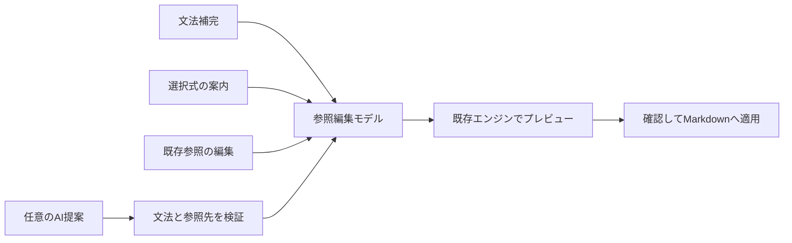

# MMI入力支援 企画案

- 作成日: 2026-09-09
- 状態: Proposed（企画。新機能は未実装）
- 基準: リリース準備コミット `2168a58`、[要求仕様](../00_Prompt/requirements.md) Phase 5/11、[記法仕様](../04_Documentation/spec/mmi-notation-v1.md)、[パラメータ定義](../04_Documentation/spec/params.schema.json)
- 方針: [ADR-0016](adr/ADR-0016-notation-first-input-assistance.md)

## 1. 提案

**文法を覚えなくても、実在する表から参照を選んで作り、後から同じ操作で直せることを中心にする。** 日常の入力はVS Code標準の候補表示と選択画面で完結させる。生成AIは、自然な日本語で書いた意図を候補へ変換する任意の入口とする。

最初の提供範囲は「文脈に応じた補完」「表を参照する案内」「既存参照の編集」「理由の分かる修正候補」。AI契約、ネット接続、APIキーを基本操作の前提にしない。参照元のExcel・CSV等は読み取り専用のまま、編集対象はMarkdownの該当記法だけに限定する。

生成AIは、ローカルモデル方式を優先して実現性を検証する。既存のAIサービスへ指示を渡す方式も提供候補とするが、既存契約があるだけで追加料金なしとは断定しない。MMIが有料クラウドAPIを自動呼び出す方式は採用しない。

## 2. 現状と不足

コード確認と今回の実機検証を分けて記載する。

| 現状 | 確認できたこと | 改善する点 |
| --- | --- | --- |
| 段階補完 | ファイル・シート・範囲・パラメータ名を候補化。実機で3シートの候補を選択できた | `header=`の次に値を選べない。説明と入力位置の管理を強化 |
| 範囲候補 | `readWorkbookMetadata`が各シートの`!ref`を集める | 選択シートへの絞込み、列の見出しと列位置の対応を示す |
| 候補取得 | 純粋コアには依存段階の分類がある | 宿主側は各要求でファイル探索とWorkbook読込を実施。段階別取得・キャッシュ・キャンセルへ接続 |
| 記法の編集 | テキストとして自由に変更可能 | 途中へ戻った際の置換範囲、閉じた記法の外、コード例の中などを区別 |
| 診断 | ファイル・シート・XML・境界外を検知 | 理由の説明と、確認可能な修正先を提示 |
| テンプレート/Paste・Drop | 既存コマンド・プロバイダあり | 新しい案内も同じ生成処理へ接続。既存経路を並存・維持 |

調査先: `03_Implement/src/dx/autocompleteProvider.ts`、`src/extension.ts`の`createCompletionProvider`/`buildAutocompleteCandidateSets`/`readWorkbookMetadata`、`src/parser/embedSyntax.ts`、`src/dx/vscodeAdapters.ts`。

## 3. 利用者の操作

### A. 書きながら入力する

1. Markdown本文で `![[` を入力すると、文書から参照できる表ファイルを表示。
2. ファイル選択後、`#` でシート名、`|` で選択シートの使用範囲を表示。
3. `?` / `&` でパラメータ名を表示。`header=` なら「先頭行を見出しにする / 見出しなし / 行番号を指定」を表示。
4. 候補を確定しても、後ろの `&caption=...]]` は消さない。Tabで次の入力箇所へ、Escapeで候補だけを閉じる。
5. 明示した既存のVS Codeショートカットと競合しない。日本語IME変換中には確定操作を奪わない。

候補には、記法の名前に加えて日本語の意味と短い例を表示する。表示ラベルを日本語にしても、挿入するキーは既定のASCII文法のままとする。

### B. 選んで参照を作る

コマンド「MMI: 表を参照する」（表示名案）またはエクスプローラーの表ファイルのメニューから開始する。

**ファイル → シート → 範囲 → 表示方法 → 確認 → 挿入**の順に進む。各画面で戻る・中止ができる。ファイル全体を別紙にしたい場合はシート選択を省略する。

- 範囲: 使用範囲、手入力、先頭行を見出しにする選択。
- 表示方法: 必要な列、行を含む語句、表題。転置・強調・印刷は「詳細」で展開。
- 確認: 生成される記法と実際の表/カードを表示。0件・巨大表のカード化・読み込み失敗を明示。
- 確定: カーソル位置へ1つの参照を挿入。元に戻す1回で取り消せる。中止時は文書を変更しない。

例: リリース判定表で「要確認を含む行」「見出しあり」「表題: 会議で確認する項目」を選ぶ。

```markdown
![[./data/release.csv#Sheet1|A1:F11?header=first&grep=要確認&caption=会議で確認する項目]]
```

`grep`は行全体への部分一致であり、「判定列が完全一致」の代わりにはしない。その意図が必要なら現在の文法では表現できない旨を表示する。列選択はgrepより先に効くので、検索対象列を外した際の結果も確認画面で見せる。

### C. 既存参照を直す

記法内で「MMI: この参照を編集」を実行すると、今の値を読み込んだ案内が開く。列の追加など、変更した項目だけを更新する。未知キー、同名キーの複数出現、キーの順序など未変更部分を勝手に失わない。

解析不能な記法は理由と候補を表示し、自動で全体を置換しない。ファイル/シート候補が複数なら利用者が選ぶ。訂正候補は通常のCode Actionで提供し、意味が変わる候補は差分とプレビューを確認してから適用する。

## 4. 共通の設計



独立したLSPサーバーや新しいクエリ言語は初期範囲に含めない。VS Code標準のCompletion/QuickPick/InputBox/Hover/CodeActionと既存プレビューを使い、フォーム専用Webviewが本当に必要かは操作検証後に判断する。これらの拡張点は[VS Codeの公式APIガイド](https://code.visualstudio.com/api/language-extensions/programmatic-language-features)で提供されている。

### 文法とデータを壊さない条件

- 完成形のパーサーと、入力途中の位置を扱う解析を分離。後者を完成形の検証の代わりにしない。
- schemaの既知キー・enumを共通カタログへ接続。日本語説明・繰返し可否などの補助情報には同期テストを付け、別の規約正本を作らない。
- 新規生成はparse→serialize→parseで意味が等しいことを検査。既存編集は対象パラメータの区間だけを更新する。
- 同名キーを一律重複禁止にしない。特に`formatColumn`は反復を保持。未知キーは規約どおり許容し、誤字候補は助言に留める。
- 値の`&`/`=`/`+`/`%`などをクエリとしてエンコードする。パス・シートに`#`/`|`/`?`/`]]`等がある場合は、現行パーサーで往復可能かを先に判定。未対応なら挿入前に理由を表示し、独自エスケープを追加しない。
- シート指定・範囲省略・クエリありは、現行パーサーとの整合を検査し、生成では`#シート|?header=first`の形を用いる。`#シート?header=first`を無条件に生成しない。
- `header`の数値指定は要求仕様の説明と記法仕様の変換後行番号の表現に差がある。実装前に既存テスト・規約を照合し、上流の説明を整合する。入力支援の都合で意味を変更しない。
- 列は元シートの列と切り出し・転置後の列を混同しない。候補の列ラベルは現在の処理段階を示す。
- 確認中に文書や原本が変更された場合、文書versionと原本mtimeを確認して再評価する。古い位置へ結果を適用しない。
- 未保存文書は保存先の選択を先に案内。multi-rootは当該文書のworkspaceを基準とし、文字列prefixだけで境界を判定しない。
- コードフェンス・インラインコード・記法外・サポートしないMarkdown表の中では自動補完を出さない。選択式案内からの挿入先も同じ制約を確認。

### 応答性

キー名・固定値の候補はファイル探索しない。シート情報は対象ファイルのみ、mtime付きの既存キャッシュを再利用して取得する。非同期要求にCancellationTokenと文書versionを関連付け、遅い旧候補が新しい候補を上書きしない。

性能目標（未測定）: キャッシュ済み候補はp95 100ms以内、冷読込は進行表示・キャンセル可能。500行/5万行のファイルを含む決めた評価環境で初回と2回目を別記録する。目標未達時は先に要因を測定し、ファイル全体の先読みで隠さない。

## 5. 追加API費用を発生させない生成AI

「MMIのAPI課金なし」「既存契約枠を消費する」「完全に費用ゼロ」を区別する。ローカル推論も端末資源・電力・初回モデル取得は必要である。

| 方式 | 追加API費用 | 提案での扱い | 条件・制約 |
| --- | --- | --- | --- |
| 文法・データに基づく補完 | なし | 必須の基本機能 | AIではないが日常操作を確実に支える |
| ローカルモデル（Ollama等） | ローカル推論にはクラウド従量API不要 | AIの第一候補として評価 | インストール・メモリ・推論待ち。クラウドモデルと外部通信を無効化して検証 |
| 既存AIへ指示を手動で渡す | MMI自身の呼出しはなし | 任意の低結合な入口 | サービス側の枠・課金は残る。利用者が送信先と内容を確認する |
| VS Code Language Model API | 契約・モデル・枠次第 | 初期採用しない。将来再評価 | APIが使えることは無償保証ではない。課金上限をMMIだけで保証できる根拠がない |
| MMI独自の有料クラウドAPI接続 | 発生し得る | 対象外 | APIキー・課金・運用負担が要件に合わない |

[Ollama公式FAQ](https://docs.ollama.com/faq)はローカル実行とクラウド機能の無効化を説明している。`localhost`への接続だけではクラウド推論を除外できないため、ローカルモデルの実体とクラウド無効化を確認する。[VS Code LM API](https://code.visualstudio.com/api/extension-guides/ai/language-model)はユーザー同意・利用可能モデル・quota超過への対応を要求している。[Copilot公式プラン](https://github.com/features/copilot/plans)には利用枠と追加使用の扱いがある。これらを根拠に、既存契約を使う方式を「常に無料」と宣伝しない。調査日: 2026-09-09。具体的なプラン額やモデル名は企画に固定しない。

### ローカルAIの操作案

1. 利用者がファイル・シートを選び、「要確認を含む行だけを、表題付きで表示したい」と入力。
2. MMIは利用目的、記法の定義、選択した参照先の識別子、列見出しと範囲の情報を用意。実データ行は初期状態では渡さない。値が必要なら利用者に指定してもらう。
3. AIは参照の候補1件と短い説明を返す。候補のパス・シートは選択済み候補集合からだけ指定できるようにする。
4. MMIがパーサー、既知パラメータ、実在する参照先、境界、プレビューを検査。エラーなら適用不可にして理由を表示。
5. 利用者が内容・件数・差分を確認し、採用したときだけMarkdownへ反映。AIにファイル操作やコマンド実行権限を渡さない。

「直近1週間」「担当者ごとの集計」「判定列が完全一致」など現在の文法で表現できない依頼は、似た別処理へ黙って置換せず、非対応として案内する。検索結果0件は文法エラーとは区別する。

AIは明示コマンド時だけ1要求を送る。キー入力ごとの呼出し、失敗時の自動再生成、有料先へのフォールバックはしない。停止・タイムアウト・未導入・モデル不在は基本の選択式案内に戻る。localhost接続先はExtension Hostの動作場所に依存するため、初期検証はWindowsローカルのみとしRemote経路は別評価にする。

AI結果、セル内の命令文、説明文は信用できない入力として扱う。通常の記法として解析しても、意味の一致は保証できないため、最終プレビューと人の確認を必須にする。モデルの追加取得・サービス設定変更は自動実行しない。

### 既存AIへの手渡し

「MMI: AIへの依頼文を準備」で、文法・選択済みメタデータ・日本語の目的を読み取り専用の文書に表示する。送信は自動化せず、利用者が必要箇所をコピーする。MMIはブラウザーや他拡張のセッションを流用しない。戻ってきた記法は「提案を確認」へ貼り付け、同じローカル検査と差分確認を通す。

これはMMIのAPI呼出しがゼロであることを保証する入口であり、コピー先サービスの費用や送信許可を保証する機能ではない。

## 6. 実装順と完了条件

| 順番 | Issue | 提供範囲 | 次へ進む条件 |
| --- | --- | --- | --- |
| 1 | [0110](issues/issue-0110-contextual-input-completion.md) | 入力位置解析・値補完・段階別メタデータ取得 | 既存記法を壊さず候補の選択とUndoが実機で成功 |
| 2 | [0111](issues/issue-0111-reference-authoring-flow.md) | 新規作成・既存編集・修正候補・プレビュー | 初心者が資料を開かず表と別紙を作成・修正できることを観測 |
| 3 | [0112](issues/issue-0112-ai-proposal-handoff.md) | AIへの依頼文準備と戻り値の検査 | 通信ゼロで依頼文を作り、不正なAI候補を適用しない |
| 4 | [0113](issues/issue-0113-local-ai-feasibility.md) | ローカルAIの限定検証 | 外部通信なし、正本非改変、実機の品質・待ち時間が許容範囲 |

1〜2だけで独立した価値を提供し、3〜4の未導入で基本機能が欠けない。今回は企画まで。IssueはDraftであり、実装開始やモデルの取得・外部送信は行っていない。

## 7. 評価シナリオ

実務サンプルを使い、少なくとも以下を実機と自動検査で確認する。

- CSVから見出し付き4行の表を作る。Excelの日本語シートを選ぶ。別紙カードを作る。
- `header=`/`orientation=`の値を選ぶ。文中の既存参照の途中を編集し、後ろの文章を保持する。
- 同名キー、未知キー、URL予約文字、IME入力、複数参照、コード例、キャンセル、Undoを確認。
- シート名変更、原本更新、読み込み中のカーソル移動、複数workspaceを確認。
- 0件、Smart Fallback、転置・列抽出後の検索を、想定した意味と照合する。
- AIには正常例10件・曖昧例5件・非対応/悪意ある入力5件の20件を用意。パーサー成功率と利用者の意図一致率を別に報告する。

品質目標（未測定）: 正常10件中9件以上で意図に沿う候補、非対応/悪意ある10件で誤った自動適用0件。候補が不正でも安全に止まることは必須。AIの初回ロードと通常応答、モデル・量子化・メモリ・端末を記録する。特定モデルの採用と端末要件はこの結果を見て決める。

操作評価は熟練者と初めて使う人を分け、完了可否、手戻り、候補の誤確定、説明書参照回数、所要時間を比較する。目標や想定を実測の改善率として報告しない。
