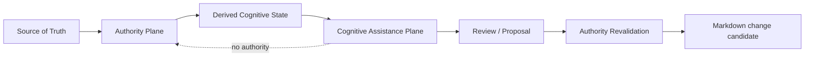

# Cognitive Assistance Plane

## 1. 目的

MMIの決定論的なAuthority Plane（記法の解析、参照先の解決、原本に基づく検証などを担う処理層）を変更せず、曖昧な候補抽出・閉集合判断（定められた選択肢からの判断）・生成提案を交換可能なprovider（認知処理を提供する実装）として接続するための境界を定義する。

本設計の正本（設計判断の根拠となる記録）はADR-0018である。この文書は、issue-0135で固定する最初の実装契約を説明する。

## 2. Trust boundary

次の図は、認知側の提案とAuthority側の検証を分けるTrust boundary（信頼の境界）を示す。



Authority Plane:

- parser
- resolver
- query semantics
- containment
- Read-only guarantee
- diagnostics
- renderer
- conformance

Cognitive Assistance Plane:

- Perception: candidate ranking / novelty / deviation
- Judgment: bounded closed-choice decision
- Reasoning / Generation: explanation / proposal generation

Cognitive provider（認知処理を提供する側）は、Authority Planeの結果を上書きしない。

## 3. Derived Cognitive State

providerへの入力には、可能な限り正本そのものではなく、正本から再生成できる観測結果を使う。

初期contract（データの受け渡しに関する契約）の`CognitiveObservation`（認知側へ渡す観測情報）は、次の項目を持つ。

- stable observation id
- observation kind
- schema version
- payload
- provenance
  - source kind
  - source digest
  - optional feature version
  - optional source profile id

payload（観測の内容）にはproviderごとの型を使えるが、contract自身はfile handle（ファイルを操作するための参照）やwrite capability（書き込みを許す機能）を要求しない。

## 4. Provider descriptor

`CognitiveProviderDescriptor`（providerの識別情報や機能を記す定義）は、provider identity（providerを区別する情報）を明示する。

- id
- version
- category
  - `perception`
  - `judgment`
  - `reasoning-generation`
- execution boundary
  - `local`
  - `external-opt-in`
- capabilities

category（分類）は信頼度ではなく責務の区分である。execution boundary（実行時の境界）はprivacy / networkの境界であり、`external-opt-in`（外部実行を呼び出し側が明示的に指定する区分）を暗黙に実行してよいという意味ではない。

## 5. Signal and abstention

成功時には、`CognitiveSignalOutcome`（認知側から返す信号の結果）として返す。

signal（認知側からの情報）には、次の項目を含める。

- signal kind
- payload
- optional evidence
- optional provider-scoped scores

判断しない結果は例外として一括処理せず、`abstained`（判断を控えた）、`unsupported`（対応していない）、`unavailable`（利用できない）、`error`（エラー）として明示する。

`ambiguous`（曖昧）/ `novel`（既知の候補に当てはまらない）のようなdomain result（対象領域固有の結果）は、provider adapter（結果を契約に合わせて変換する接続部）がsignalまたはabstention（判断保留）へ写像する。ただし、winner（最上位候補）を強制的に作ってはならない。

## 6. Score semantics

異なるproviderのscore（評価値）は、共通の尺度ではない。

`CognitiveScore`（認知側の評価値）は、次の項目を保持する。

- namespace
- name
- semantics
- value
- optional range
- optional higherIsStronger

例は次のとおりである。

- Fly matcher confidence
- Fly DeviationScore
- closed-choice provider probability
- generative provider internal rating

これらの値が同じ`0.8`でも、同じ意味を持つとは限らない。

contract層には、score平均、max選択（最大値による選択）、共通threshold（閾値）判定のhelper（補助処理）を置かない。

## 7. Provenance

結果は必ず観測参照とprovider descriptor（providerの識別情報などを記したもの）に結び付く。

最低限、次の情報を追跡できるようにする。

```text
observation id
source digest
input schema version
provider id
provider version
capability
```

この一覧のcapabilityは、provider descriptorに宣言された能力を参照する。初期contractの`CognitiveOutcome`には、個々の呼び出しで使用した能力を独立した項目として記録する欄はない。

時刻や外部状態に依存する値を、contractのidentity（同一性を識別する値）には使わない。

## 8. Failure behavior

providerが次のいずれかの状態になっても、Authority Planeの処理は継続する。

- 未導入
- timeout
- network unavailable
- unsupported input
- confidence不足
- abstain

Cognitive Assistance Planeが存在しないこと自体を、MMI runtime error（実行時エラー）にはしない。

## 9. 現段階の非責務

issue-0135では、次の事項は行わない。

- Fly matcherのadapter化
- Jev / LLM SDK接続
- network通信
- filesystem access
- VS Code UI接続
- Format Profile永続化
- provider間score統合
- production runtime import
- 正本またはMarkdownの変更

後続の作業は、issue-0136〜0138で個別に扱う。
