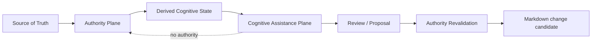

# Cognitive Assistance Plane

## 1. 目的

MMIの決定論的なAuthority Planeを変更せず、曖昧な候補抽出・閉集合判断・生成提案を交換可能なproviderとして接続するための境界を定義する。

本設計の正本はADR-0018である。この文書はissue-0135で固定する最初の実装契約を説明する。

## 2. Trust boundary



Authority Plane:

- parser
- resolver
- query semantics
- containment
- Read-only guarantee
- diagnostics
- renderer
- conformance

Cognitive Assistance Plane:

- Perception: candidate ranking / novelty / deviation
- Judgment: bounded closed-choice decision
- Reasoning / Generation: explanation / proposal generation

Cognitive providerはAuthority Planeの結果を上書きしない。

## 3. Derived Cognitive State

provider入力は、可能な限り正本そのものではなく再生成可能な観測を使う。

初期contractの`CognitiveObservation`は次を持つ。

- stable observation id
- observation kind
- schema version
- payload
- provenance
  - source kind
  - source digest
  - optional feature version
  - optional source profile id

payloadはproviderごとの型を使えるが、contract自身はfile handleやwrite capabilityを要求しない。

## 4. Provider descriptor

`CognitiveProviderDescriptor`はprovider identityを明示する。

- id
- version
- category
  - `perception`
  - `judgment`
  - `reasoning-generation`
- capabilities

categoryは信頼度ではなく責務分類である。

## 5. Signal and abstention

成功結果は`CognitiveSignalOutcome`として返す。

signalには:

- signal kind
- payload
- optional evidence
- optional provider-scoped scores

を含める。

判断しない結果は例外へ押し込まず、`abstained` / `unsupported` / `unavailable` / `error`として明示する。

`ambiguous` / `novel`のようなdomain resultはprovider adapterがsignalまたはabstentionへ写像するが、winnerを強制作成してはならない。

## 6. Score semantics

異なるproviderのscoreは共通尺度ではない。

`CognitiveScore`は:

- namespace
- name
- semantics
- value
- optional range
- optional higherIsStronger

を保持する。

例:

- Fly matcher confidence
- Fly DeviationScore
- closed-choice provider probability
- generative provider internal rating

これらが同じ`0.8`でも同じ意味とは限らない。

contract層にはscore平均、max選択、共通threshold判定のhelperを置かない。

## 7. Provenance

結果は必ず観測参照とprovider descriptorに結び付く。

最低限:

```text
observation id
source digest
input schema version
provider id
provider version
capability
```

を追跡できる。

時刻や外部状態に依存する値をcontractのidentityには使わない。

## 8. Failure behavior

providerが:

- 未導入
- timeout
- network unavailable
- unsupported input
- confidence不足
- abstain

となってもAuthority Planeは継続する。

Cognitive Assistance Planeが存在しないこと自体をMMI runtime errorにしない。

## 9. 現段階の非責務

issue-0135では以下を行わない。

- Fly matcherのadapter化
- Jev / LLM SDK接続
- network通信
- filesystem access
- VS Code UI接続
- Format Profile永続化
- provider間score統合
- production runtime import
- 正本またはMarkdownの変更

後続はissue-0136〜0138で個別に扱う。
