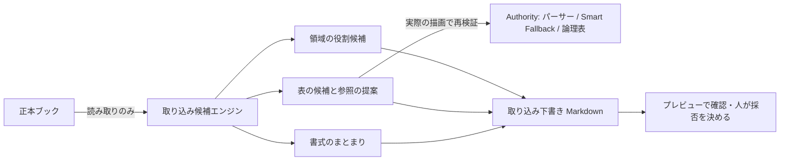

# 既存設計書の取り込み支援

- 状態: 試作（エンジン・VS Codeコマンド・単体テスト・架空データでの評価・拡張機能ホストでの確認まで）。画面操作の目視確認と、利用者による価値確認は未実施。
- 関連: [ADR-0019](../01_Plans/adr/ADR-0019-ai-era-sier-document-value-and-policy.md) D7 優先度2、[ADR-0018](../01_Plans/adr/ADR-0018-cognitive-assistance-plane.md)（認知補助の境界）、[ADR-0017 書式補助](../01_Plans/adr/ADR-0017-fly-inspired-format-deviation-assistance.md)、[issue-0192](../01_Plans/issues/issue-0192-import-assistance-prototype.md)、[認知機能の仮説カード](../01_Plans/cognitive-hypothesis-cards.md)

既存のExcel設計書（方眼紙を含む）をMarkdownへ移すとき、どの表を参照にし、何を本文へ移し、何を取り込まないかを人が決める。本設計は、その判断に必要な候補を示し、表については正本どおりに描ける参照を提案する。

## 1. 解く問題

現行機能（補完・説明からの検索が使う表検出と、素直な`header=first`の参照）を方眼紙の設計書に当てると、次のようになる（§6の開発用データ）。

| 観測 | 結果 |
| --- | --- |
| 正本どおりの表として描けた表 | 3/12 |
| 別紙（カード）になった表 | 10/14 |
| 見出しを認識した表 | 4/14 |
| 表でない領域（見出し枠・文章・押印欄など）が範囲候補として表と区別なく出た数 | 20/43 |

原因は認知の不足ではなく、次の構造にある。

1. 描画は物理セル単位で、結合を考慮しない。7列の表が29の物理列に広がり、空の列が並ぶ。
2. Smart Fallback（記法仕様§7）は`columns`を適用する前の切り出し幅で判定する。方眼紙の表は常に10列を超え、別紙になる。
3. `columns=`の列文字は、範囲の先頭列をAとする相対指定である（[利用マニュアル](../04_Documentation/user-manual.md)）。方眼紙では原本の列文字と一致せず、手で正しく書くのは難しい。
4. 見出しの判定は、先頭行の6割以上のセルに文字があることを求める。横結合の見出しは起点以外が空なので、見出しにならない。

記法を変えなくても、結合の起点列を`columns=`で選び、必要なら`mode=table`を付ければ表として描ける。利用者がこれを手で書くのは現実的でないため、取り込み支援が提案する。

## 2. 構成

エンジンは`03_Implement/src/importAssist/`にあり、VS Codeに依存しない。ADR-0019 優先度1のCLI（`inspect`）からも同じ関数を呼べる。

| ファイル | 責務 |
| --- | --- |
| `importCandidates.ts` | シートを領域に分け、役割（表・項目と値の組・文章・見出し・記入欄・図）の候補と理由を返す。表には論理列・注意・再検証済みの参照を付ける |
| `layoutGroups.ts` | 同じ書式のシートをまとめ、近い書式との差（列の追加・欠落など）を列挙する |
| `importDraft.ts` | 下書きMarkdownを作る。表は参照として置き、値を写さない |
| `src/dx/importFlow.ts` | VS Codeコマンド |

## 3. 権威の分担

ADR-0018に従い、候補と決定を分ける。

- **役割は候補である。** 構造の規則から推定し、理由（`alternating-labels`、`numbered-heading`など）を付ける。何も決めない。
- **参照の提案は、実際の描画で確かめたものだけを出す。** 提案した参照を既存のパーサー、Smart Fallback、論理表の組立て（`buildLogicalTable`、描画と同じ関数）に通し、解析で読んだ内容と一致した場合だけ提案する。一致しなければ提案せず、理由を注意に出す（`revalidation-mismatch`）。
- **見えなくなる値は番地付きで示す。** 見出しの列に揃っていない値など、提案した参照で表示されない値は、注意に番地を載せる。評価では「注意に載らずに消えた値」を0件にすることを必須とした。
- **決定論・ローカル・ネットワークなし。** 正本は読むだけで、書くのは利用者が保存先を選んだ下書きMarkdownだけである。
- **描画は変えない。** `renderTable.ts`は論理表の組立てを関数として切り出しただけで、出力は変わらない。取り込み支援の有無で論理表と診断は変わらない。

## 4. 規則の要点

- **論理セル**: 結合の起点。結合はブック自身の`!merges`だけを使い、空白から推定しない。
- **表**: 見出し行と、その起点列に揃う本文行。本文の途中の横長の区切り行、縦結合で空になる行、1〜2行の空行をはさんだ続き、背の高い見出し、2段の見出しを扱い、それぞれ注意を出す。
- **表の終わり**: 番号付きの見出し、列の型が本文と食い違う見出し行（数値の列に文字が来る）、注記（`※`・`注:`など）、揃わない行。
- **項目と値の組**: 各行がラベルと値の組で、どの列でも値が繰り返されない。表は区分・型・○×が列の中で繰り返すので区別できる。
- **見出し**: 文字の行。先頭が文字で残りが増加する整数（年度・連番）の行も見出しとする。
- **提案**: `header=first`、結合があれば`columns=`（範囲内の相対列）。論理表が10列・500セル以内で切り出しがSmart Fallbackの閾値を超えるときだけ`mode=table`を付ける。論理表がそれより大きければ、同じ大きさの普通の表と同じく別紙になる。
- **ブック自身の宣言**: Excelテーブルは推定より優先して表の候補にし（集計行は外して示す）、名前付き範囲は一致する候補に付ける。Excelで非表示の行・列が範囲にあれば注意を出す（[表の走査と選択§2](table-navigation.md#2-excelの機能への対応2026-09-27の実測)）。
- **書式のまとまり**: 見出し、表ごとの列名、枠のラベルの集合が一致するシートをまとめる。一致しないシートは、共通部分の割合（0.6以上）で最も近いシートとの差を列挙する。割合は並べ替えにだけ使い、判断には使わない。

## 5. 利用者の操作

コマンド**`MMI: Import Tables from Workbook`**（日本語表示「既存のExcel設計書から取り込み候補を作る」）。エクスプローラーでブックを右クリックしても実行できる。

1. ブックを選ぶ（右クリックから実行した場合は省略）。
2. 下書きの保存先を選ぶ。既定は開いているMarkdownと同じフォルダの`<ブック名>_取り込み候補.md`。
3. 下書きが開き、横にプレビューが出る。表はプレビューで正本から描画される。

下書きには次を載せる。

- 件数（表の候補、注意あり、表ではない領域の種類ごとの数）
- 書式のまとまり（「同じ書式: 受注登録、受注照会」「出荷指示: 受注登録に近い書式です。表「2. 画面項目」に列「初期値」があります」）
- シートごとの骨格: 見出しは`###`、表は参照、注意は引用、表ではない領域は番地・ラベル・抜粋と扱いの目安

## 6. 評価

### 6.1 方法

`npm run eval:import-assist`（開発用）、`npm run eval:import-assist -- --set holdout`（追加ケース）。データは`scripts/import-assist-eval/`の生成器で作る架空の設計書で、実在の値は含まない。

- **判定**: 参照を実際に描画し、表として表示され、見出しと本文がセル単位で期待と一致したものを正解とする。
- **現行**: 見出し行を含む検出領域に、見出しが見つかれば`header=first`を付けた参照。
- **開発用データ**: 3ブック13シート。表14（v1の記法で正確に表せる12）、表ではない領域43。エンジンと同時に同じ開発者が作成した。盲検ではない。
- **追加ケース**: 10シート。表10（正確に表せる9）、表ではない領域5。試作の完成後に、試作が頼る規則を突く形で同じ開発者が作成した。盲検ではない。1回目は修正前に記録した。

測定環境: Windows 11 Pro、Node v24.19.0（2026-09-27）。

### 6.2 結果

| 指標 | 現行（開発用） | 試作（開発用） | 現行（追加） | 試作（追加・1回目） | 試作（追加・修正後） |
| --- | --- | --- | --- | --- | --- |
| 正本どおりの表として描けた表 | 3/12 | 12/12 | 0/9 | 3/9 | 9/9 |
| 別紙になった表 | 10/14 | 0/14 | 7/10 | 0/10（候補5件） | 0/10 |
| 表でない領域の役割が正しい | ―（役割なし） | 43/43 | ― | 1/5 | 5/5 |
| 表でない領域を表の候補にした | 20/43 | 0/43 | 4/5 | 4/5 | 0/5 |
| 表せない表に注意を出した | ― | 2/2 | ― | 0/1 | 1/1 |
| 注意に載らずに消えた値 | ― | 0 | ― | 0 | 0 |

- **開発用データの満点は過学習だった。** 追加ケースの1回目は3/9、役割1/5で、見出しを挟んで続く2つの表が1つに吸収される、長い見出し枠やラベルに接尾辞のない枠を表と判定する、表内の空行で表が分かれる、表直下の注記を本文にする、年度の見出しを見出しと認めない、背の高い見出しを2段見出しと誤る、の6種類の失敗が出た。
- 失敗は個別の書き分けではなく一般規則で直した（§4の「表の終わり」「項目と値の組」「見出し」）。修正後の9/9・5/5は失敗を見てから直した値で、汎化の根拠にはならない。追加ケースはこれで消費した。
- **安全側の性質はどの回も保たれた。** 消えた値0件、誤った参照の自動挿入なし（下書きは利用者が確かめる）、原本の変更なし。
- 現行の数字は、Smart Fallbackと結合の仕様から構造的に決まるので、データを変えても大きくは変わらない見込みである。

### 6.3 研究の信号との比較

研究層の表らしさの信号（SAI body-candidate: 見出し候補の下に数値が過半の列があるか）を同じ領域に当てた。

| データ | 表で`present` | 表でない領域で`present` |
| --- | --- | --- |
| 開発用 | 12/14 | 0/20 |
| 追加 | 8/10 | 1/4 |

分類の信号としては当たりやすいが、数値の列がない表（権限の○×表、メッセージ一覧）を落とす。また、この信号は与えられた領域を分類するだけで、領域の切り分け・見出し行・論理列・参照は出さない。取り込みに必要なのは後者であり、信号は役割の補助証拠にとどまる。

### 6.4 VS Code宿主

`test/e2e/runImport.ts`で、VS Code 1.134.0（Windows、インストール済みの本体を一時的なユーザーデータ・拡張フォルダで起動）の拡張機能ホストからコマンドを実行した。保存ダイアログは台本で省略し、下書きはプレビューと同じ描画エンジン（`markdown.api.render`）で描画した。

| ブック | 参照 | 表として描画 | 別紙 | エラー | 診断 | 原本のハッシュ |
| --- | --- | --- | --- | --- | --- | --- |
| 画面定義書_受注.xlsx | 7 | 7 | 0 | 0 | 0 | 不変 |
| テーブル定義書_受注.xlsx | 5 | 5 | 0 | 0 | 0 | 不変 |
| 権限・メッセージ定義.xlsx | 2 | 2 | 0 | 0 | 0 | 不変 |

### 6.5 規模

8論理列（29物理列）の方眼紙の表で、解析（参照の再検証を含む）は500行 24ms、3,000行 94ms、10,000行 492ms。1万行の表は論理表が500セルを超えるので別紙として提案する。

### 6.6 説明からの検索・補完・案内付きの作成

表の列が結合しているシートでは、検索・補完・案内付きの作成が使う表の領域を、取り込み支援の表候補（`src/importAssist/tableRegions.ts`）から作る。領域は論理列の起点（`columnAnchors`）と、`header=first`で表示される見出しを持つ。結合のないシートは現行の表検出のままである。

- **検索**: 表全体なら起点列をすべて`columns=`に、列名を指定すればその列の起点だけを入れ、必要なら`mode=table`を付ける。原本との再照合も起点列の見出しで行う。
- **補完**: 範囲候補の説明に必要な指定（`columns=…&mode=table`）を示し、`columns=`の値候補の先頭に起点列の一覧を出す。
- **案内付きの作成**: 方眼紙の表の範囲を選ぶと、`header`・`columns`・`mode`が空なら最初から入る。確認の段で表示を確かめてから挿入する。

| 確認 | 変更前（`HEAD`） | 変更後 |
| --- | --- | --- |
| 方眼紙を含む架空データで、説明からの検索の1位が期待どおりの表（7件の依頼。構成を見て書いたので盲検ではない） | 2/7 | 5/7 |
| 同、候補5件の中に期待どおりの表 | 2/7 | 6/7 |
| issue-0115の架空業務データ（方眼紙なし）の領域検出と、全方式・全セットのRecall@5・棄却率 | 49/49 | 変化なし（同値） |
| VS Code拡張機能ホストで、案内付きの作成で方眼紙の表を選んで挿入 | ― | `header=first&columns=A,C,I,O,R,T,V&mode=table`が入り、確認の段は「表として表示: 本体8行 × 7列（見出しあり）」 |

変更前は、方眼紙の表が別紙になるか、見出しがないため列名で絞れず候補なしになった。「受注登録の画面項目」の1位は文書の見出し枠だった。変更後に残った2件は検索の順位（正しい表が2位）と文法の曖昧さ（「受注照会のイベント」を「イベント」列だけと読む。「イベントの表」と書けば表全体になる）で、[issue-0115](../01_Plans/issues/issue-0115-cpu-range-search.md)の範囲である。評価は`scripts/import-assist-eval/search.ts`。

## 7. 仕様・実装上の観察（本作業では変更していない）

1. **`columns=`の列文字**: 記法仕様§6は「A1列文字」とだけ書き、利用マニュアルは「切り出した範囲の先頭をA」と定める。実装は後者である。準拠テストはA列始まりの範囲しか使わないため、どちらの解釈でも通る。仕様の明確化が必要（v1のDraft中に判断する）。
2. **Smart Fallbackの測る対象**: `columns`の前の切り出しで判定するため、方眼紙の表は`mode=table`なしでは常に別紙になる。仕様どおりであり、取り込み支援は提案で対処した。判定を`columns`の後へ移すかは記法の判断である。
3. **表示の上限**: `mode=table`でも外せない10万セルの上限も、切り出し前のセル数で測る。
4. **説明からの検索と補完**: どちらも現行の表検出を使っていたため、方眼紙のブックでは同じ問題（見出しなし・別紙）が起きていた。§6.6のとおり、表の列が結合しているシートに限って取り込み支援の表候補を使うよう変えた。

## 8. 未確認と次の一手

- 画面操作の目視確認（ブックの選択、保存ダイアログ、横に開くプレビュー）。拡張機能ホストでの描画は§6.4で確認した。
- 実在の設計書（匿名化したもの、または利用者が用意したもの）での観測。ADR-0019 D9の「候補を採用・修正・却下した割合と理由」「取り込み範囲を決めるまでの時間」を記録する。
- 未見の架空データを別の作り手が用意し、1回だけ評価する。
- CLI（`inspect`）の表候補としての出力。
- 書式のまとまりで判断回数が減るかの観測。完全一致では拾えない「少しずつ違う」シートが多い場合に限り、Fly-inspired matcherとの比較を行う。
