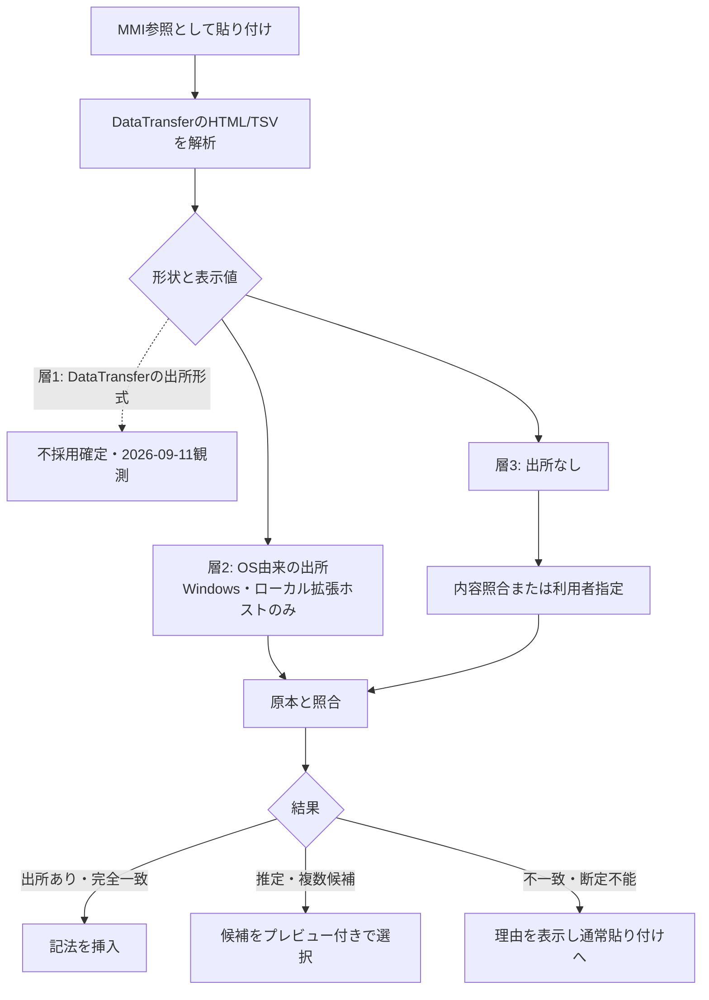

# クリップボード出所の取得と照合

- 状態: Proposed（実装未着手）。観測日 2026-09-10、2026-09-11（VS Code DataTransfer観測を追加）。**§2のVS Code観測により、出所取得は層2（Windows補助プロセス）か層3（内容照合）に限られることが確定した。**
- 対象: [pasteDrop.ts](../03_Implement/src/dx/pasteDrop.ts)、[vscodeAdapters.ts](../03_Implement/src/dx/vscodeAdapters.ts)、[extension.ts](../03_Implement/src/extension.ts)
- 関連: [ADR-0016](../01_Plans/adr/ADR-0016-notation-first-input-assistance.md)、[ADR-0017](../01_Plans/adr/ADR-0017-windows-clipboard-provenance-bridge.md)、[issue-0114](../01_Plans/issues/issue-0114-excel-range-paste.md)、[ソースモデル](input-assistance-source-model.md)

Excelで`C5:F12`をコピーし、Markdownへ`![[./data/設計.xlsx#状態遷移|C5:F12]]`として貼り付ける機能の設計。原本の開始位置をどこから得るか、そして得た住所をどう検証するかを定める。

## 1. 観測結果

架空ブックのみを使用し、Windows 11 Pro 26200 / Microsoft Excel 16.0（Office 16.0.20326.20132）で実際にコピーし、Win32のクリップボードAPIで生バイトを13ケース採取した。実務データは扱っていない。採取と表の再生成は[観測ハーネス](../03_Implement/scripts/clipboard-probe/README.md)で再実行できる。

### 1.1 Excelが公開する形式

範囲コピー1回で22形式が並ぶ。

```
EnhancedMetafile | MetaFilePict | Bitmap | Biff12 | Biff8 | Biff5 | SymbolicLink |
DataInterchangeFormat | XML Spreadsheet | HTML Format | UnicodeText | Text | Csv |
Hyperlink | Rich Text Format | Embed Source | Object Descriptor | Link Source |
Link Source Descriptor | Link | Format129 | ExcludeClipboardContentFromMonitorProcessing
```

**原本の開始位置は存在する。** ただしHTMLの中ではない。

| 形式 | 符号化 | 内容（`状態遷移!C5:F12`をコピーした場合） |
| --- | --- | --- |
| `Link` | ANSI（当環境ではCP932）、NUL区切り | `Excel` / `<絶対ディレクトリ>\[設計.xlsx]状態遷移` / `R5C3:R12C6` |
| `Object Descriptor` | UTF-16 | `Microsoft Excel ワークシート` / `状態遷移!R5C3:R12C6` |
| `Link Source Descriptor` | UTF-16 | `Object Descriptor`と同内容 |
| `HTML Format` | UTF-8（ヘッダ含む） | `SourceURL:file:///.../設計.xlsx` と、値のみのHTML表 |

`R5C3:R12C6`は行5・列3から行12・列6であり、A1表記の`C5:F12`と一致する。

### 1.2 HTMLには住所が無い

`HTML Format`の断片にはセル住所を示す語が1つも現れない。あるのは`<col width>`と`<tr>/<td>`、そして表示値だけである。行列数は「コピーされた矩形の大きさ」を表すが、開始位置ではない。現行の`inferRangeFromHtmlTable`が常に`A1:`から始まる範囲を返すのは、この情報を開始位置として使っているためで、原本の位置の証拠にはならない。

### 1.2a HTMLにはファイルパスも無い（2026-09-11、実装済みの不具合として発見）

`HTML Format`の全文（3,365文字、先頭の`head`表示だけでなく全体）を走査したが、原本ワークブックのパスは一切現れない。`.xlsx`/`.xls`/`.csv`/`.xml`のいずれかで終わる文字列は`<head>`内の2つの`<link>`要素だけである。

```html
<link id=Main-File rel=Main-File href="file:///.../msohtmlclip1/01/clip.htm">
<link rel=File-List href="file:///.../msohtmlclip1/01/clip_filelist.xml">
```

これはMicrosoftのHTMLクリップボード形式が使う一時的な「クリップ保管」参照であり、原本ワークブックではない。`clip_filelist.xml`は`.xml`拡張子を持つため、**現行の`src/dx/pasteDrop.ts`の`extractSupportedFilepathFromHtml`はこれを誤って一致させ、`![[C:/.../msohtmlclip1/01/clip_filelist.xml|A1:D8]]`という、原本ではなく一時ステージングファイルを指す壊れた提案を生成していた。** 実際に採取したペイロードを製品コードへ通して確認した（合成HTMLではなく実データでの再現）。

**2026-09-11に修正済み。** `<head>`内を検索対象から除外し、`msohtmlclip`を含む一致は候補から除く。修正後、この実データを与えると`suggestEmbedFromClipboardHtml`は`null`（提案なし）を返す。これは正しい退避動作である。原本パスがHTMLのどこにも存在しない以上、"提案しない"が"誤ったファイルを提案する"より安全である。詳細と回帰テストは[issue-0114](../01_Plans/issues/issue-0114-excel-range-paste.md)「pasteDrop.tsの修正」節。

**この発見が意味すること:** `suggestEmbedFromClipboardHtml`が抽出しようとする3項目（パス・シート名・範囲）のうち、シート名（`<title>`/`data-sheet`頼み）と範囲（A1起点の仮定）はすでに不正確と分かっていたが、パスの抽出自体が実データでは機能しないどころか積極的に誤った結果を生んでいたことは今回で初めて確認した。**現行の`suggestEmbedFromClipboardHtml`は、実際のExcelコピーに対しては正しい結果を1つも生成できない設計だった。**

### 1.3 採取した13ケース

`summarize.cjs`が生成した表である。`html`はコピーされた矩形の形状（行数×列数、colspan加算、`<table>`全体から算出）。

| ケース | book | sheet | R1C1 | A1換算 | 住所の形 | HTMLの形 | 一致 | `SourceURL` | 結合 |
| --- | --- | --- | --- | --- | --- | --- | --- | --- | --- |
| 状態遷移 C5:F12 | 設計.xlsx | 状態遷移 | `R5C3:R12C6` | `C5:F12` | 8×4 | 8×4 | 一致 | あり | - |
| 重複シート 同一内容 | 設計.xlsx | 重複 | `R5C3:R12C6` | `C5:F12` | 8×4 | 8×4 | 一致 | あり | - |
| A1開始 横結合 | 設計.xlsx | A1開始 | `R1C1:R4C2` | `A1:B4` | 4×2 | 4×2 | 一致 | あり | colspan |
| 縦結合 | 設計.xlsx | 縦結合 | `R2C2:R4C3` | `B2:C4` | 3×2 | 3×2 | 一致 | あり | rowspan |
| 単一セル | 設計.xlsx | 状態遷移 | `R7C4` | `D7` | 1×1 | 1×1 | 一致 | あり | - |
| 単一行 | 設計.xlsx | 状態遷移 | `R6C3:R6C6` | `C6:F6` | 1×4 | 1×4 | 一致 | あり | - |
| 非連続選択 C5:F5,C7:F7 | 設計.xlsx | 状態遷移 | `R5C3:R7C6` | `C5:F7` | 3×4 | 3×4 | 一致 | あり | - |
| 列全体 C:D | 設計.xlsx | 状態遷移 | `C3:C4` | **A1不可** | — | 12×2 | **不一致** | あり | - |
| フィルター可視行のみ | 設計.xlsx | 状態遷移 | `R5C3:R7C6` | `C5:F7` | 3×4 | **2×4** | **不一致** | あり | - |
| 空白入りパス | 設計 控え.xlsx | 状態遷移 | `R5C3:R12C6` | `C5:F12` | 8×4 | 8×4 | 一致 | あり | - |
| 非ANSIパス | **設計_??.xlsx** | 状態遷移 | `R5C3:R12C6` | `C5:F12` | 8×4 | 8×4 | 一致 | あり | - |
| 未保存ブック | Book1 | Sheet1 | `R3C2:R3C3` | `B3:C3` | 1×2 | 1×2 | 一致 | **無し** | - |

この表が設計の根拠である。読み取れることは6つ。

1. **保存済みブックからの通常のコピーでは、出所と住所が完全に得られる。** 単一セル・単一行・結合セルを含むコピーでも、住所と形状は一致した。
2. **住所は選択内容の証明ではない。** フィルターで行が隠れている場合、住所は3行分（`C5:F7`）を指すのにコピーされた内容は2行しかない。住所をそのまま挿入すると、利用者が意図的に除外した行が表示に混ざる。**形状の比較がこれを検出する。**
3. **R1C1にはA1と紛れる別の形がある。** 列全体を選択すると住所は`C3:C4`になる。これはA1表記の「C列の3行目から4行目」と字面が同じだが、意味は「3列目から4列目の全体」である。A1として解釈すると完全に誤った範囲になる。
4. **観測した未保存ブックでは`SourceURL`が行ごと現れない**（`Link`のパスもディレクトリを持たず`[Book1]Sheet1`になる）が、欠落だけで未保存とは判別できない。
5. **`Link`のパスはファイル名を壊し得る。** ブック名`設計_한글.xlsx`は`Link`では`設計_??.xlsx`になり、同じコピーの`SourceURL`は`設計_한글.xlsx`を正しく保持した。ANSI符号化の実害を確認した。
6. 非連続選択（COM経由の複数領域指定）では、Excelは**外接矩形**を出力した。住所`C5:F7`・内容3行がともに矩形全体であり、選択していない6行目を含む。形状は一致するため検出できない。UI操作でのCtrl+ドラッグ選択は別に確認する（§8）。

### 1.4 符号化の扱い

- `HTML Format`はUTF-8。`SourceURL`は空白をパーセント符号化する（`設計%20控え.xlsx`）が日本語はそのまま置く。復号が必要。
- `Link`のパスはANSI符号化である。システムのANSIコードページで表せない文字は失われる（`設計_한글.xlsx` → `設計_??.xlsx`を確認）。**パスの取得元として使えない。**
- `Object Descriptor`はUTF-16なのでコードページの制約を受けない。シート名と住所はここから取る。

**したがってパスは`SourceURL`から、シート名と住所は`Object Descriptor`から取る。** `Link`は交差検証にのみ使う。

.NETの`DataObject`による文字列変換はこれらを誤って復号する（`HTML Format`はUTF-8なのにANSIとして復号され、`Csv`/`Link`はANSIなのにUTF-8として復号されU+FFFDになる）。生バイトを取得し、形式ごとに復号する必要がある。

### 1.5 HTMLの構文上の注意

- コピー範囲内の空行は、空の`<td>`を持つ`<tr>`として出力される。形状に含まれる。
- 横方向の結合セルは`<td colspan=2>`になる。列数はcolspanを加算して数える（現行実装は加算しており妥当）。
- 縦方向の結合は`rowspan`になり、結合に覆われた行は`<td>`が1個少ない（`縦結合`シートのB2:C4で行ごとのtd数が`[2,2,1]`）。**製品ではrowspan/colspanの占有グリッドで列位置を復元する。観測用の最大列数だけでは一般の結合配置を扱えない。** 行ごとの数をそのまま列数としない。
- **1行だけのコピーでは`<tr>`が`<!--StartFragment-->`〜`<!--EndFragment-->`の外に置かれる。** 断片内だけを数えると0行になる。観測表の行数は`<table>`全体から数える。製品では断片と親文脈を区別する（この方法で単一行・単一セルとも住所と形状が一致した）。
- 値は表示文字列のみ。日付は原本の書式のまま、数式は計算済みの値、エラーは`#DIV/0!`、文字列書式の先頭ゼロは`007`。[ソースモデル](input-assistance-source-model.md)§6の切り出し結果と一致する。

### 1.6 クリップボードは開けないことがある

観測中、`OpenClipboard`が`ERROR_ACCESS_DENIED`(5)を返し続ける状態に入った。Win32経由と.NET経由の両方が失敗し、数分にわたって回復せず、その後は自然に復旧した。他プロセスがクリップボードを開いたまま保持している状態である。**取得は必ず失敗し得る。** 再試行に上限を設け、失敗しても貼り付け操作自体を止めない設計が必要（ハーネスは25回×120msで再試行し、それでも駄目なら`NOTHING CAPTURED`を報告する）。

## 2. VS Codeから何が見えるか（2026-09-11 確認済み）

**`DataTransfer`に出所形式は含まれない。** VS Code 1.137.0（ローカル、`remoteName: null`）の隔離インスタンスで、実Excelから`状態遷移!C5:F12`をコピーし、`vscode.languages.registerDocumentPasteEditProvider`で登録した`provideDocumentPasteEdits`を実際に呼び出させて確認した。観測されたMIME型は次の4件のみ。

```
text/plain, text/html, text/rtf, image/png
```

`Link`・`Object Descriptor`・`Csv`・`XML Spreadsheet`・`Hyperlink`・`SymbolicLink`・`Link Source Descriptor`は`pasteMimeTypes`へ明示的に登録したにもかかわらず一切現れなかった。

**さらに、`text/html`の内容そのものが、OSクリップボードの生バイトとは異なる。** §1.1で確認したOS生バイトの`HTML Format`には`Version:1.0` / `StartHTML:...` / `SourceURL:file:///...`というCF_HTMLヘッダーが前置される。VS Codeが拡張へ渡す`text/html`の文字列は`SourceURL:`・`Version:1.0`のいずれも含まず、`<html xmlns:o=...`から直接始まる（`containsSourceUrlMarker: false`を実測で確認）。VS Code／ElectronのクリップボードブリッジがCF_HTMLの外枠を除去し、Web標準の`text/html`（HTML本文のみ）へ正規化しているためである。

**結論: 原本のパス（`SourceURL`）もシート・住所（`Object Descriptor`）も、`DataTransfer`からは一切取得できない。** [ADR-0017](../01_Plans/adr/ADR-0017-windows-clipboard-provenance-bridge.md)の選択肢1（拡張内だけで完結）は**不採用が確定**した。出所を得るには選択肢2（Windows専用の補助プロセスでOSクリップボードの生バイトを読む）が必須であり、それを避けるなら選択肢3（内容照合のみ、出所なし）に限られる。

再現手順は[clipboard-probe](../03_Implement/scripts/clipboard-probe/README.md)の`probe-vscode.ps1`。観測ログは`%TEMP%\mmi-clipboard-probe\vscode-probe.log`（架空データのみ、個人パスはこの環境のTEMP配下）。

### 未確認のまま残る点

- 宣言している最低対応版（VS Code `^1.96.0`）での再現。今回の観測は現行版（1.137.0）のみ。CF_HTMLの正規化はVS Code自体でなくElectron/Chromiumのクリップボード実装に由来するため、対応版間で挙動が変わる可能性は低いと考えるが、実測はしていない。
- 実際のキー入力（Ctrl+V）による貼り付けが、本観測で使った`editor.action.clipboardPasteAction`コマンド経由の貼り付けと同じ経路を通ることの実測確認。VS Codeの既定キーバインドはCtrl+Vをこのコマンドへ割り当てており経路は同一のはずだが、任意のウィンドウへキー入力を注入するリスクを避けるため（レビューR5の設計意図に反する）、本セッションでは意図的に検証しない。

## 3. 取得経路の階層

出所の取得手段は3層あり、**どの層を通っても§4の照合を必ず通す**。



**層1（`DataTransfer`自体が出所を運ぶ）は2026-09-11の実測で不採用が確定した。** §2参照。実装は層2（Windows専用補助プロセス）と層3（内容照合・出所なし）の2系統だけを対象にする。

層2の制約。

- Windows専用。`vscode.env.remoteName`が設定されている場合（WSL・SSH・Codespaces・web）は拡張ホストとクリップボードが別の機器にあるため利用しない。
- 補助プロセスは生バイトを読むだけで、Excelを操作しない。現在アクティブなExcelの`Selection`をコピー元と決めつけない（コピー後に選択が移動している可能性がある）。
- **競合の検査が必須。** `DataTransfer`はVS Codeが貼り付け時点で取ったスナップショットだが、補助プロセスは実行時点のクリップボードを読む。両者の間にコピーが挟まると別の内容を混同する。補助プロセスが読んだHTMLの形状と表示値を`DataTransfer`のHTMLと突き合わせ、違えば出所を破棄する。
- 配布・保守の負担と採否は[ADR-0017](../01_Plans/adr/ADR-0017-windows-clipboard-provenance-bridge.md)で判断する。

## 4. 照合の契約

出所を得ても、それは**手掛かりであって証明ではない**。フィルターのケースがその反例である。

```
入力: 形状(行数×列数) + 表示値行列 + 任意の出所(パス, シート, R1C1住所)

1. 住所をA1へ変換する
   - `R<n>C<n>[:R<n>C<n>]` のみ受け付ける
   - `C<n>:C<n>` `R<n>:R<n>`（列全体・行全体）は変換せず棄却する
2. パスを検証する
   - percent復号し、ワークスペース境界内か確認する（記法仕様P4）
   - 存在しない・境界外・未信頼workspace・未保存 → 出所を使わない
3. 原本を読み、住所の矩形を切り出す（ソースモデル§3）
4. 形状を比較する
   - 行数・列数が違う → 棄却。フィルター・非連続選択・列全体の可能性を理由として表示
5. 表示値を比較する
   - 全セルの表示文字列が一致するか
   - 違う → 棄却。コピー後の原本変更、未保存の編集の可能性を表示
6. 結果を区分する
   - 出所あり かつ 形状・値が完全一致 → 「出所あり」
   - 出所なし・棄却後に内容から見つけた → 「推定」
```

- 正規化は候補の絞り込みにのみ使う。最終比較は表示文字列をそのまま比べ、先頭ゼロ・空白・日付・エラー値を同一視しない。
- 計算や外部リンクの更新は行わない。原本のハッシュが変わらないことを検証項目に含める。
- 内容が一致する領域が複数あっても（架空ブックの`重複`シートが該当）、唯一に見えても出所の証明としない。区分を保ったまま候補として並べる。

### 自動確定の規則

| 区分 | 動作 |
| --- | --- |
| 出所あり・完全一致・候補1件 | 初期提供では参照先と範囲を示して明示選択後に挿入する。利用者が「MMI参照として貼り付け」を明示的に選んでいるため。Undo1回で戻る |
| 推定・または候補複数 | 必ず候補一覧をプレビュー付きで提示する。類似度だけで確定しない |
| 断定不能 | 理由を表示し、ファイル・シート・範囲の指定へ案内する。勝手なA1範囲を作らない |

## 5. 内容照合（出所が無い場合）

1. 探索対象は利用者が選んだブック、または許可されたworkspace内に限る。端末全体を探索しない。
2. コピー内の希少な非空セルをアンカーにし、原本の転置索引から同じ表示値を持つセルを引く。
3. コピー内オフセットを引いて開始位置候補を作り、複数アンカーの候補を突き合わせる。
4. 矩形全体を§4の手順で照合する。全矩形の総当たり走査は行わない。
5. 読込サイズ・候補数・照合セル数・時間に上限とキャンセルを設ける。
6. 全セルが空、同一内容が多数、非連続選択の疑いがある場合は曖昧さを保ち、通常貼り付けへ戻れるようにする。

索引の構造は[CPU範囲探索](input-assistance-cpu-search.md)と共有する。ただし**厳密な内容照合をFlyHash等の近似検索に依存させない。**

**手順2〜4は実装済み（2026-09-14）。** `src/core/contentMatch.ts`の`findContentMatches(sheet, needle, options?)`が、単一の`SheetSource`に対してアンカー選定→転置索引引き当て→複数アンカー突き合わせ→矩形全体照合を行う。部分一致は候補にしない（手順4「棄却」）。同一内容の複数一致はすべて返す（自動で1件に絞らない、§4「自動確定の規則」）。`maxIndexedCells`（既定20万セル、超過で例外——黙って一部だけ探して真の一致を見逃すことを避ける）と`maxCandidates`（既定200件、超過分は切り詰め——内容の広範な重複は正常なケースであり自動確定禁止規則が安全弁になるため例外にはしない）で手順5の上限を扱う。テストは`test/contentMatch.test.ts`（11件）。

**手順1（探索対象ブックの決定）も実装済み（2026-09-15）。** `src/dx/contentMatchSearch.ts`の`findWorkbookContentMatches`が複数ワークブック・複数シートを横断して`findContentMatches`を呼ぶ。探索対象は「許可されたworkspace内」（`vscode.workspace.findFiles`、自動補完機能が既に使っているのと同じglob・除外設定を流用）に解決した——「利用者が選んだブック」（都度ファイルを選ばせるUI）は採用していない。1シートが大きすぎて索引不能でも、そのシートだけ読み飛ばして検索全体は止めない。手順6の「非連続選択の疑い」の検出は依然として未着手（全セル空・複数一致は扱うが、非連続選択そのものを推定するヒューリスティックはまだ無い）。テストは`test/contentMatchSearch.test.ts`（6件）。

## 6. 現行実装から変える点

| 箇所 | 現状 | 変更 |
| --- | --- | --- |
| `extractSupportedFilepathFromHtml` | `<head>`内の`msohtmlclip`一時ステージング参照を原本パスと誤認していた | **修正済み（2026-09-11）。** `<head>`を検索対象から除外し、`msohtmlclip`を含む一致も除外する。§1.2a参照 |
| `inferRangeFromHtmlTable` | HTMLの行列数から常に`A1:`起点の範囲を返す | **修正済み（2026-09-14）。** 関数を削除し、`extractHtmlTableShape`（形状のみ、開始位置を生成しない）に置き換えた。`suggestEmbedFromClipboardHtml`はもう範囲を生成しない |
| 行数の数え方 | `<tr>`をHTML全体から数える | 維持（断片内だけを数えない。§1.5）。`extractHtmlTableShape`で単一行コピーの回帰テストあり |
| 列数の数え方 | colspanを加算して最大値を取る | **修正済み（2026-09-14）。** `extractHtmlTableShape`が結合の占有グリッドから列位置と幅を求める（レビューR2）。rowspanの反例をテストで固定 |
| 転送値の取得 | `trim()`を適用 | **修正済み（2026-09-14）。** `parseTsv`を追加。ExcelのTSVクリップボードが`workbookLoader.ts`のCSVパーサーと同じRFC4180風の引用規則（タブ・改行を含むセルのみ引用、引用時は`""`で内部の引用符をエスケープ）を使うことを実機で確認し、区切り文字をタブに変えて移植した。裸の引用符だけでは引用が発生しない（厳密なRFC4180より緩い）ことも確認済み |
| シート名 | HTMLの`title`や`data-sheet`を採用 | **修正済み（2026-09-14）。** `extractSheetNameFromHtml`を削除した。`suggestEmbedFromClipboardHtml`はシート名を一切推測しない |
| 内容照合ロジック本体 | 存在しなかった | **実装済み（2026-09-14〜15）。** `src/core/contentMatch.ts`の`findContentMatches`が§5手順2〜4を単一`SheetSource`に対して行い、`src/dx/contentMatchSearch.ts`の`findWorkbookContentMatches`が複数ワークブックへ集約する（手順1） |
| VS Code統合 | 存在しなかった | **実装済み。** (1) 明示コマンド`markdownMatrixInjector.insertEmbedByContentMatch`（2026-09-15）、結果は必ず`showQuickPick`を経由。**実VS Code e2eで動作確認済み（2026-09-17）**——この過程で`registerTextEditorCommand`の非同期未サポートという実装バグを発見・修正した。(2) `editor.action.pasteAs`（Ctrl+.）への統合（2026-09-16）、`context.triggerKind === PasteAs`の場合のみVS Code標準ドロップダウンへ候補を追加。**通常のCtrl+V（`Automatic`）には統合していない**——複数`DocumentPasteEdit`は`Automatic`だと最初の1件を自動適用してしまうため（R1違反リスク）。**こちらはe2e未確認**（実クリップボードへの`text/html`設定手段が無い）。理由は下記「2026-09-16の変更のまとめ」「2026-09-17の変更のまとめ」 |
| `extension.ts`の貼り付け | document・cancellation引数を使っていない | 自動貼り付けプロバイダ（`provideDocumentPasteEdits`）自体は未変更のまま。文書相対パスの解決・処理中止・文書versionと原本mtimeの再検証は**依然として未着手** |
| 既存テスト | 人工HTMLに`data-sheet`とパスを付けて成功を確認 | 実Excelの採取結果を固定資料として使う。`test/pasteDrop.test.ts`へ実キャプチャの`<head>`構造を再現したケースを追加。すべてのsheet/range関連アサーションをfilepath-onlyの新契約へ更新（`test/extensionIntegration.test.ts`も含む） |

**2026-09-14の変更のまとめ:** `suggestEmbedFromClipboardHtml`は`filepath`のみを返すようになった（`sheet`/`range`は返さない）。これにより`![[file.xlsx]]`（ファイルのみ、シート・範囲は利用者が補完する）が最大限主張できる誠実な提案になった。`extractHtmlTableShape`（形状）と`parseTsv`（表示値行列、`text/plain`から）を独立した関数としてエクスポートし、実機データで検証・実装した。実キャプチャで両者が同じ形状（8行×4列）で一致することをクロス検証済み。続けて、両者を使って単一`SheetSource`内を検索する内容照合アルゴリズム本体`findContentMatches`（§5手順2〜4）を実装した。この時点では3つともVS Codeの貼り付けパスからどこからも呼ばれていなかった。

**2026-09-15の変更のまとめ:** `findContentMatches`を複数ワークブックへ集約する`findWorkbookContentMatches`（§5手順1）と、新規コマンド`markdownMatrixInjector.insertEmbedByContentMatch`としての`extension.ts`統合を実装した。この時点では「既存の自動貼り付けプロバイダには組み込まない」という設計判断をしていたが、**この判断は翌日（2026-09-16）に見直された。** 経緯は次項。

**2026-09-16の変更のまとめ（自動貼り付けへの統合）:** 内容照合は元々「自動貼り付けへ統合する」ことを目的に作られた機能であり、前日の「別コマンドに留める」という判断はその意図に反していた。統合を妨げていた2つの懸念を再検証した結果、両方とも解消できた。

1. **性能懸念（ワークスペース全体スキャンの毎回実行）は実測で否定された。** `/mnt/c`（WSL2↔Windowsの9pブリッジ）は実際の拡張ホスト実行環境を代表しないため、ネイティブファイルシステムで計測し直した：実サンプル30ファイルで定常状態約20ms、10倍の300ファイルで約65〜140ms。ワークスペースファイル数に対しほぼ線形で、実用規模では体感できない。
2. **`showQuickPick`が使えないという制約は、そもそも統合先を誤っていた。** VS Codeの`DocumentPasteEditProvider`は複数の`DocumentPasteEdit`を返せるが、挙動は`context.triggerKind`で異なる。`Automatic`（通常のCtrl+V）は最初の1件を**即座に自動適用**し、他候補は事後に切り替え可能なウィジェットとして出るだけ——ここに内容照合の推測を混ぜるとR1（自動確定しない）に反するリスクがある。一方`PasteAs`（`editor.action.pasteAs`、既定Ctrl+.）はVS Code公式ドキュメントの記述どおり「挿入される**前に**選択肢のドロップダウンを出す」——これは自前のUIを実装せずにR1を満たせる、正しい統合先だった。

`registerNativePasteProvider`の`provideDocumentPasteEdits`に`context.triggerKind === vscode.DocumentPasteTriggerKind.PasteAs`のガードを追加し、この条件でだけ`getContentMatchPasteEdits`（`findWorkbookContentMatches`のVS Code側ラッパー）を呼んで候補を追加で返すようにした。通常のCtrl+V（`Automatic`）の挙動は一切変更していない。単語1つ・URL1つのような明らかに矩形照合し得ない貼り付け（`looksLikeTabularClipboard`で判定）では、ワークスペースへのアクセスすら発生しない。病的に大きいワークスペース向けに`MAX_CONTENT_MATCH_WORKSPACE_FILES`（500件、暫定値）の安全弁も追加した。既存の明示コマンドはそのまま維持している（貼り付け操作を経由せず検索したい場合に有用なため）。

`extension.ts`は`text/html`と`files`を貼り付けのMIMEとして宣言している。宣言している最低VS Codeは`^1.96.0`だが調査環境の型定義は`1.110.0`である。最低版と現在版の両方で宿主テストを行う。

**2026-09-17の変更のまとめ（実VS Code e2e確認、xvfb不要と判明）:** この開発環境（WSL2）には元からWSLgによる実表示（`DISPLAY`/`WAYLAND_DISPLAY`）があり、`xvfb`のインストールなしに`test/e2e/runTest.ts`を直接実行してExtension Host e2eが動くことが分かった。実VS Code（1.138.0）でテストを走らせたところ、本物のバグを2件発見・修正した。

1. **e2eテスト自体の期待値が2026-09-14の変更に追従していなかった。** `test/e2e/suite/extensionHost.test.ts`の`PASTE_FALLBACK_EXPECTED_INSERT`等が旧`#Summary|A1:B2`形式のままだった。e2eがこの環境で一度も成功実行できていなかったため検出されず、修正した。
2. **`insertEmbedByContentMatch`が`registerTextEditorCommand`で登録されていた——これは非同期コールバックを一切サポートしないVS Codeの既知の制約**（`editor`/`edit`引数は同期区間のみ有効、`executeCommand`はコールバックの返すPromiseを待たない。microsoft/vscode#178931・#2933・#16814・#90834）。実e2eで観測した挙動は「コマンドは開始するが最初の`await`（クリップボード読込み）以降が孤立し、`executeCommand`は即座に解決、ドキュメントは変化しない」——**このコマンドは実運用でも常に何も挿入できていなかった可能性が高い。** `registerCommand`（引数を取らず`vscode.window.activeTextEditor`を関数内で自前解決、最終編集の直前にも再解決）へ修正した。

修正後、明示コマンド経路（`insertEmbedByContentMatch`）の全パイプライン——クリップボードのTSV値→`findWorkbookContentMatches`による実ワークスペース内の実ファイル検索→`showQuickPick`（テスト内で最初の項目を自動選択するよう一時的に差し替え）→`![[...]]`の挿入——を実VS Code上で確認した（`test/e2e/suite/extensionHost.test.ts`の新規ステージ`content-match-standalone-command`）。**`editor.action.pasteAs`経路のみ未確認**——実OSクリップボードへ`text/html`を設定する手段（xclip等）がこの環境になく、追加インストールもsudo認証キャッシュ失効のため行えない。

## 7. 利用者に見える動作

**3つの経路がある（2026-09-16時点）。**

1. **自動貼り付け（Ctrl+V、`triggerKind: Automatic`）**: ファイルパスが復元できた場合のみ`![[file.xlsx]]`（ファイルのみ）を提案する。実Excelコピーはパスを含まないため、この経路は現状ほぼ発火しない。**内容照合は組み込まれていない**（自動適用リスクのため、意図的に対象外）。
2. **`Paste As...`（`editor.action.pasteAs`、既定Ctrl+.）**: VS Code標準のドロップダウンが挿入前に表示され、内容照合が見つけた候補（1件でも複数件でも）がそこに並ぶ。選んだ時点で初めて挿入される。
3. **内容照合コマンド（`MMI: Insert Embed by Content Match`、コマンドパレットから明示実行）**: 貼り付け操作を経由せず、クリップボードに今ある内容でワークスペース内の全ワークブックを検索し、結果を`showQuickPick`で提示する。

共通:
- 表の値を貼る通常の貼り付けを妨げない。Undo1回で取り消せる（`editor.edit`による通常の編集操作のため）。
- 見出し・caption・grepを勝手に付けない。挿入するのは既存文法のみ。
- 一般のテキスト、対象外のファイル、境界外、未信頼workspace、読み込み失敗では通常の貼り付けを妨げない。

**未達のまま残る点**: 候補には現状ファイル・シート・範囲のみを表示し、**先頭数行の値プレビューは表示しない**(一致は常に完全一致なので根拠自体は自明だが、値を見ての確認はできない)。出所(provenance)は常に取得不能なため、「出所あり」区分は発生せず、「出所あり」と「推定」の画面上の区別も実装していない(常に内容照合による「推定」)。**明示コマンド経路（経路3）は実VS Code（1.138.0）でのe2e確認済み（2026-09-17）**——WSLg由来の実表示によりxvfb無しでExtension Host e2eが動作した。**`editor.action.pasteAs`（経路2、Ctrl+.）のみ実機確認が未達のまま**——実OSクリップボードへ`text/html`を設定する手段（xclip等）が開発環境に無く、追加インストールもsudo認証キャッシュ失効のため行えない（[issue-0114](../01_Plans/issues/issue-0114-excel-range-paste.md)「実VS Code GUI確認」節）。

## 8. 未確認事項

実装前または実装中に確認する。

| 事項 | 状態 |
| --- | --- |
| VS Codeの`DataTransfer`が公開するMIME一覧 | **確認済み（§2、2026-09-11）。`text/plain`/`text/html`/`text/rtf`/`image/png`のみ。出所形式は含まれず、`SourceURL`もCF_HTML正規化で失われる** |
| 最低対応版（VS Code 1.96系）での同一挙動 | 未確認。今回の観測は現行版（1.137.0）のみ |
| 実キー入力（Ctrl+V）と`clipboardPasteAction`コマンドの経路一致 | 未実測（意図的に未検証。§2参照） |
| UIでのCtrl+ドラッグによる非連続選択 | 未観測。COM経由の複数領域指定では外接矩形が出力された。UI操作でも同じか確認する |
| コピー後に原本を変更・保存した場合の値不一致検出 | 採取の固定資料はあるが、検出はissue-0114の実装とテストで確認する |
| 巨大な選択（数万行）のクリップボード生成時間とHTMLの大きさ | 未計測。上限とキャンセルの設計に必要 |
| Excel以外の表計算ソフト（LibreOffice等）が同じ形式を書くか | 未確認。初期対応の範囲外 |

## 9. 再現手順

`03_Implement/scripts/clipboard-probe/README.md`を参照する。`build-books.ps1`で架空ブックを作り、`probe-raw.ps1`で生バイトを採取し、`summarize.cjs`で§1.3の表を再生成する。`ext/`はVS Code側の観測用プローブ拡張である。

## 実装前の修正条件

[設計レビュー](../01_Plans/input-assistance-design-review.md)のR1/R2/R4/R5を満たすこと。同じ値の別コピーは内容比較では検出できないため、初期提供では自動確定しない。Object Descriptorはバイナリ構造のオフセットから読む。観測された形式と文字列はこの環境の実測であり、すべてのExcel環境の保証ではない。

**2026-09-11: 作業C（VS CodeのDataTransfer観測）は完了した。** §2の結果により、layer1（DataTransfer自体が出所を運ぶ）は不採用が確定し、[ADR-0017](../01_Plans/adr/ADR-0017-windows-clipboard-provenance-bridge.md)は「観測待ち」から「補助プロセス方式を実装するか、内容照合のみで進めるかの二択」へ進む。次の判断はADR-0017側で行う。
