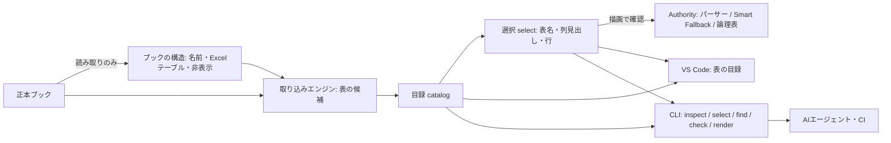

# 表の走査と選択（Excelを開かずに）

- 状態: 試作（エンジン・CLI・VS Codeの表の目録・単体テスト・拡張機能ホストでの確認まで）。画面操作の目視確認と、利用者・AIエージェントでの価値確認は未実施。
- 関連: [ADR-0019](../01_Plans/adr/ADR-0019-ai-era-sier-document-value-and-policy.md)（経路A・B）、[ADR-0022](../01_Plans/adr/ADR-0022-semantic-selection-in-notation.md)（記法での扱い、Proposed）、[ADR-0018](../01_Plans/adr/ADR-0018-cognitive-assistance-plane.md)、[取り込み支援](import-assistance.md)、[issue-0206](../01_Plans/issues/issue-0206-table-navigation-and-agent-interface.md)

人もAIエージェントも、Excelを開かずにブックの表を見渡し、表を名前で、列を見出しで、行を文字列や件数で選び、描画で確かめた参照を得られるようにする。同じエンジンを、人はVS Codeの表の目録から、AIはCLIから使う。入力支援と診断も、人とAIの両方に開く。

## 1. 構成



| 場所 | 責務 |
| --- | --- |
| `src/importAssist/workbookStructure.ts` | ブック自身の宣言を読む: 名前付き範囲、Excelテーブル、シートの表示状態、非表示の行・列、オートフィルター |
| `src/navigate/catalog.ts` | 目録: ブック→シート→表→列。表の出所、名前、本体の行数、注意、確認済みの参照 |
| `src/navigate/select.ts` | 意味による選択を記法v1へ写し、描画で確かめる |
| `src/core/evaluateEmbed.ts` | 参照1件の評価（プレビューとCLIが共有する唯一の判定経路） |
| `src/cli/mmi.ts` | AI・CI・端末向けの入口 |
| `src/dx/tableCatalogView.ts` | VS Codeのエクスプローラーの「MMI 表の目録」 |

## 2. Excelの機能への対応（2026-09-27の実測）

Excel 2016（Professional Plus）で作ったブック（`test/fixtures/excel-authored/`）と、公開されたファイル形式に沿って組んだ部品で確かめた。読込みはSheetJS 0.20.3。

| 機能 | 読込み | 描画（記法v1） | 入力支援 |
| --- | --- | --- | --- |
| .xlsx / .xlsm / .xlsb / .xls | 4形式とも同じ値 | 可 | 補完・検索・取り込み・目録の対象の拡張子は[§7](#7-残ることと判断が要ること)を参照 |
| 名前付き範囲（範囲・セル・行・列・シート単位） | 可（.xlsは列を`D1:D65536`で持つので列として扱う） | 名前では書けない。A1範囲で書く | 目録・取り込みに名前を表示。名前で表を選べる |
| 動的な名前（OFFSETなど）・定数・`#REF!`の名前 | 定義だけ取れる | 不可（MMIは数式を評価しない） | 「参照にできない理由」として示す |
| Excelテーブル（ListObject） | .xlsx/.xlsmは定義を読む。.xlsb/.xlsは読まない | A1範囲で書く | 推定より優先して表の候補にする。集計行は範囲から外して示す |
| 構造化参照・計算列 | 保存された値を読む | 値として表示 | ― |
| スピル（動的配列） | スピルした値を保存値として読む | 値として表示（再計算はしない） | ― |
| LET / LAMBDA など新しい関数 | 保存された値を読む | 値として表示 | このExcelでは作成できず、部品での確認のみ |
| セル内チェックボックス | `TRUE`/`FALSE` | 文字の`TRUE`/`FALSE`で表示 | ― |
| セル内画像 | 空のセルとして読まれる | 空欄（落ちたことは示されない） | 未対応（検出は次の一手） |
| 通貨・割合・日付の表示形式、エラー値 | Excelの表示どおりの文字列 | 可 | ― |
| 非表示の行・列、フィルター・折りたたみで隠れた行 | 構造として読める | **表示される**（Excelと違う） | 範囲内にあれば注意に出す |
| 非表示・非常に非表示のシート | 読める | 表示される | 目録・下書きに表示状態を示す |
| 条件付き書式・テーブルスタイル・データの入力規則 | 値に影響しない | 値だけを表示 | ― |

このExcelでは、スピル、LET/LAMBDA、セル内チェックボックス、スレッド形式のコメントを作れなかった。Microsoft 365で作ったファイルでの確認は未実施である。

## 3. 目録（catalog）

`describeWorkbook`は、シートごとに次を返す。

- 表示状態と使用範囲
- 表: ID（`シート!A1範囲`）、表題、出所（Excelテーブルか推定か）、名前、列（見出し・`columns=`用の列文字・シート上の列）、本体の行数、注意、確認済みの参照
- 表ではない領域（役割と範囲。枠・記入欄はラベルだけ）

既定では構造だけを返す。見出し・表題・名前は参照に書く必要があるので含めるが、本体の値（見本行、文章の抜粋）は明示したときだけ返す。出力が利用者のAIの提供元へ送られ得るためである（ADR-0019 D7）。

## 4. 選択（select）

| 指定 | 記法v1への写し方 | 描画での確認 |
| --- | --- | --- |
| 表: Excelテーブル名、名前付き範囲、表題（番号を除いても可）、ID、A1範囲 | その表の範囲 | 同じ名前の表が複数あれば候補を示して止める |
| 列: 見出し名 | `columns=`（範囲の先頭をAとする列文字。方眼紙は結合の起点列） | 見出しの打ち間違いには近い見出しを示す。同名の見出しが複数なら止める |
| 行: 文字列（列を指定できる） | `grep=` | 指定した列に含む行数と、表示される行数を比べる。違えば件数付きで知らせる |
| 行: 先頭から件数 | 範囲の終わりを狭める | ― |

`grep`は表示する列だけを対象にする（§6の順序）。そのため、絞り込みに使う列を表示しない選択はできない（理由を示して止める）。論理表が表示の閾値に収まり、切り出しが閾値を超える場合だけ`mode=table`を付ける。

記法に意味による指定を加えるかは[ADR-0022](../01_Plans/adr/ADR-0022-semantic-selection-in-notation.md)で判断する。

## 5. AIエージェントとCIの入口（CLI）

```text
mmi inspect <ブック> [--doc <md>] [--sample <行数>] [--values] [--json]
mmi select <ブック> --table <表名|範囲> [--sheet <シート>] [--columns <見出し,見出し>]
           [--contains <文字列> [--in <見出し>] | --first <行数>] [--doc <md>] [--json]
mmi find "<説明>" [--root <フォルダ>] [--doc <md>] [--json]
mmi check <md>... [--root <フォルダ>] [--json] [--strict]
mmi render <md> [--root <フォルダ>] [--format md|html] [--out <ファイル>]
```

- **読むだけ。** どのコマンドも正本を変えない。
- **終了コード。** `check`は参照にエラーがあれば1、`select`は選択できなければ1、使い方の誤りは2。
- **出力。** `--json`は`schema`付きのJSON（`mmi.cli/v0`、`mmi.catalog/v0`、`mmi.selection/v0`）。`select`の標準出力は参照だけで、補足は標準エラーに出す。
- **検証。** `check`は、VS CodeのProblemsパネルと同じ診断コードに、描画して初めて分かる失敗（`MMI_RENDER_ERROR`）を加える。
- **読み戻し。** `render --format md`は、参照を普通のMarkdownの表に展開する。AIは、本文の主張と表が矛盾しないかを読み戻して確かめられる。

実行方法は`npm run mmi -- <コマンド>`、またはビルド後の`node dist/src/cli/mmi.js`。配布形態（npm、単体の実行ファイル、拡張への同梱）はADR-0019の未解決事項である。AI向けの使い方は[AIエージェント向けの手引き](../04_Documentation/ai-agent-guide.md)に書いた。

## 6. 人の入口（VS Codeの表の目録）

エクスプローラーの「MMI 表の目録」に、ワークスペースのブック→シート→表→列が並ぶ。

- シートには表示状態、表には範囲・行数・注意、列にはシート上の列が出る。
- 表のボタン「この表の参照を挿入」「列と行を選んで挿入」から参照を作る。列は見出しで選び、行は「すべて／文字列を含む行（列を指定できる）／先頭からの行数」から選ぶ。
- どちらも案内付きの作成の確認の段（実際の描画）を通ってから挿入する。
- ブックが変わると目録を作り直す。

## 7. 残ることと判断が要ること

- **記法:** 列の見出し名・名前・テーブルによる指定、列を指定した行の選択、非表示の扱い（[ADR-0022](../01_Plans/adr/ADR-0022-semantic-selection-in-notation.md)）。
- **拡張子:** 補完・検索・取り込み・目録の対象に.xlsm・.xlsbを加えるか。読込み・描画は4形式とも同じ値で確認済み。
  - `.xlsm`はマクロ付きのOOXMLで、MMIはマクロを実行しない。
  - 現在は、補完・検索・取り込み・目録のいずれも`xlsx/xls/csv/xml`を対象にしている。CLIは.xlsm・.xlsbも受け付ける。
- **未確認:** Microsoft 365で作ったファイル（スピル、チェックボックス、セル内画像、リンクされたデータ型）での確認。セル内画像が空欄になることの検出。
- **観測:** AIエージェントが指示と`mmi`だけで参照付きの章を書き、`check`が0件になるか（ADR-0019の優先度1の到達の目安）。人が目録から選ぶ時間と、Excelを開いて座標を調べる時間の比較。
