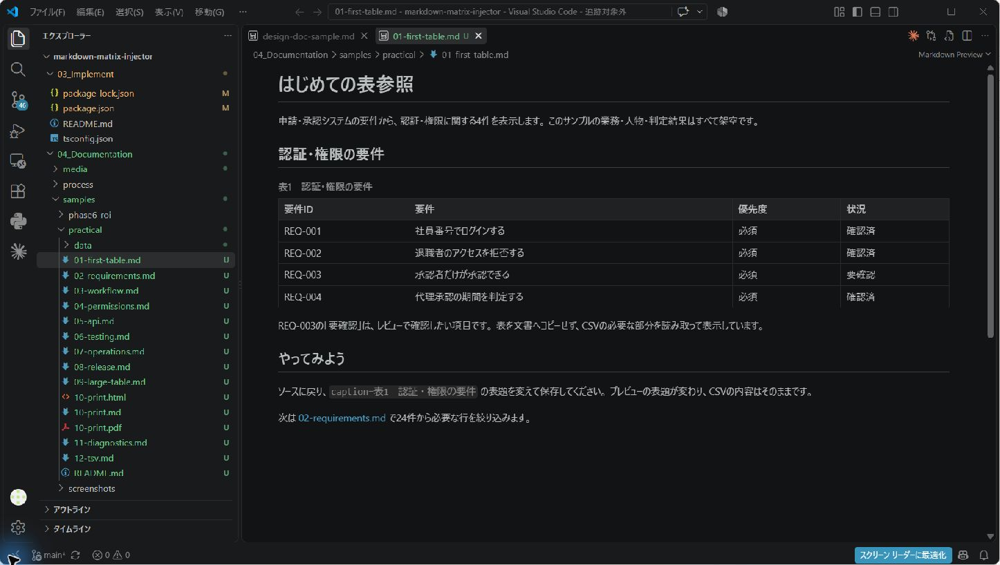

# Markdown Matrix Injector（MMI）

Excel・CSV・XMLの表をMarkdownから読み取り専用で参照する拡張です。
要件、権限、試験結果などを元データで管理し、文書には必要な行と列だけを表示できます。



## 最初の表を表示する

1. Markdownと、参照するCSVまたはExcelを同じ作業フォルダーへ置きます。
2. Markdownへ次のような参照を書きます。
3. `Ctrl+Shift+V` でプレビューを開きます。

```md
![[./data.csv#Sheet1|A1:C5?header=first&caption=確認する項目]]
```

CSVのA〜C列、1〜5行目を読み、先頭行を見出しにします。
参照をコードブロックで囲まず、本文の独立した行に書いてください。
この例の `data.csv` は自分のファイル名へ置き換えます。

## 表の見せ方

- `columns=A,C`：列を選びます。
- `grep=要確認`：文字を含む行だけを表示します。
- `highlightColumn=状況&highlightValue=要確認`：一致する行を強調します。
- `transpose=true`：縦横を反転します。
- `caption=確認対象`：表題を付けます。
- `mode=card`：別紙カードにします。

大きい範囲は自動でカードになります。列を絞って表として表示するときは `mode=table` も指定します。
ファイル名リンクはVS Code内、「外部アプリで開く」はOSの既定アプリで開く操作です。
外部オープンは信頼済みのローカルワークスペース内の表データを対象にします。

## 参照を作る・探す・直す

どの方法でも、選んで表示を確かめてから挿入します。自動では確定せず、元データも書き換えません。

- **補完**: `![[`の後にブック・シート・範囲（選んだシートの表を表題・見出し付きで）・指定と値が出ます。カーソル位置の値だけが置き換わります。
- **`MMI: 参照を作成・編集`**（右クリック、Ctrl+Alt+M）: ブック→シート→範囲→表示の指定→確認（実際の表示を先に確認）。既存の参照では変えた指定だけを書き換え、Ctrl+Z 1回で戻せます。
- **`MMI: 説明から表を探して参照を挿入`**: 「状態遷移表のIDと操作を見せて」のように入力します。記法で表せない依頼（集計・比較・否定・並べ替え）は理由を示して断ります。索引はメモリ上だけに持ちます。
- **ホバーと修正候補**: 参照にマウスを乗せると表示の先頭行が出ます。見つからないシート名・ファイル名や`mode=tabel`のような打ち間違いには、実在する候補への置き換えが出ます。
- **Excelのコピーから**: `MMI: コピーした範囲と同じ内容の表を探して参照を挿入`。同じ値の範囲を探し、表題と前後の行で見分けて選びます。

はじめての方は「ようこそ」→「チュートリアル」の **MMIをはじめる** を開いてください。

## 納品一覧

Markdownのソースを開き、コマンドパレットから `MMI: Generate Delivery Manifest` を実行します。
隣に `.delivery-manifest.csv` が作成されます。カード扱いの参照を記録するチェックリストであり、元データのコピーは行いません。
同名の一覧は再実行時に上書きされます。

## 対応範囲

Excel（XLSX/XLS）、UTF-8のCSV、TSV、XML Spreadsheet 2003を表示します。
画像・図形・マクロ・Excelの配色や結合セルの再現、数式の再計算は対象外です。
ファイルの補完・シート補完・参照先の診断を備えています。貼り付けは元アプリが渡す情報に依存します。

MMIは元データを書き換えません。外部アプリを開いた後に編集・保存した場合は、通常どおり変更されます。

## PDFを作るには

MMIで表を展開したHTMLを別のPDF生成器へ渡します。
確認済みの例はWeasyPrint 69.0です。一般のMarkdown変換や別のPDF拡張で同じように動くとは限りません。

## 詳しい説明とサンプル

本VSIXは公開準備用の検証版です。配布セットには、日本語チュートリアル・利用マニュアル・12本の実務サンプル・画面資料を含みます。
配布セットの `04_Documentation/tutorial.md` を開いてください。

プロジェクトの公開情報は [GitHubリポジトリ](https://github.com/hat47x/markdown-matrix-injector) を参照してください。検証版の最新文書は同梱セットを正とします。

最低対応はVS Code 1.100.0です（拡張機能をESMで配布しており、VS Code 1.99以前は読み込めません。2026-09-24に1.96.0・1.99.0で起動しないこと、1.100.0で全機能が動くことを確認）。Windowsでの実機確認はVS Code 1.136.1、Linux（WSL2）での自動確認は1.100.0と1.139.0です。

## ライセンス

MIT
