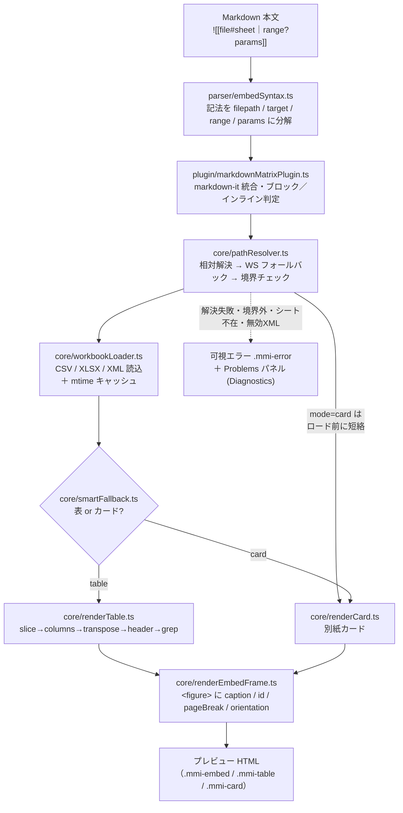
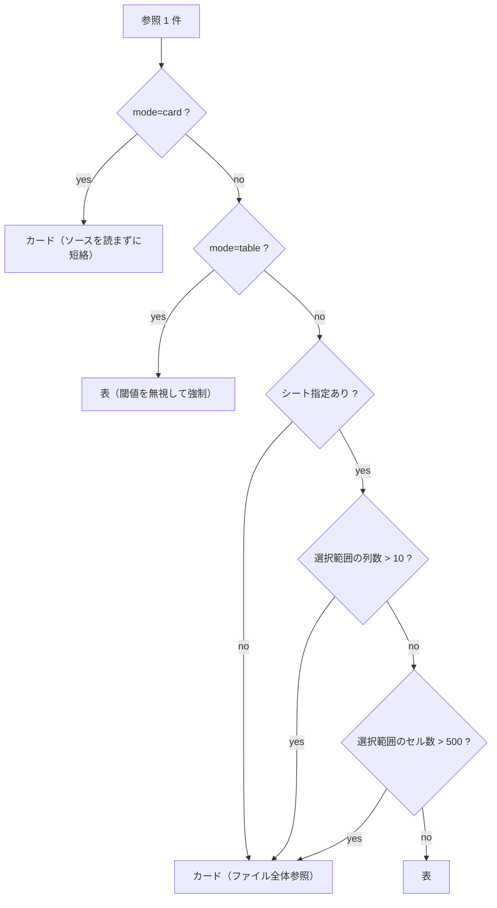

# MMI 動作リファレンス — How It Works

`![[...]]` と書いた 1 行が、VS Code プレビューの表（またはカード）に変わるまでに、
拡張の内部で **何が・どの順序で・どのコードによって** 起きるのかを 1 本で追える文書です。
フェーズ史（Phase 1〜12）ではなく **挙動そのもの** を索引にしているので、
「この動きはどこで決まっているのか」を最小コストで特定できます。

## この文書の位置づけ

- **対象読者**: 製品の内部挙動を深く理解したい人（新規コントリビューター、保守担当、上級利用者、AI エージェント開発者）。
- **前提**: `overview.md` / `tutorial.md` で「何ができるか」は把握済みであること。本書は「なぜそう動くか」を扱います。
- **正本との関係**: 挙動の**規範**は `spec/mmi-notation-v1.md`、**要件**は `00_Prompt/requirements.md`。本書と規範に齟齬があれば規範が優先します。本書は「規範がコードのどこで・どう実現されているか」を橋渡しする実装解説です。
- **読み方**: §1 の全体像 → §2 の実行トレースだけで 10 分で骨格がつかめます。特定の挙動を深掘りするときに §3 以降を辞書的に参照してください。

## 目次

1. [全体像（1 枚絵と責務マップ）](#1-全体像)
2. [エンドツーエンドの実行トレース](#2-エンドツーエンドの実行トレース)
3. [ステージ詳細](#3-ステージ詳細)
4. [Smart Fallback の判定ロジック](#4-smart-fallback-の判定ロジック)
5. [変換パイプライン（決定論の心臓部）](#5-変換パイプライン決定論の心臓部)
6. [静的解析（Diagnostics）](#6-静的解析diagnostics)
7. [コマンドと DX](#7-コマンドと-dx)
8. [失敗時の挙動と切り分け早見表](#8-失敗時の挙動と切り分け早見表)
9. [設計原則 P1–P8 とコードの対応](#9-設計原則-p1p8-とコードの対応)
10. [コードマップ早見表](#10-コードマップ早見表)
11. [用語集](#11-用語集)

---

## 1. 全体像

MMI は「正本の表データ（CSV / XLSX / XML）を、テキスト文書から**読み取り専用で参照**する」ための
記法とその VS Code 実装です。参照 1 件は、次のパイプラインを一方向に流れて HTML になります。



### 責務マップ

各モジュールは 1 つの関心事だけを持ち、`vscode` API への依存はコア（`core/` `parser/`）から排除されています。
これによりコアは純関数として単体テストでき、パイプラインの挙動は VS Code なしで再現できます。

| 層 | モジュール | 責務 | vscode 依存 |
|---|---|---|---|
| パーサ | `parser/embedSyntax.ts` | `![[...]]` の抽出と構造分解 | なし |
| 統合 | `plugin/markdownMatrixPlugin.ts` | markdown-it への接続、ブロック／インライン描画の切替、例外の可視化 | なし |
| 解決 | `core/pathResolver.ts` | パス解決とワークスペース境界の封じ込め（P4） | なし |
| 読込 | `core/workbookLoader.ts` | 形式別ロード（CSV/XLSX/XML）と正規化 | なし |
| キャッシュ | `cache/workbookCache.ts` | mtime キーの再利用 | なし |
| 判定 | `core/smartFallback.ts` | 表 / カードの分岐判定 | なし |
| 幾何 | `core/tableGeometry.ts` | A1 範囲の切り出し（`sliceRange` / `parseCellRef` / `columnToIndex`） | なし |
| 変換 | `core/renderTable.ts` | 論理表の構成と HTML テーブル化 | なし |
| 描画 | `core/renderCard.ts` / `core/renderEmbedFrame.ts` / `core/html.ts` | カード・フレーム化・HTML エスケープ | なし |
| 診断 | `dx/diagnostics.ts` | 安定コードの静的解析 | なし（純ロジック） |
| 宿主 | `extension.ts` / `dx/vscodeAdapters.ts` ほか | コマンド登録・プレビュー接続・補完・Paste/D&D | あり |

> **設計の要点**: 図の実線はすべて「純粋なコア」を通り、`vscode` に触れるのは最外周（`extension.ts` と `dx/` の一部）だけです。「挙動を理解する」ときは `core/` と `parser/` を読めば十分で、宿主層は"配線"にすぎません。

---

## 2. エンドツーエンドの実行トレース

次の 1 行が描画されるまでを、実際の関数呼び出し順で追います。

```md
![[./data/authz.csv#Sheet1|A1:C4?header=first&grep=admin&caption=権限一覧]]
```

1. **抽出** — `extractEmbedQueries()`（`embedSyntax.ts`）が本文から `![[...]]` を非貪欲に拾い、
   `{ filepath: "./data/authz.csv", target: "Sheet1", range: "A1:C4", params: {header:"first", grep:"admin", caption:"権限一覧"}, raw }` を返す。
2. **ブロック判定** — `markdownMatrixPlugin` が、この段落が「埋め込みだけの独立段落」かを判定。
   独立なら後で `<p>` を付けずに **ブロック HTML** として差し込む（理由は §3.7）。
3. **パス解決** — `resolveSourcePath()`（`pathResolver.ts`）が Markdown ファイル基準で
   `.../data/authz.csv` を解決し、ワークスペース境界内かを realpath で検査。
4. **短絡判定** — `shouldRenderAsCardImmediately()` を確認。`mode=card` ではないのでカード短絡はせず、次へ。
5. **読込** — `loadWorkbook()`（`workbookLoader.ts`）が拡張子 `.csv` を見て RFC4180 パーサで読み、
   `{ sheets: { Sheet1: string[][] } }` を返す。同一 mtime の再描画では `WorkbookCache` から再利用。
6. **表 / カード判定** — `shouldRenderAsCardAfterLoad()`（`smartFallback.ts`）。
   シート指定あり・`A1:C4` は 3 列 12 セルで閾値（10 列 / 500 セル）内なので **表**。
7. **変換** — `renderEmbedTable()`（`renderTable.ts`）が
   `slice(A1:C4)` → `columns`（無指定）→ `transpose`（無指定）→ `header=first`（1 行目をヘッダ化）→ `grep=admin`（"admin" を含む行だけ残す）
   の順で論理表を構成し、`<table class="mmi-table">…` を生成。
8. **フレーム化** — `renderEmbedFrame()`（`renderEmbedFrame.ts`）が
   `<figure class="mmi-embed"><figcaption class="mmi-embed__caption">権限一覧</figcaption> …table… </figure>` に包む。
9. **描画** — 生成 HTML がプレビューへ。CSS（`media/markdown-matrix.css`）が体裁を与える。

どこかで例外（ファイル不在・シート不在・無効 XML・境界外）が起きた場合は、
手順 7–8 の代わりに `<div class="mmi-error">…</div>` が出力され（P2: 可視劣化）、
同じ条件は編集中に Diagnostics が Problems パネルへ先出しします（§6）。

---

## 3. ステージ詳細

### 3.1 記法のパース — `parser/embedSyntax.ts`

`body`（`![[` と `]]` の中身）を次の規則で分解します（規範は spec §3.1）。

- `body` を **最初の `|`** で 2 分割 → 前半 `pathAndTarget` / 後半 `rangeAndParams`。
- `pathAndTarget` を **最初の `#`** で分割 → `filepath` / `target`（シート名）。
- `rangeAndParams` があれば **最初の `?`** で `range` / `params` に分割。
  `|` が無いときは `target`（=`pathAndTarget`）内の `?` 以降を `params` とみなす。
- `filepath` は前後空白を除去。**空なら記法として扱わず原文のまま残す**（`null` を返す）。
- `params` は `URLSearchParams`（`&` 区切り・パーセントデコード・同名キー複数可）。

抽出には 2 つの入口があります。**ブロック用**の `parseEmbedSyntax()` は行全体アンカー（`^!\[\[...\]\]$`）、
**インライン用**の `extractEmbedQueries()` は非貪欲グローバル（`!\[\[(.+?)\]\]`）で、
1 行に複数・文中混在の参照を拾えます。

例:

| 記法 | filepath | target | range | params |
|---|---|---|---|---|
| `![[a.csv#S1｜A1:C4?header=first]]` | `a.csv` | `S1` | `A1:C4` | `header=first` |
| `![[a.csv?mode=card]]` | `a.csv` | – | – | `mode=card` |
| `![[a.xlsx#売上]]` | `a.xlsx` | `売上` | – | – |

### 3.2 パス解決とセキュリティ境界 — `core/pathResolver.ts`

参照先ファイルを次の順で探し、**最初に実在した候補**を返します。

1. **参照元 Markdown ファイルからの相対パス**（第一優先）。
2. 見つからなければ **ワークスペースルートからの相対パス**（フォールバック）。

そのうえで **封じ込め（Containment, P4）** を必ず検査します。

- 境界は「ワークスペースルート（あれば）」、単体ファイル時は「Markdown のあるディレクトリ」。
- 候補は `fs.realpathSync` で実体パスに解決してから境界内かを判定 → **シンボリックリンクによる境界外への抜け道を封じる**。
- 境界外なら `PathContainmentError`、どの候補も無ければ「Unable to resolve source file」を送出（いずれも可視エラー＋ Diagnostics 対象）。
- 判定に通れば **実体パスではなく元の候補パス**を返す（以降のファイルアクセスは作者が書いたパスで行う）。

> ネットワーク取得はコアに含みません（P4）。参照はワークスペース境界内のローカルファイルに限定されます。

### 3.3 ソースの読み込み — `core/workbookLoader.ts`

拡張子で分岐します。

| 形式 | 処理 | 要点 |
|---|---|---|
| `.csv` | 自前の **RFC4180 パーサ**（`parseCsv`） | クォート内のカンマ・改行・`""` エスケープを正しく処理。単一シート `Sheet1` として扱う。BOM 除去・全体 trim。非クォートセルは trim、クォートセルは**逐語保持**。 |
| `.xml` | **署名検証**後に SheetJS へ | 先頭に `mso-application progid="Excel.Sheet"` 等が無ければ「Unsupported XML format」で中断（正本は読まない）。汎用 XML は拒否。 |
| その他（`.xlsx` 等） | SheetJS `XLSX.readFile` | `dense:true` で読み、`sheet_to_json({ header:1, raw:false, blankrows:false })` で行列化。`null` セルは空文字に。 |

**日付の正規化（issue-0107）**: XLSX / XML の **Excel が日付型として持つセル**は
`cellDates:true, dateNF:'yyyy-mm-dd'` により **ISO 8601（`YYYY-MM-DD`）** で描画します。
ロケール依存の曖昧表記（`4/3/26` が 4 月 3 日か 3 月 4 日か）を避けるためです。
日付「らしく見えるだけのテキスト」や非日付の数値は対象外。CSV はセル型を持たないためこの正規化の対象外です。

### 3.4 キャッシュ — `cache/workbookCache.ts`

`WorkbookCache` は **パス → { mtimeMs, 解析済みデータ }** の Map です。
`getOrCreate(path, snapshot, loader)` は、記録された `mtimeMs` が現在のファイルと一致すれば
解析済みデータを返し、**mtime が変われば破棄して再読込**します。
プレビュー統合（`extendMarkdownIt`）は拡張ホストの生存期間で **1 つのキャッシュを共有**するため、
プレビュー再描画のたびに同じファイルを読み直しません。正本が編集されれば mtime が動き、自動的に最新化されます。

### 3.5 表 / カードの分岐 — `core/smartFallback.ts`

§4 に判定表と決定木を独立して記載します。ポイントは **2 段階**であること。

- **即時判定**（読込前）: `mode=card` のときだけカードへ短絡し、`loadWorkbook` を呼ばず **ソースの内容を読み込みません**（巨大ファイルでもコンテキストを消費しない）。※パス解決による存在確認だけは行われます。
- **読込後判定**: 実際の選択範囲の行数・列数・セル数を使って最終決定。

### 3.6 変換と描画 — `core/renderTable.ts` / `renderCard.ts` / `renderEmbedFrame.ts`

- **表**: §5 のパイプラインで論理表を作り、`<table class="mmi-table">`（`<thead>`/`<tbody>`、ハイライト行・整形セル付き）を生成。
- **カード**: `<div class="mmi-card" data-path="絶対パス">` にファイル名リンク・シート/範囲メタ・「外部アプリで開く」ボタン（拡張URI, ADR-0015）を出力。絶対パスは機械可読属性 `data-path` に保持。
- **フレーム**: 表・カードのどちらも最後に `renderEmbedFrame()` が `<figure class="mmi-embed">` で包み、
  `caption` → `<figcaption>`、`id` → `id` 属性、`pageBreak`（`before`/`after`/`both`）→ `data-page-break`、
  `orientation`（`landscape`/`portrait`）→ `data-orientation` を付与。**規定外の値は黙って無効化**（安全な劣化）。

すべての文字列出力は `core/html.ts` の `escapeHtml()` を共有し、`&`→`<`→`>`→`"` の順でエスケープします
（`&` を最初に処理しないと二重エスケープになるため順序が規範）。

### 3.7 markdown-it への統合とブロック / インライン判定 — `plugin/markdownMatrixPlugin.ts`

パース時と描画時を分けて処理します。VS Codeの標準Markdown拡張は、パース後の描画時に文書URIを渡すためです。

- coreルールは独立段落を `mmi_embed_block`、文中の記法を `mmi_embed_inline` トークンに変換します。元の記法と行情報を保持します。
- rendererルールが描画時の `env.currentDocument.fsPath` または設定された `markdownFilePath` から参照先を解決し、表・カード・エラーを出力します。
- 文書パスがない場合は、元の記法をエスケープして表示します。パース済みトークンを別文書で再利用しても、描画時の文書を基準にします。
- 独立段落では段落タグを外し、表を段落内に入れません。文中混在では周囲の文章をエスケープして保持します。
- `activate()` は `{ extendMarkdownIt }` を返します。この公開APIを標準Markdown拡張が取得します。Extension Hostのテストも、この実際の公開APIを通して検証します。
- 参照の読込エラーは `<div class="mmi-error">` として描画します。

---

## 4. Smart Fallback の判定ロジック

巨大な表を文書に直接展開すると可読性と印刷体裁が崩れるため、MMI は条件に応じて
**表**か**カード（別紙参照）**かを自動で選びます（`core/smartFallback.ts`）。閾値は
`MAX_COLUMNS_BEFORE_CARD = 10`、`MAX_CELLS_BEFORE_CARD = 500`（いずれも**超過**でカード）。



| # | 条件 | 結果 | 判定段階 | `reason` コード |
|---|---|---|---|---|
| 1 | `mode=card` | カード | 即時（**読込前に短絡**） | `explicit-card-mode` |
| 2 | `mode=table` | 表（閾値無視） | 読込後 | `explicit-table-mode` |
| 3 | シート未指定（ファイル全体参照） | カード | 読込後 | `missing-sheet-target` |
| 4 | 選択範囲の列数 > 10 | カード | 読込後 | `column-threshold-exceeded` |
| 5 | 選択範囲のセル数 > 500 | カード | 読込後 | `cell-threshold-exceeded` |
| 6 | 上記以外 | 表 | 読込後 | `within-table-threshold` |

- **計測は選択範囲（slice 後）**で行います。`columnCount` は最長行の列数、`cellCount` は各行の長さの合計、`rowCount` は行数。
- **即時判定でカードになるのは `mode=card` だけ**。この場合 `loadWorkbook` を呼ばずに描画するため、巨大な正本でもその内容を読み込まず、コンテキストを消費しません（context economy）。※パス解決による存在確認だけは行われます。
- `reason` コードは §7 の納品マニフェスト（`reason` 列）に人間可読ラベルとして落ちます（例: `列数が閾値(10)超過`）。

---

## 5. 変換パイプライン（決定論の心臓部）

`renderEmbedTable()`（`core/renderTable.ts`）は、**この順序でのみ**論理表を構成します。
順序が固定であることが決定論（P3）の根拠です。

| 順 | ステージ | パラメータ | 効果 | 論理表を変える |
|---|---|---|---|---|
| 1 | slice | `range` | A1 範囲で切り出し（単一セルは 1×1）。`core/tableGeometry.ts` が担当 | ○ |
| 2 | columns | `columns=A,C,F` | 指定列のみ抽出（A1 列文字・大小不問、欠損は空文字） | ○ |
| 3 | transpose | `transpose=true` | 行列反転（最長行に空文字補完） | ○ |
| 4 | header 分離 | `header=first` / `header=<n>` / `header=none` | ヘッダ行を本体から分離。`<n>` は**変換後**の第 n 行（1 始まり）、範囲外は可視エラー | ○ |
| 5 | grep | `grep=<kw>` | 本体行のうち、いずれかのセルに `<kw>` を含む行だけ残す（大小不問の部分一致、**0 行も正常**） | ○ |
| — | highlight | `highlightColumn` + `highlightValue` | 一致行へ `.mmi-table__row--highlight` を付与 | ×（装飾） |
| — | formatColumn | `formatColumn=<selector>:<format>` | 対象セルを `.mmi-table__cell-code` のコード表示に（不正指定は無視） | ×（装飾） |

**順序が効く例**:

- **header は grep より前**。だから grep はヘッダ行を絶対に消しません（ヘッダは本体から先に分離済み）。
- **columns は transpose より前**。`columns=A,C` で列を選んでから転置するので、「元表の A・C 列」が転置後の行になります。
- highlight / formatColumn は論理表を変えない**装飾**なので、どの行が残るか・どうヘッダが決まるかには影響しません。

`highlightColumn` と `formatColumn` の `<selector>` は、まず**ヘッダ名**（前後空白・大小無視で照合）、
無ければ **A1 列文字**として解決されます。

---

## 6. 静的解析（Diagnostics）

`dx/diagnostics.ts` は、描画を待たずに **編集中**（開く／変更／保存時）へ問題を Problems パネルへ先出しします。
コードは**安定 API**（P6）で、意味を変えません。AI エージェントが生成した文書のリンク健全性を
機械的に検証する土台になります。

| コード | 条件 | 優先度 | 描画時の対応 |
|---|---|---|---|
| `MMI_FILE_NOT_FOUND` | `target` が解決不能 | 0（最優先） | `.mmi-error` |
| `MMI_PATH_OUTSIDE_BOUNDARY` | ファイルは実在するが境界外（P4） | 0 | `.mmi-error` |
| `MMI_INVALID_XML` | XML 2003 署名不一致 | 1 | `.mmi-error`（正本は読み込まない） |
| `MMI_SHEET_NOT_FOUND` | 指定シートが不在 | 2 | `.mmi-error` |

- 重複時は **優先度 → 出現位置** の順で整列。すべて severity=`error`、source=`markdown-matrix-injector`。
- 配線は `extension.ts` の `refreshDiagnosticsForDocument()`。`onDidOpen/Change/Save` で更新、`onDidClose` で消去。
- 診断は「修正候補の提示」であり、正本の自動修復は行いません。

---

## 7. コマンドと DX

VS Code への接続点はすべて `extension.ts`。プレビュー本体は `extendMarkdownIt()`
（`contributes.markdown.markdownItPlugins`）が入口で、拡張ホストの生存期間で 1 つの `WorkbookCache` を共有します。

| コマンド ID | 表示名 | 動作 |
|---|---|---|
| `markdownMatrixInjector.generateDeliveryManifest` | MMI: Generate Delivery Manifest | カード化される埋め込みを抽出し `<名前>.delivery-manifest.csv`（列: `sourcePath, sheet, range, reason, caption, id`）を隣に出力。**リンク切れ・シート不在は含めない**（それらは Diagnostics 対象）。対象 0 件なら書かず通知のみ、未保存なら保存を促す。 |
| `markdownMatrixInjector.openSource` | MMI: Open Embed Source | カードの拡張URIハンドラーから共通処理で`env.openExternal`へ渡す。信頼済みのローカルワークスペース内の表データに限定する。元のcommand URI方式は標準プレビューで動作せずADR-0015で更新した。 |
| `markdownMatrixInjector.insertEmbedFromPaste` / `…FromDrop` | Paste / D&D 挿入 | クリップボードの HTML／ドロップファイルから `![[...]]` を生成挿入。ネイティブ provider 非対応の旧ホスト向け互換経路。 |
| `markdownMatrixInjector.insertEmbedByContentMatch` | MMI: Insert Embed by Content Match | クリップボードの`text/plain`（TSV）を`dx/contentMatchSearch.ts::findWorkbookContentMatches`へ渡し、ワークスペース内のワークブック（自動補完と同じglob）を横断して`core/contentMatch.ts::findContentMatches`で検索する。結果は必ず`showQuickPick`（1件でも）を経て挿入する（issue-0114作業D、2026-09-15）。 |

- **Autocomplete**: `![[` 入力後に `filepath` → `#sheet` → `range` → `?param` を段階提示（`dx/autocompleteProvider.ts`）。
- **ネイティブ Paste / D&D provider**: 対応ホストでは `registerDocumentPasteEditProvider` / `…DropEditProvider` を使用。実Excelコピーは原本パスを一切含まないため（実機確認済み）、通常のCtrl+Vではこの経路は実質的に発火しない。
- **`editor.action.pasteAs`（Ctrl+.）統合**（issue-0114作業D続き、2026-09-16）: `provideDocumentPasteEdits`は`context.triggerKind === vscode.DocumentPasteTriggerKind.PasteAs`のときだけ、上記content-match検索の結果を追加の`DocumentPasteEdit`として返す（`getContentMatchPasteEdits`）。VS Code公式の「PasteAsは挿入前に選択肢を出す」という仕様により、自前のUIなしでR1（自動確定しない）を満たす。**通常のCtrl+V（`Automatic`）ではこの検索を一切行わない**——`Automatic`は複数`DocumentPasteEdit`のうち最初の1件を即座に自動適用する仕様のため、そこに含めると未確認の推測が自動挿入されるリスクがある。`looksLikeTabularClipboard`が単一スカラー値の貼り付け（単語・URL等）を弾き、`MAX_CONTENT_MATCH_WORKSPACE_FILES`（500件）が病的に大きいワークスペースへの安全弁になる。ワークスペース全体検索の性能は実測済み（ネイティブファイルシステムで実サンプル30ファイル約20ms、300ファイル約65〜140ms、`/mnt/c`のようなWSL2↔Windowsブリッジは代表的でないため除外）。
- **テスト／開発専用コマンド**: `ExtensionMode.Test` または環境変数 `MMI_ENABLE_TEST_COMMANDS=1` のときだけ登録（`exportQueryEvidence` など）。query-evidence は「エージェントが書いた記載が正本と一致するか」を検証する ground truth を出力します。

---

## 8. 失敗時の挙動と切り分け早見表

MMI は失敗を**必ず可視化**します（P2）。原文がそのまま残るか、`.mmi-error` が出るかのどちらかで、
黙って空白になることはありません。

| 症状 | 主因 | 最初の確認 | 関連コード / 診断 |
|---|---|---|---|
| 表が出ず原文のまま | 記法が成立していない（空 filepath 等）／ドキュメントパス未解決 | `![[ ]]` の綴り、区切り記号（縦棒・`#`・`?`）の位置 | `embedSyntax.ts` |
| `.mmi-error`「Unable to resolve source file」 | 参照先が不在 | Markdown 基準の相対パス、ワークスペース内か | `pathResolver.ts` / `MMI_FILE_NOT_FOUND` |
| `.mmi-error`「outside workspace boundary」 | 境界外・シンボリックリンク越え | 参照先が WS 内の実体か | `pathResolver.ts` / `MMI_PATH_OUTSIDE_BOUNDARY` |
| `.mmi-error`「Sheet not found」 | シート名違い | `#シート名` の実在 | `renderTable.ts` / `MMI_SHEET_NOT_FOUND` |
| `.mmi-error`「Unsupported XML format」 | 汎用 XML | XML Spreadsheet 2003 か | `workbookLoader.ts` / `MMI_INVALID_XML` |
| 意図せずカード化 | 閾値超過／シート未指定 | 列 > 10・セル > 500・シート指定の有無 | `smartFallback.ts`（`mode=table` で上書き可） |
| `grep` で 0 行 | 大小・空白・対象列の想定違い | `grep` を外して切り分け | `renderTable.ts`（**0 行は仕様**） |
| 画面は正しいが PDF だけ崩れる | PDF 生成器依存 | まず画面で属性付与を確認、その後に生成器差分 | `renderEmbedFrame.ts` ＋ 生成器 |

---

## 9. 設計原則 P1–P8 とコードの対応

規範（`spec/mmi-notation-v1.md` §2）の 8 原則が、実装のどこで守られているかの対応表です。

| 原則 | 規範 | 実装での担保 |
|---|---|---|
| P1 Read-only | 正本を改変しない | 全経路が読み取り（`readFileSync` / `XLSX.readFile`）のみ。書き込み API を一切持たない |
| P2 Visible degradation | 失敗を沈黙で隠さない | `markdownMatrixPlugin` の `try/catch` → `.mmi-error`。未解釈でも原文が可視 |
| P3 Determinism | 同一入力 → 同一表 | 固定順パイプライン（§5）＋ 判定と描画で **同一の `tableGeometry`** を共有し slice がずれない |
| P4 Containment | 境界内に限定 | `pathResolver` の realpath 境界チェック。ネットワーク非対応 |
| P5 Forward compatibility | 未知キーは無視 | `URLSearchParams`。参照しないキーは単に無視される |
| P6 Stable diagnostics | コードは安定 | `dx/diagnostics.ts` の `DiagnosticCode` 型が固定 |
| P7 i18n 中立 | キーは ASCII、値は Unicode | パラメータキーは ASCII、出版概念は Delivery Profile に隔離 |
| P8 Machine-readable contract | 契約を機械可読で公開 | `spec/params.schema.json`、`test/conformance/cases.json` |

> §5 の「共有幾何」が P3 の肝です。もし Smart Fallback の見積りと実際の描画が別々の slice 実装を使っていたら、
> 「表としてサイズ判定したのに別の範囲を描画する」ズレが起こり得ます。`core/tableGeometry.ts` の 1 実装を
> 両者が使うことで、その齟齬を構造的に排除しています。

---

## 10. コードマップ早見表

| ファイル | 役割 | 主要 export | 主なテスト |
|---|---|---|---|
| `parser/embedSyntax.ts` | 記法分解 | `parseEmbedSyntax`, `extractEmbedQueries` | `embedSyntax.test.ts` |
| `core/pathResolver.ts` | 解決＋境界 | `resolveSourcePath`, `isPathWithinBoundary` | `pathResolver.test.ts` |
| `core/workbookLoader.ts` | 形式別読込 | `loadWorkbook`, `parseCsv` | `conformance.test.ts` ほか |
| `cache/workbookCache.ts` | mtime キャッシュ | `WorkbookCache` | `workbookCache.test.ts` |
| `core/smartFallback.ts` | 表／カード判定 | `evaluateSmartFallback`, `shouldRenderAsCard*` | `smartFallback.test.ts` |
| `core/tableGeometry.ts` | A1 幾何（共有） | `sliceRange`, `parseCellRef`, `columnToIndex` | `renderTable`／`smartFallback` 経由 |
| `core/renderTable.ts` | 変換＋表化 | `renderEmbedTable` | `markdownMatrixPlugin.test.ts` |
| `core/renderCard.ts` | カード | `renderEmbedCard` | `renderCard.test.ts` |
| `core/renderEmbedFrame.ts` | フレーム化 | `renderEmbedFrame` | `enterpriseOutput.test.ts` |
| `core/html.ts` | HTML エスケープ（共有） | `escapeHtml` | 全描画経由 |
| `plugin/markdownMatrixPlugin.ts` | markdown-it 統合 | `markdownMatrixPlugin` | `markdownMatrixPlugin.test.ts` |
| `dx/diagnostics.ts` | 静的解析 | `validateEmbedDiagnostics` | `diagnostics.test.ts` |
| `manifest/collectDeliveryManifest.ts` | 納品マニフェスト | `collectDeliveryManifestRecords`, `buildDeliveryManifestCsv` | `collectDeliveryManifest.test.ts` |
| `extension.ts` | 宿主配線 | `activate`, `extendMarkdownIt` | `extensionIntegration.test.ts` |

---

## 11. 用語集

- **正本 / source of truth**: 参照先の元データファイル（CSV/XLSX/XML）。MMI は決して書き換えない。
- **参照 / 埋め込み (embed)**: `![[...]]` 記法 1 件。
- **論理表 (logical table)**: 変換パイプライン（§5）を通した後・装飾前の行列。
- **カード / 別紙 (card)**: 表に展開せずリンク UI へ縮退した描画。
- **Smart Fallback**: 表かカードかの自動判定（§4）。
- **Delivery Profile (L3)**: 出版制御（`caption` / `id` / `pageBreak` / `orientation` / 別紙マニフェスト）。
- **conformance level L0–L3**: 準拠段階。上位は下位を包含する（規範 §8）。
- **Diagnostics**: 安定コードによる静的解析（§6）。
- **Containment**: ワークスペース境界の封じ込め（P4）。
- **context economy**: 巨大な正本を丸ごとコンテキストへ展開せず、必要な断面だけを参照する性質。

---

## 関連文書

- 規範（挙動の正本）: [`spec/mmi-notation-v1.md`](spec/mmi-notation-v1.md)
- パラメータ逆引き: [`reference.md`](reference.md)
- はじめの一歩: [`tutorial.md`](tutorial.md) / 価値と導線: [`overview.md`](overview.md)
- 機械可読契約: [`spec/params.schema.json`](spec/params.schema.json) / 準拠コーパス: `03_Implement/test/conformance/cases.json`
- 決定正本: [`ADR-0012`](../01_Plans/adr/ADR-0012-mission-redefinition-notation-as-governance-boundary.md)
