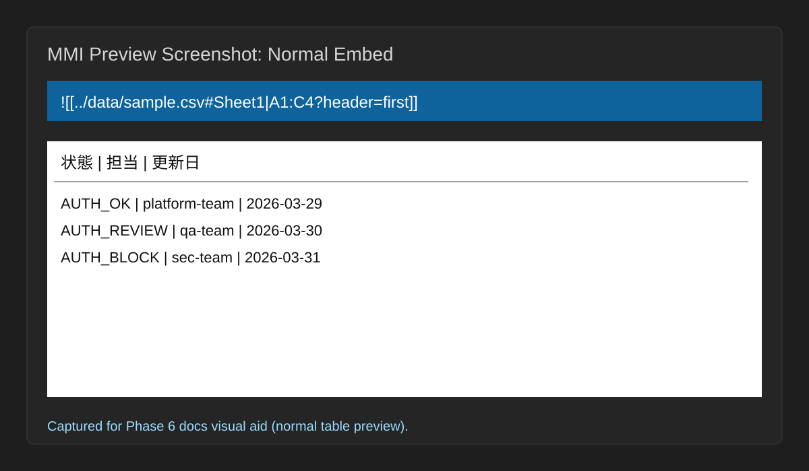

# Markdown Matrix Injector Overview

## Publication
- Public Gist: [https://gist.github.com/<YOUR_GITHUB_ACCOUNT>/mmi-overview](https://gist.github.com/<YOUR_GITHUB_ACCOUNT>/mmi-overview)
- Canonical source: `04_Documentation/overview.md`

## Target reader
- **導入判断者（マネージャー / テックリード）**: Word 中心運用から Markdown 中心運用へ移行する投資判断を行う人
- **PoC担当（評価・検証担当エンジニア）**: 30 分以内に「埋め込み成功」を再現し、採用可否を見極める人
- **運用担当（文書保守・納品担当）**: 正本データと納品文書の整合を日常運用で維持する人

## Prerequisites
- Markdown を日常的に編集していること
- 元データとして Excel / CSV / XML を保持していること
- 「文書に表を貼り付ける」のではなく「正本データを必要な文脈だけ見せたい」という課題を持っていること
- 追加評価を行う場合、`tutorial.md` と `reference.md` を参照できること

## Expected result
この文書を読むと、次の 3 点を短時間で説明・判断できるようになります。
1. Markdown Matrix Injector がどの課題を解き、どの読者にどんな価値を返すか。
2. 導入判断者・PoC担当・運用担当それぞれの「意思決定ポイント」（投資判断 / 採用可否 / 継続運用可否）。
3. 次に読むべき文書（Tutorial / Scenario / Reference）と、導入初期に把握すべき制約。

## Scope fixed from issue-0016 (overview対象)
- 本書で充足する受入条件は **「overview.md に対象ユーザー別の価値（導入判断者 / PoC担当 / 運用担当）を明記すること」**。
- Tutorial や README の受入条件は別ストリーム対象として扱い、本書では導線の参照のみを提供します。

## What this tool is
Markdown Matrix Injector は、Excel / CSV / XML を **Single Source of Truth** のまま保持しつつ、Markdown 上には必要な範囲だけをインライン表示するためのツールです。

このツールが重視するのは次の 3 点です。
1. **正本を壊さないこと**: 元データは編集せず、ビューアとして参照に徹します。
2. **Markdown の弱点を補うこと**: テーブルやマトリクスが多い設計文書でも、Markdown を中心に据えたまま運用できます。
3. **納品品質まで見据えること**: Smart Fallback や印刷制御により、巨大表や PDF 出力時の崩れを扱いやすくします。

## Reader-specific value
本セクションは、導入判断者 / PoC担当 / 運用担当の 3 ロールそれぞれに対し、意思決定で使える価値訴求を固定するための要約です。

### 導入判断者の価値
- 正本保護（read-only）と印刷要件対応（Smart Fallback / `pageBreak` / `orientation`）を同時に評価でき、導入リスクを早期に見積もれます。
- `Overview -> Tutorial -> Scenario -> Reference` の導線で、組織展開前に必要な説明責任の根拠を揃えられます。
- **意思決定で得る成果**: 「Word 代替としての導入に足るか」を、セキュア運用（正本保護）と納品品質（印刷制御）の両軸で判断できます。

### PoC担当の価値
- `![[...]]` 記法を起点に、`columns` / `grep` / `header` など最小パラメータで 30 分以内の「最初の成功」を再現できます。
- 失敗時も関連文書へ即遷移できるため、検証ログを残しながら採用判定を進めやすくなります。
- **意思決定で得る成果**: 「このチームで再現可能か」を、短時間で成功判定できる導線とトラブル初動の明確化で判断できます。

### 運用担当の価値
- 文書へ表を再貼り付けせず、正本データ参照に統一することで、改訂時の差分管理と整合確認（正本との突合）を軽量化できます。
- 巨大表をカード化する運用により、日常編集と納品体裁（印刷）を両立できます。
- **意思決定で得る成果**: 「運用を回し続けられるか」を、日常更新コストと納品時品質の両立可否で判断できます。

## Core capabilities at a glance
- `![[...]]` 記法で CSV / XLSX / XML Spreadsheet 2003 を埋め込む
- `columns`, `transpose`, `grep`, `header` などで必要な範囲だけ切り出す
- `caption`, `id`, `pageBreak`, `orientation` で印刷や相互参照を補助する
- 巨大表やファイル全体参照は Smart Fallback でカード表示へ縮退する
- Autocomplete / Diagnostics / Paste & D&D により記法入力を支援する

## Related docs
- **Adoption fast path**: `Overview -> Tutorial -> Scenario -> Reference`
- 最初に試す: `04_Documentation/tutorial.md`
- 業務シナリオを見る: `04_Documentation/scenario-sier-design-docs.md`
- 詳細仕様を引く: `04_Documentation/reference.md`

## Known limitations
- **プレビュー描画（G1）**: HTML 構造・クラス・属性は自動テスト（unit 167 件）で実証済み。実 VS Code プレビューの視覚スクリーンショットは GUI 環境での manual-e2e で確認してください（`04_Documentation/vscode-e2e-testing.md` の Checklist F 参照）。
- **PDF/印刷（G2）**: `pageBreak` / `orientation` のHTML 属性付与は実証済み。PDF への反映は利用する PDF 生成器に依存します。推奨は VS Code Markdown PDF 拡張（Chromium 系）または weasyprint。詳細は `04_Documentation/samples/sier-design/README.md`。
- **XML**: XML Spreadsheet 2003 のみ対応。汎用 XML はエラー表示になります。
- 実機 UI の最終確認には host 環境や VSCode バージョン差の影響があります。
- 本書は `overview.md` 単体の価値訴求を優先しており、操作手順の詳細は `tutorial.md` を参照してください。

## 視覚補助素材（比較表）
導入判断者が「どの文書から何を判断するか」を 1 分で把握できるよう、導線と判断目的を比較表で固定します。

| 文書 | 主な目的 | 典型読者 | この文書で判断すること |
|---|---|---|---|
| Overview | 価値と導線の把握 | 導入判断者 / PoC担当 / 運用担当 | 採用検討を進める価値があるか |
| Tutorial | 30分以内の初回成功再現 | PoC担当 | まず動かせるか、失敗時に復帰できるか |
| Scenario | 業務導入時の期待効果比較 | 導入判断者 / 運用担当 | 自組織で運用可能か |
| Reference | 記法・制約・一次対応の参照 | 実装/運用担当 | 問題時にどこを確認するか |

## FAQ（Overview）
### Q1. この文書だけで導入可否を決められますか？
A1. いいえ。Overview は「価値」と「導線」の判定入口です。最終判断は Tutorial の再現性と Scenario の運用適合を確認して行います。

### Q2. Word 代替の観点で最初に見るべき項目は何ですか？
A2. 正本保護（read-only）、巨大表対応（Smart Fallback）、印刷制御（`pageBreak` / `orientation`）の 3 点を優先して確認してください。

### Q3. どの読者がどの文書を先に読むべきですか？
A3. 原則は全員 `Overview -> Tutorial -> Scenario -> Reference` です。時間が限られる場合でも Overview の導線確認後に Tutorial へ進むことを推奨します。

## スクリーンショット（通常埋め込み）
通常の埋め込み表示イメージです。PoC 初動時に「テーブルとして表示される状態」の認識合わせに使用します。

