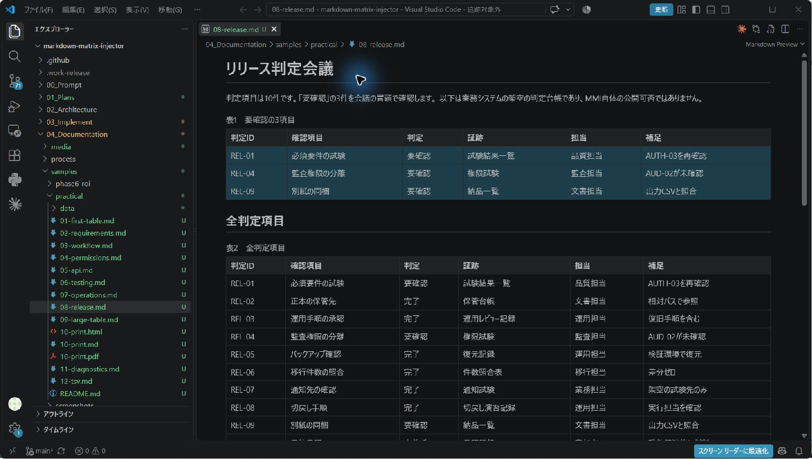
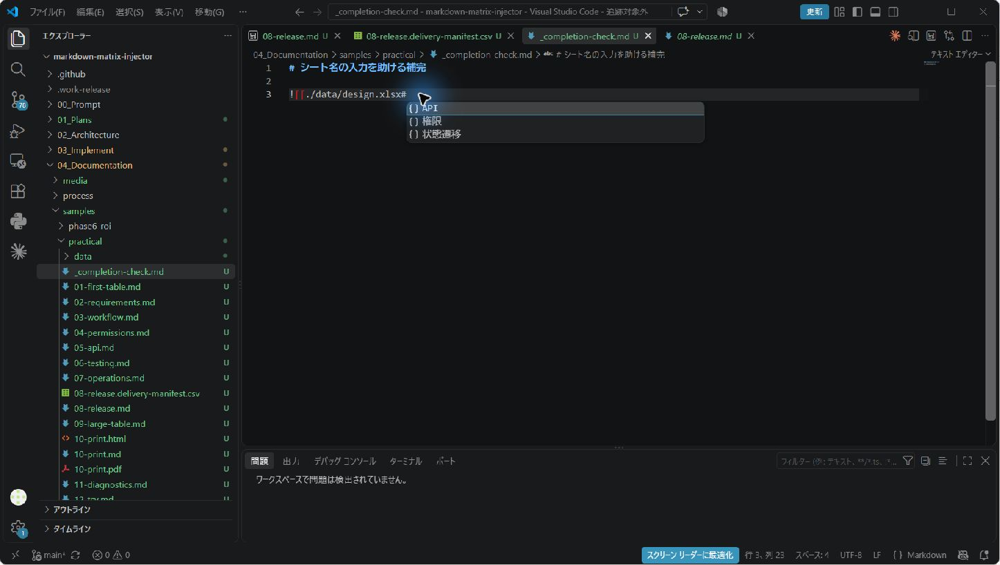

# はじめてのMMI：ExcelやCSVの表をMarkdownで読む

ExcelやCSVで管理している表を、設計書に何度も貼り付けていませんか。
MMIでは、参照するファイルと範囲をMarkdownに1行で指定すると、プレビューに表が表示されます。
この手順では、付属の申請・承認システムのサンプルを使います。元データはすべて架空のものです。

## 用意するもの

- デスクトップ版のVS Code。拡張の最低対応バージョンは1.96.0です。
- MMIのVSIXファイル。ここで使う検証版の番号は0.1.0です。
- [実務サンプル](samples/practical/README.md)のフォルダー一式。Markdownファイルだけでなく、`data`フォルダーも必要です。

拡張を使うだけなら、Node.jsや開発用のビルドは不要です。
このチュートリアルはWindowsでの操作を説明します。目安は15〜30分です。

## 1. MMIをインストールする

1. VS Codeで `Ctrl+Shift+P` を押します。
2. `Extensions: Install from VSIX...`（VSIXからのインストール）を検索します。
3. 手元のMMIの `.vsix` ファイルを選びます。
4. 更新後に再読み込みを求められたら、ウィンドウを再読み込みします。

左の拡張機能一覧で `Markdown Matrix Injector (MMI)` を確認します。
公開準備中のため、手元にあるVSIXファイルを使ってください。拡張機能の公開サイト（Marketplace）から取得する手順ではありません。

## 2. サンプルをフォルダーごと開く

VS Codeの「ファイル」→「フォルダーを開く」で `practical` を開きます。
リポジトリを取得済みの場合は `04_Documentation/samples/practical` にあります。

```text
practical/
  01-first-table.md
  02-requirements.md
  ...
  data/
    requirements.csv
    design.xlsx
    ...
```

ファイルを移動するときも、このフォルダーの位置関係を保ってください。
`./data/requirements.csv` は「このMarkdownと同じフォルダーにあるdataの中」という意味です。

## 3. 最初の表を表示する

`01-first-table.md` を開き、`Ctrl+Shift+V` を押してください。
「認証・権限の要件」という表題の下に、REQ-001〜REQ-004の4行が表示されれば成功です。


この表は、次の1行の記法によって表示されます。

```md
![[./data/requirements.csv#Sheet1|A1:G5?header=first&columns=A,C,D,G&caption=表1　認証・権限の要件]]
```

| 部分 | 意味 |
|---|---|
| `./data/requirements.csv` | 読み取るファイル |
| `#Sheet1` | CSVのシート名。CSVではこの名前を使います |
| `A1:G5` | A列からG列、1行目から5行目まで |
| `header=first` | 選んだ範囲の先頭行を見出しにする |
| `columns=A,C,D,G` | 範囲内のA・C・D・G列だけを見せる |
| `caption=...` | 表題を付ける |

見出しが1行、データが4行なので、指定する範囲は合計5行です。
記法は本文中に単独の行として書き、前後に空行を入れておくと読みやすくなります。
バッククォートで囲んだコード例は表に変換されません。

## 4. 表題を変えてみる

プレビュー右上の「ソース ファイルとして再度開く」を選び、Markdownの編集画面に戻ります。
`caption=表1　認証・権限の要件` を `caption=次回のレビュー対象` に変え、保存してください。
再びプレビューを開くと表題が変わります。この操作でCSVの値は変更されません。

## 5. 必要な行だけを読む

`02-requirements.md` を開きます。24件の中から、状態が「要確認」の5件だけを取り出す例です。

```md
![[./data/requirements.csv#Sheet1|A1:G25?header=first&columns=A,C,F,G&grep=要確認&highlightColumn=状況&highlightValue=要確認&caption=次回レビューの対象]]
```

REQ-003、REQ-008、REQ-010、REQ-016、REQ-024の5件が表示されます。
`grep`は行内の文字を部分一致で検索します。`columns`で列を絞った後の値が検索対象になるため、調べたい列を`columns`の指定から外さないでください。


以下の画像は`08-release.md`にあるリリース会議の例です。同じ絞り込みと強調表示を判定台帳でも使えます。



## 6. Excelのシートを参照する

`03-workflow.md` では、Excelの「状態遷移」シートを参照します。

```md
![[./data/design.xlsx#状態遷移|A1:F13?header=first&caption=状態遷移]]
```

12通りの状態遷移が表示されます。Excelの配色や結合セルを再現するのではなく、セルの値をMMIの表として表示します。
MMIで参照しても、元のExcelファイルは変更されません。

シート名を覚えていなくても、`#` の後で `Ctrl+Space` を押すと候補を選べます。



## 7. 大きな表は別紙にする

`09-large-table.md` には60件・11列の申請一覧があります。大きい範囲はカードで表示されます。


カードのファイル名はVS Code内で開くリンクです。「外部アプリで開く」は、その形式に関連付けられたアプリで開きます。
別紙を渡すときは、元のExcelやCSVも忘れずに同梱します。

必要な行と列を表として表示したい場合は、`mode=table`も指定します。

```md
![[./data/applications-wide.csv#Sheet1|A1:K61?mode=table&header=first&columns=A,B,C,E&grep=承認待ち]]
```

承認待ちの15件が表示されます。カード表示にするかどうかは列の絞り込みより先に判断されるため、`columns`だけを指定しても表表示には戻りません。

## 動画で表示例を見る

[表・別紙カード・PDFの解説動画](media/release-20260908/mmi-visual-guide.mp4) で表示例を確認できます。採取済みの実画面とPDFの静止画をつないだ36秒の動画です。[納品一覧とシート補完の実操作動画](media/release-20260908/mmi-live-walkthrough.mp4) も用意しました。こちらは実際の操作を2倍速にした60秒の録画です。
動画の内容と確認ポイントは [動画ガイド](media/release-20260908/README.md) にまとめています。

## 表が出ないとき

1. 拡張機能一覧にMMIがあるか確認します。更新した直後ならウィンドウを再読み込みします。
2. Markdownを保存し、参照先ファイルが同じ作業フォルダー内にあるか確認します。
3. ファイル名、シート名、範囲を見直します。CSVのシート名は`Sheet1`です。
4. 追加したパラメータを減らしてから、1つずつ戻します。

`11-diagnostics.md` は、わざと間違った参照を3件含む練習用ファイルです。
`Ctrl+Shift+M` で「問題」パネルを開き、表示されたエラーの理由と正しい記法を見比べてください。

## ここまでの確認

- [ ] CSVの4件を表として表示できた。
- [ ] 表題を変えるか、必要な行を絞り込めた。
- [ ] 表を表示するために元データを変更する必要がないと確認できた。

次は [実務サンプルの一覧](samples/practical/README.md) から、自分の仕事に近い文書を選んでください。
納品一覧・PDF・困ったときの対処は [利用マニュアル](user-manual.md)、詳しい記法は [リファレンス](reference.md) にあります。
対応範囲の正本は [MMI Notation v1](spec/mmi-notation-v1.md)、今回の環境と実測結果は [検証記録](release-validation-2026-09-08.md) で確認できます。


