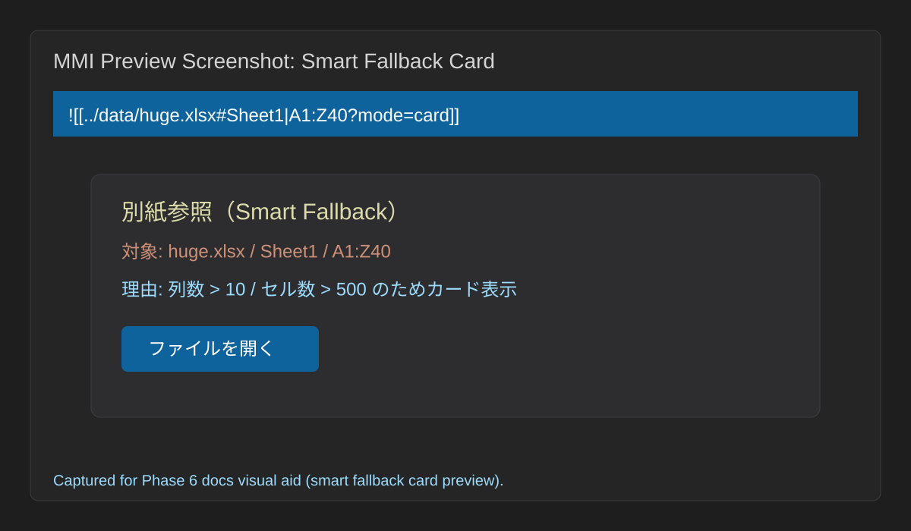
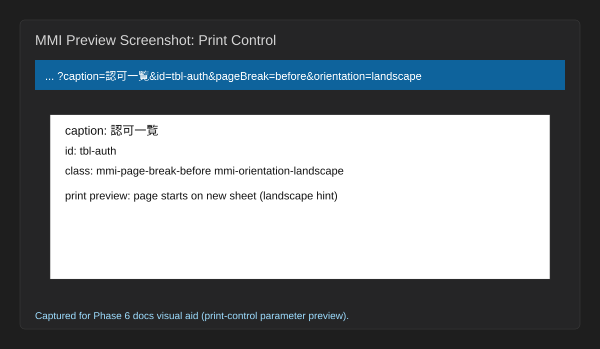

# Markdown Matrix Injector Tutorial

## Publication
- Public Gist: [https://gist.github.com/<YOUR_GITHUB_ACCOUNT>/mmi-tutorial](https://gist.github.com/<YOUR_GITHUB_ACCOUNT>/mmi-tutorial)
- Canonical source: `04_Documentation/tutorial.md`

## Target reader
- はじめて Markdown Matrix Injector を試す利用者
- 最小構成で「まず 1 回成功したい」PoC 担当者

## Prerequisites
- `03_Implement` 配下で依存導入とビルドができること
- 手元に CSV もしくは XLSX のサンプルがあること
- Markdown ファイルから相対パスでデータファイルを参照できること

## Expected result
このチュートリアルを終えると、Markdown 内に外部表データを 1 件埋め込み、クエリパラメータで見せ方を変える基本操作を再現できます。

## TFS acceptance gate (issue-0016, fixed)
- 開始条件:
  - `03_Implement` 配下で依存導入・ビルド済みであること。
  - Markdown とデータファイル（CSV / XLSX）が同一ワークスペースにあり、相対パスが解決できること。
  - プレビュー更新（再描画）が可能なエディタ状態であること。
- 所要時間目安（固定）:
  - 30 分以内（Time-to-First-Success の目標、超過時は「失敗時の最初の確認ポイント」へ移行）。
- 成功判定:
  - `![[...]]` で指定した範囲がプレビューに表として表示される。
  - `header`, `columns`, `grep` の少なくとも 1 つが期待どおりに反映される。
  - 元ファイル（CSV / XLSX）が編集されていないことを確認できる。
- 失敗時の最初の確認ポイント:
  - 最初の確認ポイントは「参照パスとシート/範囲指定が実在するか」。
  - まず `![[../data/sample.csv#Sheet1|A1:C4]]` の最小記法に戻し、表示成功後に `header` → `columns` → `grep` の順で段階的にパラメータを再追加する。

## 30分以内の手順導線（time-boxed handrail, TFS最短順）
- 0〜5 分: 開始条件チェック（ワークスペース、相対パス、サンプルデータの存在確認）。
- 5〜12 分: 最小埋め込み（`![[../data/sample.csv#Sheet1|A1:C4]]`）で表示確認。
- 12〜20 分: `header=first&columns=A,C,E&grep=AUTH` を追加し、結果差分を確認。
- 20〜27 分: `caption`, `id`, `pageBreak`, `orientation` を追加し文書制御を確認。
- 27〜30 分: 成功判定を満たしているか確認し、未達の場合は「失敗時の最初の確認ポイント」を起点に即時復帰する。

## 失敗時の最初の確認ポイントと復帰導線
- 最初の確認ポイント:
  - Markdown ファイル基準での相対パスが正しいか（例: `../data/sample.csv`）。
  - `#Sheet1` と `A1:C4` が実データ上に存在するか。
  - プレビューが最新内容に再描画されているか。
- 初回利用者の復帰導線（3ステップ）:
  1. 最小記法 `![[../data/sample.csv#Sheet1|A1:C4]]` に戻して、表が出る状態を再確立する。
  2. `header=first` のみ追加して確認し、次に `columns`、最後に `grep` を1つずつ追加する。
  3. どの追加で崩れたかを特定したら、そのパラメータだけを見直して再実行する。

## Completion checklist (30分TFS)
- [ ] 開始条件3点（ビルド済み / 相対パス解決 / プレビュー再描画）を満たした。
- [ ] 30 分以内に最小記法の描画成功を確認した。
- [ ] 成功判定3点（表示成功 / パラメータ反映 / 元ファイル非改変）を確認した。
- [ ] 失敗時は最初の確認ポイントから3ステップ復帰導線を実行できた。

## Quickstart flow
### 1. 準備する
- Markdown ファイルと、同じワークスペース内の CSV または XLSX を用意します。
- 例として `docs/spec.md` から `../data/sample.csv` を参照する前提にします。

### 2. 最初の埋め込みを書く
次のような埋め込みを Markdown に記述します。

```md
![[../data/sample.csv#Sheet1|A1:C4]]
```

期待する結果:
- `A1:C4` の範囲が HTML テーブルとしてプレビューに表示される。
- 元の CSV / XLSX は編集されない。
- 失敗時の最初の確認ポイント:
  - `../data/sample.csv` が Markdown ファイル基準の相対パスとして正しいか。
  - `#Sheet1` と `A1:C4` が実データに存在するか。

### 3. 表示を絞り込む
次のようにクエリパラメータを付けます。

```md
![[../data/sample.csv#Sheet1|A1:F10?header=first&columns=A,C,E&grep=AUTH]]
```

期待する結果:
- 1 行目がヘッダとして扱われる。
- A, C, E 列だけが残る。
- `AUTH` を含む行だけが表示される。

### 4. 文書向けの装飾を試す
```md
![[../data/sample.csv#Sheet1|A1:F10?header=first&caption=認可一覧&id=tbl-auth&pageBreak=before&orientation=landscape]]
```

期待する結果:
- 埋め込みにキャプションと ID が付き、印刷制御用の属性も加わる。
- 大きい表では、設定やサイズ条件に応じて Smart Fallback が働くことがある。

### 5. 入力支援を使う
- `![[` を入力し始めたら候補を確認する。
- ファイルパス、`#` 後のシート、`?` 後のパラメータ候補が段階的に出ることを確認する。
- ファイル不在や無効 XML では Diagnostics が出ることを確認する。

## Related docs
- 価値や全体像: `04_Documentation/overview.md`
- 業務適用イメージ: `04_Documentation/scenario-sier-design-docs.md`
- パラメータ詳細: `04_Documentation/reference.md`
- 開発環境セットアップ: `04_Documentation/developer-setup.md`

## Known limitations
- Preview UI や native Paste / D&D の最終 UX は、host 環境と VSCode バージョンに影響されます。
- XML は XML Spreadsheet 2003 のみが対象で、汎用 XML はエラー表示になります。

## 視覚補助素材（比較表）
初回導入時に「どこで失敗しやすいか」を短時間で把握できるよう、手順別チェックポイントを比較表で固定します。

| ステップ | 成功状態 | 失敗の兆候 | 最初の復帰アクション |
|---|---|---|---|
| 1. 最小記法埋め込み | `A1:C4` が表で表示される | 表が表示されない | 相対パスとシート/範囲指定を再確認 |
| 2. クエリ絞り込み | `header/columns/grep` が反映される | 列や行が期待どおりに絞られない | パラメータを 1 つずつ再追加して差分確認 |
| 3. 印刷制御付与 | `caption/id/pageBreak/orientation` が反映される | 印刷結果のみ崩れる | 画面表示でパラメータ解釈を確認後、PDF 生成器差分を切り分け |

## FAQ（Tutorial）
### Q1. 30 分以内に終わらない場合、どこからやり直すべきですか？
A1. 最小記法 `![[../data/sample.csv#Sheet1|A1:C4]]` に戻し、成功後に `header -> columns -> grep` の順で再追加します。

### Q2. `grep` を追加すると結果が 0 件になるのは不具合ですか？
A2. 多くは検索語の大小文字・空白差分・対象列の想定違いです。まず `grep` だけを外し、他パラメータの影響を切り分けてください。

### Q3. 画面は正しいのに PDF だけ崩れる場合は？
A3. 仕様上あり得ます。`pageBreak` / `orientation` 値の妥当性を確認した後、利用中の PDF 生成器ごとの差分として検証してください。

## スクリーンショット（Smart Fallback / 印刷制御）
比較表で示した失敗復帰導線を、実画面イメージで補強するための参照です。

### Smart Fallback カード表示


### 印刷制御パラメータ反映プレビュー

