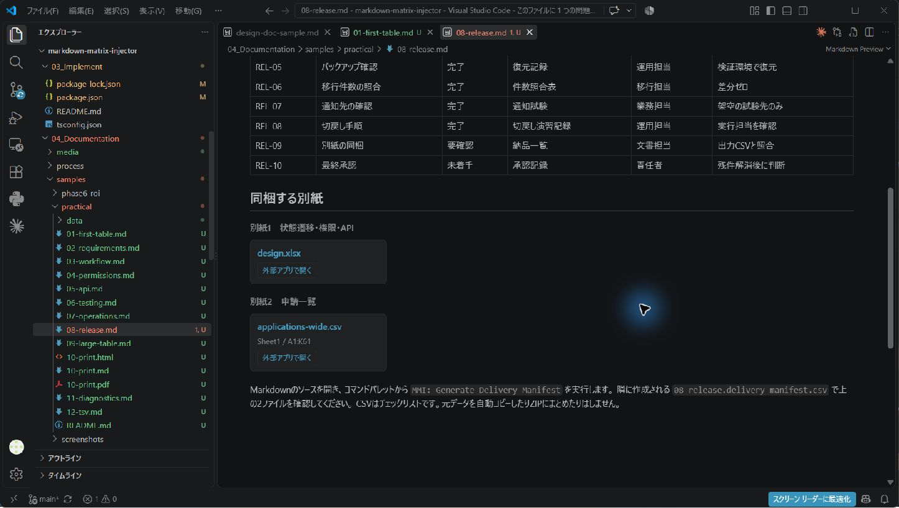
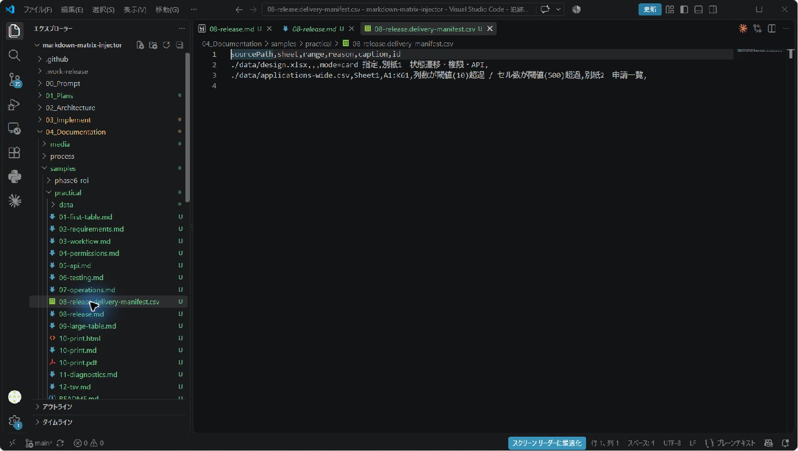
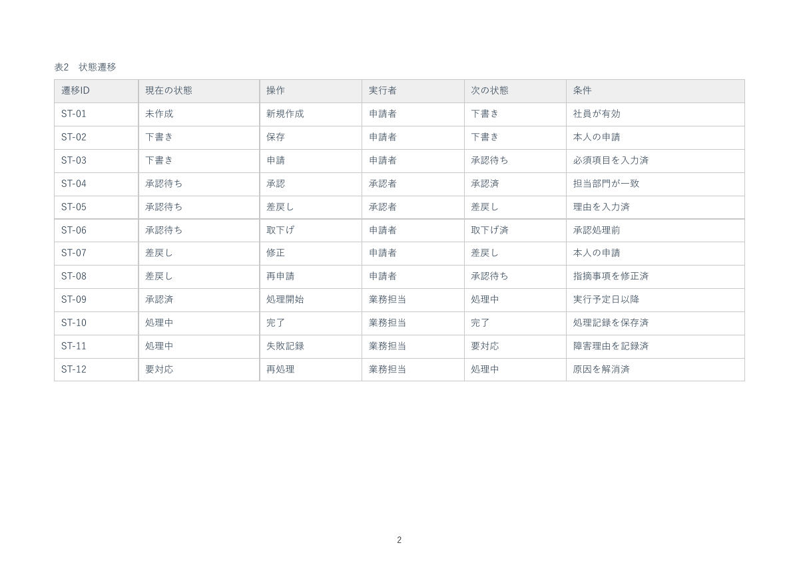
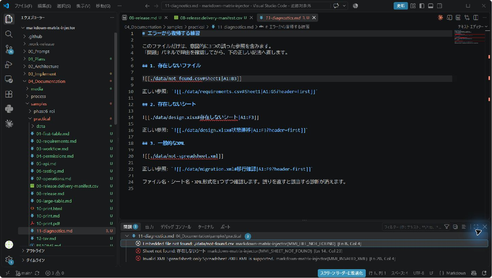
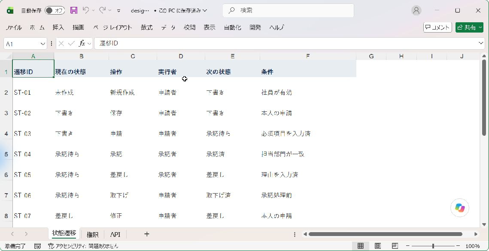

# MMI 利用マニュアル

Excel・CSV・XMLの表を参照しながら、Markdownで設計書や運用手順書を書くためのガイドです。
初めて使う方は [チュートリアル](tutorial.md) から始めてください。ここではWindowsのデスクトップ版VS Codeを基本に説明します。

## やりたいことから探す

| 目的 | 読むところ・使うサンプル |
|---|---|
| 最初の表を表示する | [チュートリアル](tutorial.md) |
| 参照を選んで作る・直す、表を言葉で探す | [入力を楽にする](#入力を楽にする) |
| 要件や試験の残件を確認する | [要件レビュー](samples/practical/02-requirements.md)、[試験結果](samples/practical/06-testing.md) |
| Excelの設計表を載せる | [権限](samples/practical/04-permissions.md)、[状態遷移](samples/practical/03-workflow.md) |
| JSONを読みやすく表示する | [API応答例](samples/practical/05-api.md) |
| 大きな表を別紙にする | [大きい表](samples/practical/09-large-table.md) |
| 納品ファイルを確認する | [納品一覧を作る](#納品一覧を作る) |
| PDFを作成する | [PDFを作る](#pdfを作る) |
| エラーの理由を調べる | [困ったとき](#困ったとき) |

## 元データと文書の置き方

```text
案件フォルダー/
  設計書.md
  data/
    要件.csv
    業務設計.xlsx
```

この場合、設計書には `./data/要件.csv` と書きます。Markdownの場所を基準に探し、見つからない場合にワークスペースのルートを探します。
参照対象はワークスペース内に置いてください。外部URLや境界外のファイルの直接参照は対象外です。

元データの修正はExcelなど、普段使うツールで行います。原本を保存したあとは、プレビューを開き直して表示を確認してください。
MMIには更新日時に基づく読み込みキャッシュがあります。正本と文書の変更を常時監視・自動通知する機能とは異なります。

## 記法の基本

```md
![[./data/業務設計.xlsx#状態遷移|A1:F13?header=first&caption=状態遷移]]
```

`![[`から`]]`までが1つの参照です。`#`の後にシート名、`|`の後にセル範囲、`?`の後に表示の指定を書きます。複数の指定は`&`でつなぎます。
参照は独立した行に置いてください。コードブロックに入れると、記法の説明用になります。

ファイル名・シート名に区切り文字（`#`、`|`、`?`など）を使う運用は避けると扱いやすくなります。
パラメータの値に`&`を含めたい場合は、`%26`のようにURLエンコードします。

## 表の見せ方を変える

| 指定 | 使い方 | 気をつけること |
|---|---|---|
| `header=first` | 範囲の先頭行を見出しにする | 省略時は見出しなし |
| `columns=A,C,F` | 列を選ぶ | 切り出した範囲の先頭をAとして指定 |
| `grep=要確認` | 文字を含む行を選ぶ | 大文字小文字を区別しない部分一致。正規表現ではない |
| `transpose=true` | 行と列を入れ替える | 小さな比較表向け |
| `highlightColumn=状況&highlightValue=要確認` | 一致する行を強調 | 見出し名または表示後の列位置を使う |
| `formatColumn=応答例:json` | JSONをコード表示する | JSONの実行機能ではない |
| `caption=確認対象` | 表題を付ける | 番号は自分で付ける |
| `id=review-items` | 表へのリンク先を付ける | 文書内で重複しないIDを使う |

処理順は「範囲 → 列選択 → 転置 → 見出し → 行検索 → 強調・書式」です。
`B1:F4`を選んだ後の`columns=A,C`は、元シートのB列とD列を指します。
数値の`header`指定は切り出し・変換後の行位置として処理されます。普段は`header=first`を使うと分かりやすくなります。
詳しくは [リファレンス](reference.md) を参照してください。

## 別紙カードを使う

参照範囲が10列を超える、500セルを超える、シートを指定しない、または`mode=card`を付けると、表の代わりにカードになります。
大きさの判定は`columns`や`grep`で絞る前の範囲に対して行われます。



- ファイル名リンク：VS Code内で開きます。Excelはバイナリのため、文字のエディターでは表示できないという案内になる場合があります。
- 「外部アプリで開く」：OSの既定アプリへ渡します。Excel用のアプリが関連付けられている必要があります。
- 外部オープンは信頼済みのローカルワークスペース内の表データが対象です。VS CodeやOSが確認を表示した場合は、開く対象を確認してください。

表にしたいときは`mode=table`を付けます。大量のセルを展開する前に、範囲や列も絞ってください。
MMIは元データを書き換えません。ただし、開いたExcel側で編集・保存すれば通常どおり元データが変わります。

## 入力を楽にする

どの方法でも、参照は選んで確かめてから入ります。候補を自動で確定したり、原本を書き換えたりすることはありません。

Markdownを開いた状態で右クリックすると「MMI: 参照を作成・編集」「MMI: 説明から表を探して参照を挿入」「MMI: コピーした範囲と同じ内容の表を探して参照を挿入」が並びます。参照の作成・編集は **Ctrl+Alt+M**（macOSは Cmd+Alt+M）でも開けます。はじめての方は、VS Codeの「ようこそ」→「チュートリアル」の **MMIをはじめる** で順に試せます。コマンド名はVS Codeの表示言語が日本語なら日本語で表示されます。

### 書きながら補完する

`![[`を書き始めるとファイル、`#`の後はシート、`|`の後は範囲、`?`や`&`の後はパラメータ、`=`の後は値の候補が出ます。候補が出ない場合は`Ctrl+Space`を押してください。

- **範囲の候補は、選んだシートにある表です。** 表題と見出しが説明に出るので、「遷移」と打てば「状態遷移表」の範囲に絞れます。シート全体の使用範囲も最後に出ます。
- **値の候補には日本語の説明が付きます**（`mode=`→`table`／`card`、`header=`→`first`／`none`など）。`columns=`では範囲内の列文字が見出し名付きで出ます。`A,`の後は残りの列だけが出ます。
- 候補を選ぶと、カーソル位置の値だけが置き換わります。後ろに続く指定や本文はそのままです。コードブロックの中では候補を出しません。

### 案内に沿って作る・直す

コマンドパレットで **`MMI: Create or Edit Embed`** を実行すると、ブック→シート→範囲→表示の指定→確認の順に選べます。キーボードだけで操作でき、各段の「戻る」ボタンで前に戻れます。Escで閉じれば文書は変わりません。

- 確認の段では、実際の表示を先に確かめられます。「表として表示: 本体3行 × 3列（見出しあり）」「該当行0件」「別紙カード」「エラー: …」のいずれかです。
- 既存の`![[…]]`の上で実行する（またはホバーの「編集」、電球メニューの「この参照を編集…」を使う）と、今の値から始めます。変えた指定だけを書き換え、`x-`で始まる独自の指定や繰り返した`formatColumn`はそのまま残します。
- 挿入は1回の編集なので、Ctrl+Z 1回で元に戻ります。途中で文書が変わった場合は挿入を中止します。原本が変わった場合は表示を確かめ直します。

### 説明から表を探す

**`MMI: Find Table by Description`**（または上の案内の最初の段の「説明から探す…」）で、表を言葉で探せます。

```text
状態遷移表のIDと操作を見せて
リリース判定の表から要確認を含む行
設計.xlsxの画面一覧
```

- 入力に合わせて候補が更新されます。各候補には「対象: … / 列: … / 条件: 行のどこかに「要確認」を含む（部分一致）」の説明が付きます。選ぶと確認の段へ進み、表示を確かめてから挿入します。
- **表せない依頼は理由を示して断ります。** 集計（「担当者別に集計」）、比較（「1000以上」）、否定（「〜以外」）、並べ替え（「最新」）、特定の列の値での絞り込み（「判定列がNGの行」）は、MMI記法にない操作です。代わりに「「NG」を含む行」と書けば、行のどこかに含む行として探せます。
- 探す対象はワークスペース内のブックです。初回は索引を作るので進行表示が出ます（キャンセル可）。索引はVS Codeのメモリ上だけに持ち、ファイルには保存しません。2回目以降は変更のあったブックだけを読み直します。`MMI: Clear Table Search Index`でいつでも消去できます。
- 名前が一致する表が無いときは、名前の一部だけが合う表を「近いかもしれない表（名前は一致しません）」として別に示します。選ぶ前に説明と確認の表示で確かめてください。
- 自由な日本語をすべて理解するわけではありません。表・シート・ブックの名前と列名を含めると見つかりやすくなります。

### 参照を確かめる・直す

- **ホバー**: `![[…]]`にマウスを乗せると、実際の表示（表なら先頭5行）、行数・列数、カード表示かエラーかが出ます。「編集」「原本を開く」もここから選べます。
- **修正候補**: シート名やファイル名が見つからない参照には、電球メニューに「「Sheet1」に置き換える」のような候補が出ます。候補は実在するシート・ファイルだけで、名前の似ている順に並びます。置き換わるのは間違っている部分だけです。
- **指定の打ち間違い**: `mode=tabel`のように使えない値は警告になり（表示では無視されます）、「「table」に置き換える」が出ます。`heder=first`のように既知の指定に似た名前は、無視される指定として情報表示し、`header`への置き換えを出します。`x-`で始まる独自の指定や、似ていない未知の指定は警告しません。

### Excelからコピーした範囲を参照にする

貼り付け・ドラッグ＆ドロップは、元アプリから渡される情報に依存します。Excelのセルをコピーしても元ファイルの場所が含まれない場合は、参照記法を作れません。
確実に始めるには、サンプルの記法をコピーして、パス・シート・範囲を置き換えてください。
`MMI: Insert Embed From Paste` / `MMI: Insert Embed From Drop` は互換用コマンドです。どんな貼り付けでもExcel参照へ変換できるわけではありません。

Excelのクリップボードにはコピー元情報が含まれる場合があります。ただし、VS Codeの貼り付けAPIからその情報を取得できるか、またコピー内容と元範囲が一致するかは別の問題です。通常のCtrl+Vで参照に変換されない場合は、次のいずれかを使ってください。

- **`Paste As...`（既定 Ctrl+.、貼り付け直後にも切替ウィジェットから呼び出せます）**: 通常どおりCtrl+Vで貼り付けた直後、または貼り付け前にCtrl+.を押すと、VS Code標準の「貼り付け方法を選ぶ」ドロップダウンが表示されます。クリップボードの内容でワークスペース内のワークブックを検索し、一致する範囲が見つかればそこに選択肢として並びます。何も選ばなければ挿入されません。
- **コマンドパレットから `MMI: Insert Embed by Content Match` を実行**: 貼り付け操作を経由せず、クリップボードに今ある内容で同じ検索を行います。一致が見つかれば候補として提示します（1件でも必ず確認を求めます。何も選ばずEscで閉じれば挿入されません）。同じ値が複数の場所にある場合は、候補ごとに表題・見出し・直前と直後の行が出るので、それを見て選んでください。一致は内容から推定したもので、コピー元の証明ではありません。

**Windows（ローカル）では、コピー元をそのまま使えます。** Excelで範囲をコピーしてから上のどちらかを使うと、クリップボードに入っているコピー元（ブック・シート・セル範囲）を読み、保存済みの原本が同じ値を示すことを確かめたうえで「コピー元を確認済み」として先頭に示します。例えば`設計.xlsx`の`状態遷移`で`C5:F12`をコピーすると、`![[./data/設計.xlsx#状態遷移|C5:F12]]`が候補になります。次の場合は確認できないため、内容からの推定だけになります: ブックを保存していない・保存後に変更した、フィルターで行や列を隠してコピーした、ブックがワークスペースの外にある、リモート環境（WSL・SSHなど）で開いている。この機能は設定「MMI › Paste: Use Clipboard Source」でオフにできます。読んだクリップボードの内容は保存しません。

どちらも通常のCtrl+V自体の挙動は変えません（未確認の推測を自動的に本文へ入れることはありません）。ワークスペース内に候補となるワークブックが多い場合、検索に時間がかかることがあります。

## 納品一覧を作る

1. `08-release.md` の**ソース編集画面**を開きます。
2. `Ctrl+Shift+P` で `MMI: Generate Delivery Manifest` を実行します。
3. 同じフォルダーの `08-release.delivery-manifest.csv` を開きます。
4. `design.xlsx` と `applications-wide.csv` の2件を確認します。




対象は、この文書内でカード扱いになっている参照です。通常の表として表示したファイルは対象外です。
CSVにはファイルパス、シート、範囲、カード化の理由、表題、IDが出ます。
**元データのコピーやZIP化は行いません。** 一覧を見ながら、別紙を納品フォルダーへまとめます。
同名の一覧は再実行すると上書きされるため、手作業で追記した内容を残す場合は先に別名で保存してください。

## コマンドで使う

`mmi`コマンドは、VS Codeを開かずに参照の確認・展開を行います。AIエージェントに設計書を書かせるとき、CIで参照を検証するときに使います。どのコマンドも元データを書き換えず、`-o`を指定したときだけファイルへ書き出します。

| コマンド | 内容 |
| --- | --- |
| `mmi inspect <正本>` | シートごとの表の範囲・見出し・行数と、そのまま使える参照の例を表示。既定ではセル値を出さない（`--values 3`で先頭3行を表示） |
| `mmi check <文書またはフォルダー>` | 参照の誤りを「問題」パネルと同じ診断コードで表示。誤りがあれば終了コード1 |
| `mmi render <文書>` | 参照を展開したMarkdownを出力。`--to html`でPDF変換用のHTML |
| `mmi manifest <文書>` | 別紙カードになる参照の一覧をCSVで出力 |

参照を検証する範囲（ワークスペース）は、実行したフォルダーです。`--root`で変えられます。`--json`を付けると機械可読な出力になります。

現在はNode.js 20以上と、リポジトリの`03_Implement`での`npm ci`が必要です。実行例です。

```bash
cd 03_Implement
npm run build
node dist/src/cli/mmi.js check ../04_Documentation/kits/basic-design --root ../04_Documentation/kits/basic-design
```

AIエージェントに使わせる場合は、[AI向け指示](../skills/mmi/SKILL.md)を読ませ、[基本設計書キット](kits/basic-design/README.md)の依頼例から始めてください。

## PDFを作る

MMIはプレビュー用のHTMLとCSSを生成します。PDFへの変換は別の生成器を使います。
通常のMarkdown変換器だけでは`![[...]]`が展開されないので、**まずMMIで表を展開し、そのHTMLをPDFに変換**します。

確認用の [設計書PDF](samples/practical/10-print.pdf) は、縦・横・縦の3ページです。



開発環境を使える方は、リポジトリの`03_Implement`で実行します。

```bash
npm run mmi -- render ../04_Documentation/samples/practical/10-print.md --to html -o ../04_Documentation/samples/practical/10-print.html --root ../04_Documentation/samples/practical
weasyprint ../04_Documentation/samples/practical/10-print.html ../04_Documentation/samples/practical/10-print.pdf
```

拡張の開発依存、WeasyPrint、日本語フォントが導入済みであることが前提です。
今回の検証はWeasyPrint 69.0と游ゴシックで行いました。フォントがないと文字が四角になるため、用意してから再生成します。
WindowsのフォントをWSLから指定した手順は [検証記録](release-validation-2026-09-08.md) にあります。

`pageBreak=before`は表の前の改ページ、`orientation=landscape`は横向き、`portrait`は縦向きの指定です。
これらはプレビュー画面を紙のページに区切る機能ではありません。
別のPDF生成器を使う場合は表の展開・改ページ・用紙の向きまで確認してください。
VS Codeの「Markdown PDF」拡張からの直接出力は、今回の検証済み経路に含みません。

## 困ったとき

| 症状 | 確認すること |
|---|---|
| 記法がそのまま表示される | 拡張が有効か、更新後の再読み込みが済んだか、コード例の中ではないか |
| ファイルが見つからない | Markdown基準の相対パス、dataフォルダー、ワークスペース境界 |
| シートが見つからない | 全角・半角を含むシート名。CSVは`Sheet1` |
| XMLのエラーが出る | XML Spreadsheet 2003形式か。一般の設定XMLは対象外 |
| 検索すると0行になる | 列を絞った後にも検索対象が残るか。見出し行は検索対象外 |
| 列を減らしてもカードのまま | `mode=table`も指定したか |
| 外部アプリが開かない | ローカルの信頼済みワークスペースか、既定アプリがあるか |
| 原本を変更したのに表示が古い | 原本の保存後にプレビューを開き直したか |
| PDFだけ表が出ない | MMIで展開済みのHTMLから変換しているか |
| PDFの日本語が四角になる | PDF生成環境に日本語フォントがあるか |


問題の報告には、VS Code・MMIのバージョン、OS、最小の記法、期待した表示、実際の表示を添えてください。
同梱サンプルで再現できるか確認すると、業務データを送らずに切り分けできます。

## 対応範囲

表示対象はExcel（XLSX/XLS）、UTF-8（BOM有無）またはCP932のCSV、TSV、XML Spreadsheet 2003です。補完や貼り付けの対象形式は表示対象より狭い場合があります。
数式を再計算する機能ではなく、保存済みの値を使います。数式は元アプリで再計算・保存してから参照してください。
画像・図形・マクロ・Excelの詳細レイアウトは再現しません。

実機確認はWindowsのVS Code 1.136.1、PDFはWeasyPrint 69.0です。
最低対応バージョンでの全機能、macOS、リモート環境、各アプリからのネイティブなセル貼り付け・ドラッグ操作をすべて保証するものではありません。
結果と未確認事項は [検証記録](release-validation-2026-09-08.md) を参照してください。

## 関連資料

- [解説動画と画面一覧](media/release-20260908/README.md)
- [実務サンプル12本](samples/practical/README.md)
- [パラメータリファレンス](reference.md)
- [MMI Notation v1](spec/mmi-notation-v1.md)
- [要件定義](../00_Prompt/requirements.md)

## 画面で確認する



別紙ボタンから初めて開く際に、VS Codeが拡張URIを開く許可を求める場合があります。MMIと対象ファイルであることを確認して「開く」を選びます。常に許可する設定へ変更する必要はありません。



[納品一覧とシート補完の実操作動画](media/release-20260908/mmi-live-walkthrough.mp4)

### CSVの文字コード

ソースコードのCSV読込みはUTF-8を優先し、UTF-8として不正な場合はCP932を試します。UTF-8 BOM付きの不正データや、どちらでも解釈できないデータはエラーにします。UTF-16は対象外です。両方で有効なデータはUTF-8が選ばれるため、完全な自動判定ではありません。必要な場合は原本を残してUTF-8 BOM付きの別ファイルを用意してください。[CP932の例](samples/practical/13-cp932.md)。既配布VSIXには更新が必要です。
