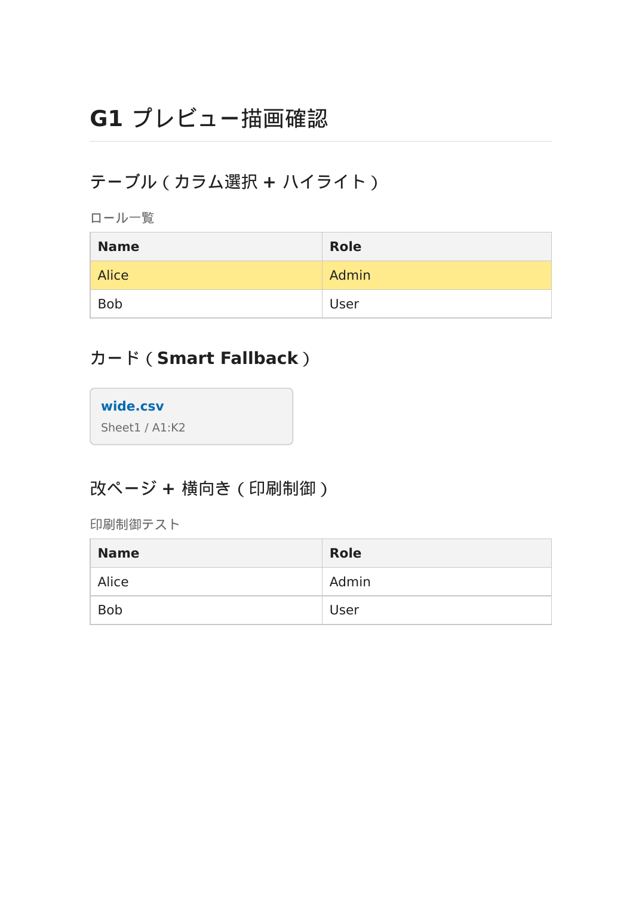

# Markdown Matrix Injector (MMI)

**コピーではなく、参照を。**

[](https://github.com/hat47x/markdown-matrix-injector/actions/workflows/ci.yml)
[](LICENSE)

**Markdown Matrix Injector (MMI)** は、正本表データ（Excel / CSV / XML）をテキスト文書から**宣言的・読み取り専用・検証可能**に参照するための公開規約 **MMI Notation** と、その参照実装（VS Code 拡張）です。

```md
![[./設計データ.xlsx#状態遷移|A1:F20?header=first&caption=状態遷移表&id=tbl-state]]
```

AI エージェントがあらゆるファイルを編集できる時代、正本と文書内コピーの乖離（ドリフト）は人間の手作業時代より速く・大量に発生します。MMI はコピーを**参照**へ置き換え、構造的に書き込めない境界（Read-only MUST）で正本を守る——**人間と AI エージェントが共存する文書運用のガードレール**です。

---

## インストール

### VS Code Marketplace（推奨）

VS Code Marketplace で `Markdown Matrix Injector` を検索してインストールしてください。
（Marketplace 公開は準備中です。公開までは下記の `.vsix` 手動インストールをご利用ください。）

### .vsix から手動インストール

1. [Releases](https://github.com/hat47x/markdown-matrix-injector/releases) から最新の `.vsix` をダウンロードします。
2. VS Code で `Ctrl+Shift+P` → `Extensions: Install from VSIX...` を実行します。
3. ダウンロードした `.vsix` ファイルを選択します。

---

## クイックスタート（5 分）

### 1. 最初の埋め込み

Markdown ファイル（`.md`）を開き、次のように記述します：

```md
![[./data/sample.csv#Sheet1|A1:D10?header=first&caption=サンプル表]]
```

### 2. プレビューを開く

`Ctrl+Shift+V`（または `Cmd+Shift+V`）で Markdown プレビューを開きます。`![[...]]` が実際のテーブルに置き換わって表示されます。



### 3. 次の一歩

- **チュートリアル**: [`04_Documentation/tutorial.md`](04_Documentation/tutorial.md) — 30 分で全機能を体験
- **業務シナリオ**: [`04_Documentation/scenario-sier-design-docs.md`](04_Documentation/scenario-sier-design-docs.md) — SIer 設計書での活用例
- **リファレンス**: [`04_Documentation/reference.md`](04_Documentation/reference.md) — 全パラメータ・記法仕様

---

## 主な機能

1. **正本の完全性（恒久規範）**: 参照経路からは正本を改変できない（Read-only MUST）。構造的な安全装置。
2. **クエリエンジン**: 記法 `![[ファイル#シート|範囲?パラメータ]]` による宣言的な断面参照。巨大な正本から必要なスライスだけを抽出。
3. **Smart Fallback**: 巨大表を自動検出し、リンクカード UI へ縮退。別紙の納品マニフェスト出力に対応。
4. **エンタープライズ印刷制御**: キャプション・相互参照・PDF 改ページ・横向き（Landscape）指定（実 PDF 再現実証済み）。
5. **AI エージェント協働**: リンク切れ検知（Diagnostics）は機械検証可能。query-evidence は「エージェントが書いた文書と正本の一致検証」の根拠。
6. **開発者体験 (DX)**: オートコンプリートと静的解析による執筆支援。

---

## サポート形式

| 形式 | 拡張子 | 備考 |
|---|---|---|
| Excel Workbook | `.xlsx` | シート・セル範囲指定 |
| CSV / TSV | `.csv` `.tsv` | ヘッダ行・列選択 |
| XML Spreadsheet 2003 | `.xml` | Office 2003 XML 形式のみ |

---

## 既知の制約

- **PDF 生成器依存**: `pageBreak` / `orientation` の PDF 反映は利用する PDF 生成器に依存します。推奨: VS Code Markdown PDF 拡張（Chromium 系）または WeasyPrint。
- **XML 形式**: XML Spreadsheet 2003 のみ対応。汎用 XML はエラー表示になります。
- **文字エンコーディング**: ソースファイルは UTF-8 前提です。Shift-JIS 等の自動検出は未対応。
- **ネットワークソース**: ファイルパスは VS Code ワークスペース境界内に限定されます。リモートソースの直接参照は非対応です。
- **VS Code バージョン**: VS Code ≥1.96.0 が必要です。
- 詳細な制約一覧は [`04_Documentation/samples/manual-e2e-g3-g4-result-2026-07-15.md`](04_Documentation/samples/manual-e2e-g3-g4-result-2026-07-15.md) を参照してください。

---

## なぜ「規約」なのか

ツールは世代交代しますが、記法とその保証性質（読み取り専用・決定論・可視な劣化）は残ります。MMI Notation は conformance levels（L0–L3）で部分実装を許し、特定エディタ・特定 AI ツールに依存せず存続します。

- **仕様書**: [`04_Documentation/spec/mmi-notation-v1.md`](04_Documentation/spec/mmi-notation-v1.md)（RFC 2119 規範・8 原則・劣化クラス）
- **機械可読契約**: [`params.schema.json`](04_Documentation/spec/params.schema.json)（AI エージェント教示・実装検証用）
- **conformance corpus**: [`03_Implement/test/conformance/`](03_Implement/test/conformance/)（他実装の準拠試験を兼ねる実行可能な規範例）
- **表パターンガイド**: [`04_Documentation/samples/phase9-rule-table-pattern-guide.md`](04_Documentation/samples/phase9-rule-table-pattern-guide.md)（MMI 非依存で読める SIer 設計文書向け表パターン集）
- **決定正本**: [`ADR-0012`](01_Plans/adr/ADR-0012-mission-redefinition-notation-as-governance-boundary.md)

同梱の VS Code 拡張は、最上位 L3（Delivery Profile: エンタープライズ印刷制御・納品マニフェスト）に準拠する参照実装です。

---

## コントリビューション

MMI への貢献を歓迎します。以下の手順で参加してください。

### 開発環境のセットアップ

```bash
git clone https://github.com/hat47x/markdown-matrix-injector.git
cd markdown-matrix-injector/03_Implement
npm ci
npm run build
npm test
```

**要件**: Node.js 22+, npm 10+

### 開発の流れ

1. 新規開発・修正を行う前に、`01_Plans/issues/TEMPLATE.md` を用いて Issue Memo を起票してください。
2. AI エージェント（Claude Code 等）を使用する場合は、必ず作業前に [`AGENTS.md`](AGENTS.md) を一読させてください。
3. 詳細なコントリビューション手順は [`CONTRIBUTING.md`](CONTRIBUTING.md) を参照してください。

### AI エージェント向け導線

このリポジトリは AI エージェントとの協働を前提に設計されています。

- **AI エージェント入口**: [`AGENTS.md`](AGENTS.md) — ゴールデンルールと Project Map
- **プロジェクト憲法**: [`00_Prompt/system_prompt.md`](00_Prompt/system_prompt.md) — 絶対遵守ルール
- **要件定義**: [`00_Prompt/requirements.md`](00_Prompt/requirements.md) — 設計思想と機能要件
- **計画ハブ**: [`01_Plans/README.md`](01_Plans/README.md) — ADR と Issue Memo のインデックス

---

## CI/CD

| ワークフロー | 内容 |
|---|---|
| CI | push / PR ごとに build + unit test + release gate + VSIX packaging |
| Release Bundle | タグ push で配布用 tar.gz を生成 |
| Release Gate Manual | 手動実行のリリースゲート確認 |

---

## プロジェクト構造

```
markdown-matrix-injector/
├── 00_Prompt/          # 憲法・要件定義・AI プロトコル
├── 01_Plans/           # ADR・Issue Memo（計画と決定）
├── 02_Architecture/    # 技術設計・インターフェース
├── 03_Implement/       # 実装本体（VS Code 拡張）
├── 04_Documentation/   # 仕様書・チュートリアル・運用マニュアル
├── AGENTS.md           # AI エージェント向け入口
├── CONTRIBUTING.md     # コントリビューションガイド
└── LICENSE             # MIT
```
